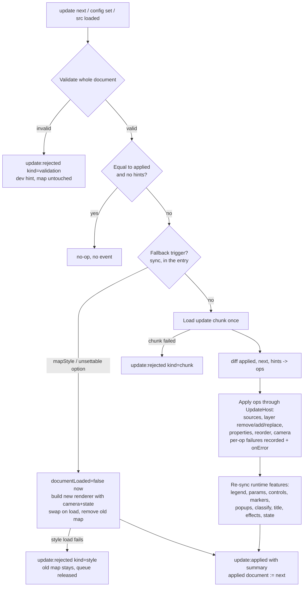
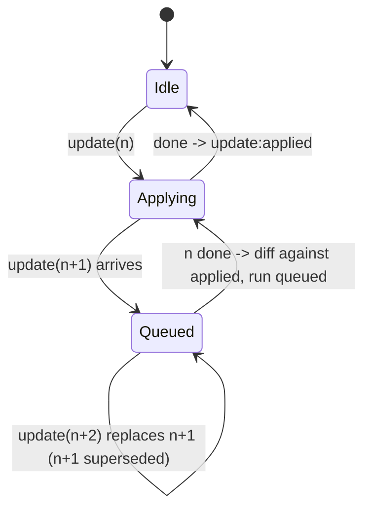

# Live Documents - Plan

## Goal Capsule

- **Objective:** A running map accepts a changed document and applies the difference in place, keeps the current map when the new document is invalid, and lets a host read and set the document's `state:` values through methods and events.
- **Product authority:** maintainer decisions of 2026-10-23 (recorded on ml-4ug: read-only by default, opt-in, never break a running map, trust unchanged) and of 2026-10-27 (this document's Key Decisions). Design principles: `docs/brainstorms/2026-07-24-library-direction-requirements.md` (R3 no executable logic in the format; R11 check capabilities against both real consumers). Product Contract preservation: changed R6 (effects named as a runtime feature), the Key Decision on the story element (its render path is unchanged; the engine gains one update listener), AE4 and AE9 (preconditions made explicit), F5 (the host carries its layers through `transformStyle`), and the map-party and bundle Success Criteria (hooks move to the update event; the budget is declared, not zero). The brainstorm's Outstanding Questions are resolved in the Planning Contract.
- **Execution profile:** one PR per implementation unit or tight pair of units into `main` (the 0.9 convention), each with its own changeset when it changes the published surface. Units U1 to U3 may land behind an unexported method so published behaviour does not change until U6. The release ships as core 0.10.0 and astro 0.8.0 through the changesets version PR. An alpha prerelease is cut once U6 lands so map-party and the Python widget work can test the update API.
- **Stop conditions:** stop and ask if a unit needs a MapLibre capability that the pinned `maplibre-gl` range lacks and feature detection cannot cover; if the entry bundle exceeds the declared budget under R20; if preserving the document-owns-its-keys rule (R10) proves impossible for a layer kind; or if a MapLibre behaviour contradicts a Key Technical Decision below.
- **Tail ownership:** the implementing session runs `pnpm presubmit` and `pnpm verify:browser`, writes the changesets, updates the beads (ml-4ug, ml-u0l), posts progress to the maintainer after each unit, and reports. The maintainer merges PRs and approves staged npm publishes.
- **Open blockers:** none. Four decisions carry defaults the maintainer may override before the unit that uses them (Open Questions). Whether map-party upgrades from core 0.4.0 during the 0.10 cycle is a map-party decision; it affects the success criteria, not the requirements.

---

## Product Contract

### Summary

Core 0.10 adds an in-place update path to `MapRenderer` and to `<ml-map>`: a new document is validated whole, then diffed against the applied one so layers, sources, properties and camera change without a rebuild. Hosts get `setState` / `getState` over the document's `state:` block and events for applied, rejected and state changes. A basemap change, and any change the differ declines, falls back to a rebuild that keeps the camera and never shows a blank map.

### Problem Frame

Today a document is applied once. Every path that hands `<ml-map>` a different document, whether the `config` property, the `config`, `src` or `base` attributes, or `reload()`, destroys the renderer and builds a new MapLibre map. The camera resets, every source refetches, and the map flashes. The React integration page documents this as a caveat, and the docs playground works around it by copying the live camera back into the document before each render. An invalid document replaces the map with the error card, so an editor that applies on every keystroke blanks the map mid-edit.

The consumer that feels this most is map-party. It pins core 0.4.0 and bypasses the element, holding a `MapRenderer` and diffing sources, layers, paint, layout and filters itself with bare MapLibre calls, rebuilding only on a basemap change. That differ has known gaps: no layer reorder, no change to an existing source's URL or data, new layers always land on top, and invalid YAML blanks the map. It also re-applies its own highlight layers and local filters after every diff because the library gives it no signal.

The document's `state:` block has a related gap. Defaults are applied once in the load handler through MapLibre's global state. MapLibre drops global state on a full style load, and nothing reapplies the defaults. The renderer itself calls `setStyle` in three places (basemap label hiding, Protomaps basemap load and its fallback), so `global-state` filters can silently read `null` without any host involvement.

### Key Decisions

- **Methods and events now, a bindable store later.** The 0.10 surface is `update(document)`, `setState(values)`, `getState()`, `getDocument()` and change events, plus a documented React hook recipe. A subscribe / snapshot store object that zustand or `useSyncExternalStore` can wrap directly is deferred until a real host has used the model, because a store's snapshot semantics are hard to change once bound to.
- **The element diffs by default.** Assigning a different `config` or `src` to `<ml-map>` updates the running map in place. This changes behaviour for existing pages: the camera no longer resets and `getMap()` keeps returning the same map. It is a minor-version behaviour change with a changeset and an Upgrading note; no opt-in attribute.
- **The document owns only the keys it declares.** An update touches layers, sources and properties that the previous or next document declares. Layers a host added through `getMap()` stay where they are. A property a host set on a document layer is overwritten only when the document's value for it changed. Hosts that need to re-apply their own changes do so on the update event.
- **An invalid update keeps the map and reports.** The library validates the whole next document first. On failure it fires an error event carrying the diagnostics, shows a small hint on the map only in development (the existing author-hints policy), and leaves the map, camera and applied document untouched. Readers of a published map never see it.
- **A basemap change is a rebuild in 0.10.** `mapStyle` changes, and any update the differ cannot apply, fall back to a rebuild. The fallback keeps the current camera unless the document's camera changed, never shows a blank or error state for a valid document, and the update event says a rebuild happened. Diffing a basemap swap is deferred.
- **Camera follows the document only when the document's camera changed.** Center, zoom, bearing, pitch and `fitTo` are applied when their values differ between the applied and next document. A host can opt out so an update never moves the camera, for hosts whose viewport is per-user.
- **`setState` writes declared keys only.** A key not declared under the document's `state:` block is rejected with an error, not silently written. Values written through `setState` and through the params panel are the same state; each reflects the other.
- **State defaults survive `setStyle`.** The document's `state:` values are reapplied after any style load, whether the renderer or a host through `getMap()` triggered it.
- **The story element's render path is unchanged; the engine gains one update listener.** `<ml-scrollytelling>` keeps re-setting the inner map's `config` on each story render and driving chapters through `getMap()`. Because the inner element now diffs by default, a changed story keeps the same inner map and the active chapter's camera instead of rebuilding; the engine re-applies the active chapter's layer visibility when an update added layers. Live story editing beyond that is deferred.
- **The update reports what it did.** The completed-update event carries a summary: layers added, removed, moved and replaced, properties set, sources replaced, camera moved, failures, and whether the update fell back to a rebuild. This makes tests and host debugging cheap.

### Actors

- A1. **Host application** - a React, Astro or vanilla page, map-party's editor, the docs playground, or the Python package's notebook widget, which holds the document and decides when to apply a new one.
- A2. **Document editor** - the person typing YAML or using a UI control in A1; expects the map to follow valid edits and to stay put on invalid ones.
- A3. **Reader** - a visitor to a published map; must never see an update's failure state.
- A4. **Library** - `MapRenderer` and `<ml-map>`; owns validation, the diff and the state block, never persists anything.

### Requirements

**Updating a document**

- R1. `MapRenderer` and `<ml-map>` accept a new document for a running map through one explicit call (`update`) and, on the element, through a changed `config` or `src`.
- R2. The next document is validated whole before anything is applied; a document that fails validation changes nothing on the map.
- R3. A valid update applies the difference in place: layers are added, removed and reordered to match document order; a source's data, URL, tiles or options are replaced through MapLibre's source setters; paint, layout, filter, zoom range and visibility are set on the existing layer.
- R4. Layers whose source changes to a different kind (for example inline data to a cloud-native format) may be replaced rather than patched, in their document position.
- R5. Live-data behaviour (`refresh`, streams, merge) and by-view cloud-native loading continue after an update, restarted only for sources whose relevant configuration changed.
- R6. Runtime features derived from the document (legend, popups, hover highlight, classify, params panel, controls, markers, effects, title and description) reflect the next document after an update.
- R7. A `mapStyle` change, or any update the differ declines, falls back to a rebuild that keeps the camera unless the document's camera changed, shows no blank or error state for a valid document, and is reported as a rebuild in the update event.
- R8. Assigning a document equal to the applied one is a no-op, as today.
- R9. The camera is applied only when the document's camera keys changed between the applied and next document; a host option disables camera changes from updates entirely.
- R10. An update touches only what the previous or next document declares; layers and properties a host set through `getMap()` are left alone unless the document's own value for that property changed.

**State surface**

- R11. Hosts can read the applied document and the current `state:` values from the renderer and the element.
- R12. Hosts can set one or more `state:` values in one call; only keys the document declares are accepted, and an undeclared key is reported as an error.
- R13. A state change made through `setState`, through the params panel, or through an update that changed defaults fires one state-change event with the keys and values, and the params panel shows the current value.
- R14. The document's `state:` values are reapplied after any style load on the map, including a host-initiated `setStyle` through `getMap()`.

**Reporting**

- R15. A completed update fires an event with a summary of what changed and whether it fell back to a rebuild.
- R16. A rejected update fires an error event with the same diagnostics (message, path, position) that validation gives, and shows a hint on the map only in development.
- R17. Runtime failures after validation (for example a tile URL that 404s) are reported through the existing data and layer error events; they do not roll back the update.

**Compatibility and cost**

- R18. `getMap()` returns the same map object across in-place updates; it changes only after a fallback rebuild, which the update event announces.
- R19. Trust is unchanged by updates: an untrusted document stays untrusted, and an update cannot raise trust.
- R20. Pages that never update pay nothing extra beyond the declared entry budget: the diff machinery loads on the first update.
- R21. The React, web components and element reference pages drop the "a new document makes a new map" caveats and document the update and state surface with a hook recipe.
- R22. Existing behaviours that updates could regress (slot children, effects attach/detach, lazy chunk retry on reload) keep passing, with `reload()` semantics decided during planning.

### Key Flows

- F1. Valid edit in an editor
  - **Trigger:** A2 changes a layer's colour and reorders two layers in A1's editor.
  - **Steps:** A1 calls `update(next)`; A4 validates, diffs, sets the paint property and moves the layer; the legend updates; the camera does not move.
  - **Outcome:** The update event reports one property set and one layer moved; `getMap()` is unchanged.
  - **Covers:** R1, R3, R6, R9, R15, R18.
- F2. Invalid edit mid-typing
  - **Trigger:** A2 has typed half a key, so the document no longer validates.
  - **Steps:** A1 calls `update(next)`; A4 rejects it before touching the map; an error event carries the diagnostics; in development a hint shows on the map.
  - **Outcome:** The map, camera and applied document are exactly as before; A1 shows the diagnostics in its editor.
  - **Covers:** R2, R16.
- F3. Basemap change
  - **Trigger:** A2 switches `mapStyle`.
  - **Steps:** A4 declines to diff, rebuilds with the current camera and state, re-adds the document's layers, and fires the update event with the rebuild flag.
  - **Outcome:** A1 re-adds its own layers on the event; A3 never sees a blank map.
  - **Covers:** R7, R18.
- F4. Host drives a scenario toggle
  - **Trigger:** A1's UI sets `year` to 2020.
  - **Steps:** A1 calls `setState({ year: 2020 })`; A4 writes the global state value; layers whose filters read it update; the params panel slider moves; a state-change event fires.
  - **Outcome:** A1's own store and the map agree without a document rewrite.
  - **Covers:** R12, R13.
- F5. Host swaps the style through the escape hatch
  - **Trigger:** A1 calls `getMap().setStyle(other, { transformStyle })`, carrying the document's sources and layers into the new style as MapLibre requires for any runtime-added layer.
  - **Steps:** MapLibre reloads the style; A4 reapplies the current `state:` values when the style loads.
  - **Outcome:** `global-state` filters keep working.
  - **Covers:** R14.

### Acceptance Examples

- AE1. **Covers R3.** Given a map with layers `a, b, c`, when the next document lists `c, a, b`, then the map's layer order is `c, a, b` and the update summary reports moved layers and no added or removed ones.
- AE2. **Covers R3, R5.** Given a GeoJSON source with `url: ./2023.geojson`, when the next document changes it to `./2024.geojson`, then the source's data is replaced without removing the layers that draw it, and popups on those layers keep working.
- AE3. **Covers R2, R16.** Given a running map, when the next document is invalid, then no layer, source, property or camera value changes, an error event carries the diagnostics, and in development a hint is shown on the map.
- AE4. **Covers R7, R9, R18.** Given a map the reader has panned and a document whose camera keys are unchanged, when the next document changes only `mapStyle`, then the map rebuilds at the reader's camera, the update event reports a rebuild, and `getMap()` returns a new map.
- AE5. **Covers R10.** Given a host added a highlight layer through `getMap()`, when any valid update applies in place, then the host's layer is still on the map.
- AE6. **Covers R9.** Given a document whose `center` is unchanged between versions and a reader who has panned away, when an update applies, then the camera does not move; when the next document's `center` differs, then the camera moves to it; when the host has opted out of camera control, then the camera never moves on updates.
- AE7. **Covers R12.** Given a document declaring `state: { year: { default: 2010 } }`, when the host calls `setState({ month: 3 })`, then the call reports an error naming `month` and no state changes.
- AE8. **Covers R13.** Given a params panel slider bound to `year`, when the host calls `setState({ year: 2020 })`, then the slider shows 2020 and one state-change event fires with `{ year: 2020 }`.
- AE9. **Covers R14.** Given a document with `state:` defaults and a filter reading `global-state`, when the host calls `getMap().setStyle(otherStyle, { transformStyle })` carrying the document's layers, then after the style loads the filter evaluates against the current state values, not `null`.
- AE10. **Covers R8.** Given an applied document, when the host assigns a JSON-equal document, then no event fires and nothing changes.
- AE11. **Covers R6.** Given a layer with `classify:`, when the next document changes the field or breaks, then the layer's paint and its legend entry reflect the new classification.

### Success Criteria

- map-party, once on core 0.10, can delete its hand-rolled differ and its invalid-YAML fallback; its highlight-layer and local-filter hooks move to the `ml-map:update-applied` event, re-running only when the summary names a layer they touch; it keeps its own layers and viewport policy.
- The Python package's notebook widget (design PR #204, unit Y7b) can apply a data change through `update()` with no camera reset and read rejections from the rejected-update event.
- The docs playground drops its camera copy-back workaround.
- The React integration page no longer carries the camera-reset caveat.
- A plain page with no updates ships within the declared entry budget (the 0.9.2 baseline plus the allowance recorded in `packages/core/size-baseline.json`), enforced by a test.
- e2e coverage exists for every Acceptance Example above.

### Scope Boundaries

**Deferred for later**

- A bindable store object (subscribe / snapshot / set) for `useSyncExternalStore` and zustand; revisit once a host has used the methods-and-events surface.
- Diffing a basemap change instead of rebuilding; MapLibre's `setStyle` with `transformStyle` is the candidate mechanism to evaluate for 0.11.
- Live story editing beyond what the inner element's in-place update already gives.
- Undo, history or transaction grouping of updates.
- Feature-level patching of inline data (diffing features inside a GeoJSON source); 0.10 replaces the source's data whole.

**Outside this product's identity**

- Persisting or writing documents anywhere; comment-preserving serialisation. The host owns storage and edit permissions.
- Any implicit update: the library applies a document only when the host asks.

**Deferred to follow-up work**

- CLI preview: replace the full page reload on `yaml-update` with `config` assignment and surface rejected updates in the debug panel (bead filed; not in 0.10).
- Enforce `CapabilityPolicy.allowedOrigins` on the render path. The field is declared and `allowsOrigin` exists, but nothing on the fetch, polling, stream or by-view path calls it, and no docs page mentions it (bead filed; not in 0.10).
- The CI size budget for every chunk and page scenario (ml-7qa.1); this plan adds only the entry budget it needs.

### Dependencies / Assumptions

- `setGlobalStateProperty` needs maplibre-gl 5.6 or later; on older runtimes the state surface warns once and is inert, as today.
- The map-party upgrade from core 0.4.0 is tracked on the map-party ledger; the library's e2e suite, not map-party, is the acceptance gate for 0.10.
- The Python package design's widget unit (Y7b in PR #204) should target core 0.10 so it can use `update()` and `camera="host"` instead of hand-patching through `getMap()`; the two plans must agree before Y7b starts.
- The lazy-chunk seam hosts the pure differ and the apply and re-sync logic as an import-free chunk; the orchestration that must live in the entry is covered by the declared budget.
- Existing e2e tests that assert a new map object after a config change or `reload()` will be rewritten to the new semantics.

### Sources

- Beads: ml-4ug (update API and the 2026-10-23 principles), ml-u0l (state defaults lost after `setStyle`), ml-315 (0.10 planning), ml-3e9.1 (global-state parameterization spike, the later DSL arc), ml-aot.142 and ml-o30 (hover highlight and `generateId` rules), ml-7qa.1 (CI size budget), ml-iz3 (e2e flake history).
- Vault notes: `~/vault/raw/notes/2026-10-23-map-party-live-edit-findings.md` (how map-party applies edits and its gaps), `~/vault/raw/notes/2026-10-27-maplibre-yaml-0.9-cycle-summary.md`.
- Plans: `docs/plans/2026-10-18-lazy-loading-plan.md` (chunk seam, generation tokens, `reload()` as chunk retry), `docs/plans/2026-09-27-001-feat-maplibre-yaml-0.7-eject-doctrine-plan.md` (what the library may own at runtime; `state:` inlined on eject), the Python package design on PR #204 (`origin/docs/plan-python-package:docs/plans/2026-10-23-python-package-design.md`, widget section and Y7b).
- Code: `packages/core/src/components/ml-map.ts` (config setter, `renderMap`, `teardownRenderer`, `mapReady`, `setupEffects`, `MLMapEventMap`), `packages/core/src/renderer/map-renderer.ts` (public surface, `state:` defaults in the load handler, params callbacks, the three internal `setStyle` calls, `applyProjection` / `applySky` feature detection), `packages/core/src/renderer/layer-manager.ts` (data pipeline ownership, `generateId` rule, `beforeOrTop`), `packages/core/src/formats/decoders.ts` and `packages/core/tsup.config.ts` (`LOADERS` seam: self-contained chunks, type-only imports, injected dependencies), `packages/core/tests/lazy-chunks.test.ts` (`LIBRARY_MARKERS`, the no-relative-imports assertion), `packages/core/src/schemas/map.schema.ts` (`StateSchema`, `ParametersSchema`, `MapConfigSchema`), `packages/core/src/components/ml-scrollytelling.ts` and `packages/core/src/scrollytelling/engine.ts` (how chapters drive the inner map), `packages/core/src/react.ts` (`MLMapProps`, `MLMapEventProps`), `packages/astro/src/components/FullPageMap.astro` (the `ml-map:load` listener), `docs/src/playground/app.ts` (camera copy-back), `docs/src/content/docs/integrations/react.mdx` and `docs/src/content/docs/reference/elements.mdx` (caveats to remove), `e2e/effects.spec.ts`, `e2e/slots.spec.ts`, `e2e/react-example.spec.ts` (new-map assertions to rewrite).
- map-party (external repo): `packages/ui/src/components/map/MapPreview.tsx` and `local-filter-applier.ts`, the hand-rolled differ and the hooks this plan moves onto the update event.

---

## Planning Contract

### Key Technical Decisions

- **KTD1. The differ is a pure function over documents plus explicit hints.** `MapRenderer` keeps the applied document (the normalized model: config, layers, sources, options) as instance state. `update(next)` validates, normalizes through the same `model/normalize.ts` path the element uses today, and calls `diff(applied, next, hints)` where `hints` is `{ failedSources: ReadonlySet<string>; urlsRebased: boolean }` supplied by the renderer. The equality short-circuit (no operations, no event) applies only when `hints` is empty; `reload()` and a `base` change always pass hints, so an unchanged document still retries failed sources. The apply step reconciles existence defensively: a document layer missing from the map (a host removed it) is re-added, and a layer id that collides with a host-added layer is recorded as a failure with a dev hint, never adopted. Map state is otherwise never read to decide what to do, so the differ is unit-testable with no MapLibre and host changes through `getMap()` are invisible to it, which is what R10 requires.
- **KTD2. Identity is the id; host layers are anything the document did not declare.** A layer id or source id that appears in both documents is the same object; a renamed layer is a remove plus an add. Layers added through `renderer.addLayer`, `el.addLayer` or `getMap().addLayer` are host layers alike: the differ never removes or moves them. `updateLayerData` and `setLayerVisibility` on a document layer are host overrides on a document key, subject to R10. Properties MapLibre cannot change on a live layer or source force a replacement in document position (table in High-Level Technical Design). Adding `hover:` to a layer implies `generateId: true` on its source (the 0.9.1 rule in `layer-manager.ts`), so that edit is a forced source replacement and the summary says so.
- **KTD3. Ordering moves only document layers.** After adds and removes, each document layer is placed before the next document layer in document order, using `moveLayer`; the last document layer keeps its `before:` anchor or stays where it is. Host layers are never moved and keep their absolute stack position, so a host layer does not follow a document layer that moves. `before:` naming a basemap layer is honoured for that layer; `before:` that contradicts document order among document layers yields to document order with the existing dev hint, not re-spammed per update (the `ml-map.ts` warning de-duplication rule). Effects layers (`::fx-` suffixed, owned by `@maplibre-yaml/effects`) are re-placed by the effects re-attach in KTD6b, not by the differ.
- **KTD4. Source changes use MapLibre setters when they exist, replacement otherwise.** Inline sources (`${layerId}-source`) are replaced in place with `setData`; a `url:` change on a GeoJSON source goes through the existing fetch path and `setData`; a `tiles` or `url` change on a tile source uses `setTiles` / `setUrl`, feature-detected on the source instance the way `setGlobalStateProperty` is detected today, and falling back to `sourceReplace` when absent (the peer range spans maplibre-gl 3 to 6). Reference counts settle after the whole diff: layers that lose a named source release it, layers that gain it claim it, and only sources whose count is zero at the end are removed, so two layers swapping sources never tear a source down and refetch it. A document source still used by a host layer is left in place and reported in `summary.failures`.
- **KTD5. Overlapping updates coalesce last-wins under a generation token.** One update applies at a time. An update arriving mid-apply is queued and replaces any already-queued one; when the in-flight update finishes, the queued one diffs against the then-applied document. A superseded update resolves with outcome `superseded` and fires no applied event. Every async continuation (fetched data, loader results, chunk loads) carries the update generation and is dropped when stale, the pattern the lazy-loading plan established for format chunks. `update()` resolves when its outcome is final: after the last operation and re-sync for an in-place update, after the swap for a fallback, or when a rejection is decided.
- **KTD6. State is current values with provenance; visibility overrides join it.** The renderer holds `stateValues`: per key a value and a provenance of `'default'`, `'seed'` (the params panel's range midpoint) or `'user'` (`setState` or a panel write). `getState()` returns the values. After any `style.load`, `stateValues` is reapplied, which fixes ml-u0l for the renderer's own `setStyle` calls and for a host's. When an update changes or adds a key's default, the new default replaces the current value unless its provenance is `'user'`. A key the next document no longer declares is deleted from `stateValues` and reported in the state-change event. The params panel's layer toggles are recorded the same way as visibility overrides with provenance `'user'`, so a panel rebuild seeds from current values and a user-hidden layer stays hidden across an update that recolours it. `setState` during a fallback rebuild is applied once the new map loads rather than dropped. `parameter:change` keeps firing per key for compatibility; a panel write fires exactly one `parameter:change` and one `state:change`.
- **KTD6b. Runtime features re-sync after the operations, effects included.** Legend, params panel, controls, markers, popups, classify, title and description, images, and effects each have a re-sync rule keyed on whether their inputs changed. Effects are detached and re-attached when an `effect:` block is added or removed, when an effect-bearing layer is replaced, or when such a layer moved, so `::fx-` layers follow their static layer; the `effectsAttachment` guard in `ml-map.ts` is cleared on detach so a fallback rebuild attaches again.
- **KTD7. Fallback is decided before any mutation; per-operation failures are reported on both channels.** The fallback classification runs synchronously in the entry, before the chunk is awaited, over the normalized documents: a `mapStyle` change, or a change to a map construction option without a MapLibre setter (interaction handlers, `canvasContextAttributes`, `renderWorldCopies` and the like), marks the update as `fallback`. Projection, terrain, sky, light, `minZoom`, `maxZoom` and `maxBounds` apply in place through the existing feature-detecting helpers (`applyProjection`, `applySky` and their siblings), so older peer majors degrade with the same once-only warning as on first load rather than a failure per update. A setter that throws mid-apply does not escalate to fallback: the failure is caught per operation, recorded in `summary.failures`, also emitted through the existing non-fatal `onError` path (so hosts' `ml-map:error` counters see the same failure an initial render would report), the rest of the diff continues, and `getDocument()` returns the next document because the document is the source of truth.
- **KTD8. Fallback rebuild preserves camera and state, never blanks, and keeps the ready contract honest.** `renderMap` is split into `buildRenderer(mapBlock, container)` (constructs into a fresh container, no teardown) and `commitRenderer()` (tears down the previous renderer, parks slots, swaps containers). On a fallback the element flips `documentLoaded = false` in the same synchronous turn as the config assignment, so a `mapReady()` called immediately after resolves the new map, never the dying one. The new renderer is built with the old renderer's current state values and visibility overrides as `initialState` / `initialVisibility`, applied after the document defaults in its load handler. When the new map's `load` fires, the element reads the old map's camera at that moment and `jumpTo`s it on the new map (unless the document's camera keys changed and the host has not opted out), commits, removes the old map, and `ml-map:load` fires for the new map object. The old renderer's pipelines are paused at fallback start so two sets of fetches do not overlap. A second fallback requested during a swap waits for the swap, so at most two maps exist at any time. If the new map reports a fatal style error (the existing `kind: 'style'` classification) and never loads, the new renderer is destroyed, the old map and applied document stay, `update()` resolves `{ outcome: 'rejected' }` with `update:rejected` `kind: 'style'`, a non-fatal `ml-map:error` fires, and the queue releases so a later valid update applies.
- **KTD9. New events, named by the existing convention.** Renderer events follow `noun:verb-past` for lifecycle facts and `noun:change` for value changes: `update:applied` `{ summary }`, `update:rejected` `{ kind: 'validation' | 'fetch' | 'chunk' | 'style', errors }`, `state:change` `{ values, changed }`. The element forwards them by the mechanical colon-to-hyphen mapping every existing event uses: `ml-map:update-applied`, `ml-map:update-rejected`, `ml-map:state-change`. `ml-map:error` keeps both of its current meanings (fatal: the error card replaced the map; non-fatal: a runtime layer or source failure), so the playground's counter and `mapReady()`'s fatal filter are unaffected. The events-docs test pins every new name to the dispatch site, the `@fires` tags and the reference table; React props appear automatically as `onml-map:update-applied` and so on through `MLMapEventProps`.
- **KTD10. The update engine is an import-free lazy chunk through the existing `LOADERS` seam.** The seam's contract is that a chunk shares nothing with the main bundle: `tsup` builds each chunk self-contained and `tests/lazy-chunks.test.ts` asserts no relative imports. The engine therefore imports core modules as types only and receives an `UpdateHost` from `MapRenderer.update` carrying the map, `LayerManager`, `EventHandler`, the legend, params and controls builders, `ClassifyRuntime`, `onError`, `strings`, the normalize helpers and the effects re-attach hook. `diff.ts` is pure over data; `apply.ts` and `resync.ts` call only `UpdateHost` methods. What stays in the entry, and is covered by the declared budget: the validation gate, applied-document state, the queue and generation token, `stateValues` and the `style.load` reapply, `setState` / `getState` / `getDocument`, the `LayerManager` methods U2 and U3 add (`replaceLayer`, `moveLayer`, `setLayerProperty`, `setSourceUrl`, `setSourceTiles`, `retargetPipeline`), the element wrappers, the fallback swap, and the three hints. `formats/decoders.ts` gains an `update` entry and `LIBRARY_MARKERS.update` a marker string the main bundle never contains; the chunk test asserts `chunks/update.js` has no static imports and contains no main-bundle marker. The first `update()` awaits the chunk; a chunk failure rejects the update with `kind: 'chunk'` and the existing chunk wording, leaving the map untouched. The engine never imports `emitter/` or `export/`.
- **KTD11. `reload()` and `base` become updates.** `reload()` re-fetches or re-reads the source and applies it through `update` with `hints.failedSources` set from `LayerManager`'s failure state, so sources whose last load failed (chunk or data) count as changed and the lazy-chunk retry e2e keeps passing. A `base` change re-resolves every relative URL and is applied as an update with `hints.urlsRebased = true`, so every URL-bearing source counts as changed. From an error card (no running map) any valid document renders fresh.
- **KTD12. A `src` fetch failure keeps the map.** `loadFromURL` on a running map fires `ml-map:loading` as today, and on a non-2xx or network failure fires `update:rejected` with `kind: 'fetch'` and shows the dev-only hint, instead of `showFailure`. The error card remains the response when there is no running map.
- **KTD13. Camera ownership by keys; `fitTo` fits once per change; `camera` names the owner.** A camera key present in `applied` but absent in `next` is no longer owned and causes no move. A `fitTo` that is added or whose target changed fits once, using the loaders' `extent` or the existing prefetch path; the same `fitTo` over changed data does not re-fit. The host opt-out is `camera: 'host'` in `MapRendererOptions` and a reflecting `camera="host"` attribute on the element (default `document`), with a matching `camera` prop in `MLMapProps`. The name is unambiguous in the document schema (`MapConfigSchema` has no `camera` key); it is documented alongside the camera value keys so the Python widget, whose `camera` traitlet carries values, can map `camera="host"` to "Python owns the camera". Under opt-out the fallback rebuild always keeps the current camera. Hosts that relied on the old rebuild snapping the camera back to the document re-apply the document camera on `ml-map:update-applied`; `camera="host"` is for the opposite case.
- **KTD14. Trust is fixed per renderer and gated at the sink.** The capability policy is set when the renderer is constructed and governs every document delivered through `update()`; `update()` takes no per-call policy, so a host that renders documents from more than one author constructs the renderer untrusted (the element always does, since it never passes `capabilities`) and raises trust only by constructing a new renderer. `update()` may receive a parsed object carrying the structural `{"$html": ...}` marker; nothing changes at apply time because `popup-builder.ts` already escapes or allows per the renderer's `capabilities`. `allowedOrigins` is not enforced on the render path today and this plan does not add it (follow-up bead).
- **KTD15. Two document shapes, each where it belongs.** `el.getDocument()` returns the parsed `MapBlock`, the same shape `el.config` returns and the emitter consumes. `renderer.getDocument()` returns the normalized model the renderer applies, the same shape its constructor receives. Neither is the other's input, and the docs say so.
- **KTD16. Two-map fallback over MapLibre's own style diff, for 0.10.** MapLibre's `setStyle(next, { diff: true, transformStyle })` could swap a basemap on the same map object and would avoid the second WebGL context, the `mapReady()` subtlety and the `ml-map:load` re-fire. It was not chosen for 0.10 because its diff falls back to a full reload on several change kinds, it removes every runtime-added layer unless `transformStyle` re-injects them (which conflicts with hosts that add layers through `getMap()` without knowing about the swap), and library-owned pipelines (by-view loaders, live data, classify) would need re-binding either way. The two-map rebuild reuses the existing construction path and is observable (AE4). Evaluating `transformStyle` as the basemap-diff mechanism is the first candidate for 0.11.

### Cross-surface naming contract

One table the implementer and the Python package can both read. Every surface uses the same verb and the same noun.

| Capability | `MapRenderer` | `<ml-map>` | DOM event | React prop | Astro (`Map`, `FullPageMap`) |
|---|---|---|---|---|---|
| Apply a new document | `update(doc)` returns `Promise<UpdateResult>` | `update(doc)`; also `config =` / `src` | `ml-map:update-applied` `{ summary }` | `onml-map:update-applied` | `id` prop so page scripts can reach the element; `FullPageMap` listens to re-sync its chrome |
| Rejected document | resolves `{ outcome: 'rejected' }`, emits `update:rejected` | same | `ml-map:update-rejected` `{ kind, errors }` | `onml-map:update-rejected` | none |
| Read the document | `getDocument()` (normalized model) | `getDocument()` (`MapBlock`) | none | none | none |
| Read state | `getState()` | `getState()` | none | none | none |
| Write state | `setState(values)` | `setState(values)` | `ml-map:state-change` `{ values, changed }` | `onml-map:state-change` | none |
| Camera ownership | option `camera: 'document' \| 'host'` | attribute and property `camera` | none | `camera` prop on `MLMapProps` | `camera` prop passed through |

`UpdateResult` is `{ outcome: 'applied' | 'superseded' | 'rejected' | 'fallback', summary?, errors? }`; `kind` on a rejection is `'validation' | 'fetch' | 'chunk' | 'style'`; `summary` is `{ added, removed, moved, replaced, propertiesSet, sourcesReplaced, cameraMoved, rebuild, failures }` with layer and source ids in the arrays, `propertiesSet` as `{ layerId, property }` records so hosts can re-apply only on affected layers, and `failures` as `{ op, message }` records.

### High-Level Technical Design

The update pipeline, from a host call to the applied event:

Update lifecycle with overlapping calls (KTD5):

Changes that force a layer or source replacement in document position (KTD2):

| Changed key | Why MapLibre cannot patch it | Replacement scope |
|---|---|---|
| layer `type` | no setter for layer type | layer |
| layer `source` (different id) | a layer's source is fixed at add time | layer |
| layer `source-layer` | fixed at add time | layer |
| source kind (`geojson` to `vector`, inline to cloud-native format) | different source class | source and its layers |
| source `promoteId`, `generateId`, `cluster*`, `tolerance`, `buffer`, `lineMetrics` | GeoJSON source options are constructor-only | source and its layers |
| adding or removing `hover:` on an id-less source | implies `generateId` (0.9.1 rule) | source and its layers |
| source `scheme`, `bounds`, `minzoom`, `maxzoom` on tile sources | constructor-only | source and its layers |
| tile source `tiles` or `url` where the runtime lacks `setTiles` / `setUrl` | setter absent on older maplibre-gl | source and its layers |

Everything else on a layer (`paint`, `layout`, `filter`, `minzoom`, `maxzoom`, `visible`) and on a source (`data`, `url`, `tiles` with setters present, by-view `load` options, `refresh`, `stream`) applies in place.

### System-Wide Impact

- **Every page that sets `config` twice changes behaviour.** The camera no longer resets and `getMap()` keeps its identity. The Upgrading page names this. Hosts that relied on the reset re-apply the document camera on `ml-map:update-applied` (recipe in the Upgrading note); `camera="host"` is for the opposite case, hosts whose viewport is per-user.
- **`@maplibre-yaml/astro` is a consumer.** `FullPageMap` re-captures its reset-home camera and re-syncs its zoom buttons on `ml-map:load`; after this change a camera or controls edit arrives as `ml-map:update-applied` instead, so it must listen to both (U10). `Map` and `FullPageMap` gain `id` and `camera` props; otherwise they render a plain `<ml-map>` whose methods and events work after hydration.
- **`@maplibre-yaml/effects` attaches on `ml-map:load` and positions `::fx-` layers relative to their static layer.** Re-sync must detach and re-attach effects when their layer set, blocks or positions change (KTD6b), and the fallback rebuild must fire `ml-map:load` again (KTD8). Test 6 in `e2e/effects.spec.ts` becomes the regression guard.
- **`<ml-scrollytelling>` inherits the new behaviour and gains one listener.** It re-sets the inner map's `config` per story render and drives chapters through `getMap()`, so it is a host under R10. A changed story now keeps the inner map and the active chapter's camera. The engine listens to `ml-map:update-applied` and re-applies the active chapter's `layers.show/hide` when the summary added layers (U6). Because the story calls `mapReady()` synchronously after setting `config`, KTD8's synchronous `documentLoaded` flip is what keeps its one-time `setMap` binding correct on a basemap change.
- **The docs playground** counts `ml-map:error` as runtime problems and bakes the live camera back into the document; it drops the camera workaround (U8) and keeps its counter, which now also sees per-operation failures (KTD7).
- **The CLI preview** reloads the page on every YAML change and listens only to `ml-map:load` and `ml-map:error`; nothing breaks, and the follow-up to use `config` assignment is filed, not scoped.
- **The emitter and export path** import nothing from the renderer or element and read only the document; `getDocument()` on the element returns the same `MapBlock` shape they consume (KTD15). The chunk test asserts the engine never imports them.
- **The Python package's widget** (PR #204, Y7b) becomes a first-class consumer: it applies data changes through `update()`, reads `ml-map:update-rejected`, and maps its `camera` traitlet to `camera="host"`; if it drives the camera from Python, the recipe is `camera="host"` plus `getMap().jumpTo`.
- **Failure propagation.** Validation failures stop before any mutation. Per-operation setter failures continue the diff, land in `summary.failures` and in a non-fatal `ml-map:error`. Stale async results are dropped by generation. A chunk failure rejects the update with the map untouched. A fallback whose new map never loads rejects with `kind: 'style'`, keeps the old map, and releases the queue; the error card remains the response only when there is no running map.

### Risks & Dependencies

| Risk | Mitigation carried in the plan |
|---|---|
| `setTiles` / `setUrl` behave differently across the maplibre-gl 3 to 6 peer range, and the repo has never called them | KTD4 feature-detects per source and falls back to replacement; U3 has an absent-setter test and checks the pinned range before touching them |
| The entry bundle grows silently, as it did through 0.9 under manual tracking, and a zero-growth gate is unreachable because the wrappers and queue live in the entry | U4 adds a failing test against a recorded baseline plus a declared allowance in `size-baseline.json`; the allowance and the list of entry-resident additions are approved by the maintainer in that PR; ml-7qa.1 extends the budget later |
| The update chunk duplicates core modules or trips the self-contained assertion | KTD10 makes the engine import-free with an injected `UpdateHost`; the chunk test asserts no static imports and no main-bundle marker |
| e2e specs wait on polled window flags and have flaked before (ml-iz3); the queue makes polled flags racy | U8's spec awaits the real `ml-map:update-applied` and `-rejected` DOM events; the fixture exposes an event log, not flags |
| Two maps alive during fallback leak WebGL contexts under repeated basemap swaps, or a basemap that never loads wedges the queue | KTD8 removes the old map on swap, serialises queued fallbacks, and rejects with `kind: 'style'` when the new map never loads; U6 tests all three |
| A fallback rebuild silently drops slider and visibility overrides | KTD8 carries `initialState` / `initialVisibility` into the new renderer; U6 tests it |
| Reference-count settlement and per-operation failure tolerance interact badly (a throw mid-swap leaves counts wrong) | U2 and U3 share a combined scenario: a throwing replace during a source swap leaves counts consistent and the source alive |
| Per-keystroke editors call `update()` far more often than the differ was tuned for | KTD5 coalesces; U4 measures a 50-layer document's diff-and-apply time in a unit benchmark and records it in the PR body; hosts are told the library does not debounce |
| map-party cannot verify the acceptance claim until it upgrades from 0.4.0 | the alpha after U6 is a named Verification Contract gate with a two-week report window; the library e2e suite is the acceptance gate regardless |
| `parameter:change` and `state:change` both fire on a panel write and hosts double-count | KTD6 fixes the rule (one of each per write); U5 tests it; the docs name `state:change` as the aggregate |

### Assumptions

- The params panel can be rebuilt into its existing mount the way `redrawLegend` rebuilds the legend; the builder keeps no references, so a rebuild is cheap.
- `transformStyle` is available across the maplibre-gl peer range for the AE9 fixture's host-side style swap.

### Open Questions

**Deferred to implementation, with defaults** (none blocks U1 to U3; the maintainer may override before the unit named)

- Where the ml-u0l fix lands (before U5): default is inside U5 as one unit, closing ml-u0l with U5's PR. The alternative is a 0.9.x patch carrying only the `style.load` reapply, which ships the bug fix to current users weeks earlier and shrinks U5; it needs its own small PR, changeset and test.
- The entry budget allowance (before U4): default 4 KB gzip over the 0.9.2 baseline, with the list of entry-resident additions in the U4 PR body.
- Whether R10 gains one sentence naming the host-layer rules (host layers keep absolute position; a document source still used by a host layer is left in place and reported): default yes, in U9's reference text, since KTD3 and KTD4 already decide the behaviour.
- Whether to spike `transformStyle` as the basemap-swap mechanism before U6 instead of building the two-map fallback: default no for 0.10 (KTD16); the spike is the first 0.11 candidate.

### Deferred to Implementation

- Exact module split inside the update chunk (one `renderer/update/` directory with `diff.ts`, `apply.ts`, `resync.ts` and the `UpdateHost` type is the starting shape).
- Whether by-view cloud-native loaders are retargeted or destroyed and recreated when their `load` options change; recreate is the default unless the loader exposes a cheap retarget.
- Whether a `merge` strategy change clears accumulated merged features in `sourceData` or keeps them; clear is the default because the strategy defines what accumulated means.
- The hook recipe's exact return shape beyond `{ map, document, state, setState, update }`.
- Whether a refused `update()` on a trusted renderer should ever accept a per-call policy that only narrows trust; out of scope unless a mixed-authorship host asks.

---

## Implementation Units

Phase A (U1 to U3) builds the engine behind `MapRenderer.update`; Phase B (U4, U5) completes the renderer surface, the chunk seam and the budget test; Phase C (U6, U7) wires the element and proves the chunk in the browser; Phase D (U8, U9, U10) proves, documents and updates the Astro consumer. U1 to U3 can land behind an unexported method so each is its own PR without changing published behaviour.

### U1. Applied-document state and the pure differ

- **Goal:** `MapRenderer` keeps the applied document and a pure function turns two documents plus hints into an ordered operation list with a fallback classification.
- **Requirements:** R2, R3, R4, R7, R8, R10, R15 (summary shape); KTD1, KTD2, KTD7, KTD11 (hints).
- **Dependencies:** none.
- **Files:** `packages/core/src/renderer/update/diff.ts` (new), `packages/core/src/renderer/update/types.ts` (new: operation, `UpdateResult`, summary and `UpdateHost` types from the naming contract), `packages/core/src/renderer/map-renderer.ts` (store the normalized applied document; the constructor already receives config, layers, sources and options), `packages/core/tests/renderer/update-diff.test.ts` (new).
- **Approach:** `diff(applied, next, hints)` returns typed operation records: `sourceAdd`, `sourceReplace`, `sourceSetData`, `sourceSetUrl`, `sourceSetTiles`, `sourceRemove`, `layerAdd`, `layerRemove`, `layerReplace`, `layerSetProperty` (paint, layout, filter, zoom range, visibility), `layerMove`, `cameraSet`, `fitTo`, `optionSet` (projection, terrain, sky, light, title, description, controls, legend, parameters, markers, popups, images, effects, state), `fallback(reason)`. It compares the normalized model from `model/normalize.ts` so sugar never leaks into the comparison. Equality uses the same JSON-key approach as the element's `configKey` and short-circuits only when `hints` is empty. `hints.failedSources` turns an otherwise-equal source into `sourceSetUrl` / `sourceReplace`; `hints.urlsRebased` marks every URL-bearing source changed. The summary is derived from the operation list, not from applying it. `diff.ts` imports nothing but types.
- **Patterns to follow:** `model/normalize.ts` denormalizers used in `ml-map.ts` `constructRenderer`; `configKey` in `ml-map.ts`; `MapRendererEvents` typed event map.
- **Test scenarios:**
  - Identical documents with empty hints produce an empty list and `changed: false`.
  - Identical documents with `failedSources = {'lots-source'}` produce one retry operation for that source and nothing else.
  - Identical documents with `urlsRebased = true` produce one operation per URL-bearing source.
  - Reordering `a, b, c` to `c, a, b` produces only `layerMove` operations and the summary counts moved layers (Covers AE1).
  - Changing one paint property produces one `layerSetProperty` naming layer and property.
  - Changing a GeoJSON source `url` produces `sourceSetUrl` on the source and no layer operations (Covers AE2).
  - Changing a layer `type`, `source`, or `source-layer` produces `layerReplace` carrying the document position.
  - Changing `promoteId`, adding `cluster`, or adding `hover:` to a layer on an id-less inline source produces `sourceReplace` plus `layerReplace` for every dependent layer.
  - Changing `mapStyle` produces a single `fallback('mapStyle')` and no other operations; changing `interactive` likewise; changing `projection` produces `optionSet`.
  - Camera: center unchanged yields no `cameraSet`; center changed yields one; a camera key removed yields none (KTD13).
  - `fitTo` added yields `fitTo`; same `fitTo` with changed source data yields none.
  - A renamed layer yields `layerRemove` plus `layerAdd`, never a move.
  - Adding or removing an `effect:` block on a layer yields `optionSet('effects')` so re-sync knows to re-attach.
  - A named source dropped while a layer still names it is a validation error from the parser, not a differ case (parity assertion with first render).

### U2. Layer and property application with ordering and reference counting

- **Goal:** Apply layer and property operations on a live map through `LayerManager`, with document-only reordering, existence reconciliation and end-of-diff source reference settlement.
- **Requirements:** R3, R4, R10, R17; KTD1 (reconciliation), KTD2, KTD3, KTD4 (settlement), KTD7 (dual-channel failures).
- **Dependencies:** U1.
- **Files:** `packages/core/src/renderer/update/apply.ts` (new; calls `UpdateHost` only), `packages/core/src/renderer/layer-manager.ts` (add `replaceLayer`, `moveLayer`, `setLayerProperty`, deferred `releaseSource` settlement, `claimedLayerIds` updates), `packages/core/src/renderer/event-handler.ts` (re-attach events on replaced layers; `resetFeatureState` on data replacement), `packages/core/tests/renderer/update-apply-layers.test.ts` (new), `packages/core/tests/renderer/layer-manager.test.ts` (extend).
- **Approach:** Apply order: source adds, layer removes, layer replaces and adds in document position (using the next document neighbour as `before`), property sets, then the ordering pass (KTD3), then source removals for zero-count sources. Each operation runs in a try/catch; a throw records `{ op, message }` in `summary.failures`, calls the existing non-fatal `onError` with the same context kinds first render uses, and continues (KTD7). Before applying, reconcile existence: a document layer in `applied` that the map no longer has is treated as an add; a `layerAdd` whose id the map already has (a host layer) is a failure with a dev hint. Property sets compare against the applied document, never against `map.getPaintProperty`, so host-set values on unchanged keys are left alone (R10). Hover highlight and `generateId` rules from `layer-manager.ts` run through the same `addClaimedLayer` path for replaced layers, so ml-aot.142's fix is preserved. A source still used by a host layer at settlement time is left in place and recorded as a failure.
- **Patterns to follow:** `LayerManager.addLayer` / `addClaimedLayer` / `beforeOrTop`; `EventHandler.attachEvents` / `detachEvents` / `resetFeatureState`; `options.onError(error, false, { kind })` in `map-renderer.ts`; map-party's per-property try/catch in `MapPreview.tsx` as the failure-tolerance precedent.
- **Test scenarios:**
  - Reorder `a, b, c` to `c, a, b` calls `moveLayer` only on document layers and the final order (mock style) is `c, a, b` (Covers AE1).
  - A host-added layer `h` between `a` and `b` is never passed to `moveLayer` and is still present after a reorder (Covers AE5).
  - Two layers swapping named sources never call `removeSource`; the reference count ends where it started.
  - A `layerReplace` that throws during a source swap leaves the counts consistent and the source alive (combined risk scenario).
  - Replacing a layer by `type` re-adds it before the same neighbour and re-attaches click and hover handlers.
  - A paint value the host changed on an unchanged document key is not overwritten; a changed document value overwrites it.
  - A setter that throws (mock throws on one `setPaintProperty`) records one failure, calls `onError` once with `fatal: false`, and the remaining operations still apply.
  - A host removed document layer `b` through `getMap()`; the next update re-adds `b` in position and the summary lists it under `added`.
  - A `layerAdd` colliding with a host layer id records a failure and does not remove the host layer.
  - The last document layer on a source is removed while a host layer still draws from it: the source stays and one failure is recorded.
  - `before:` naming a basemap layer places the layer there; `before:` contradicting document order yields to document order and emits the hint once across two updates.
  - Removing a layer stops its polling and detaches events (existing `removeLayer` behaviour retained).

### U3. Source changes, live data and cloud-native loaders

- **Goal:** Replace source data, URL or tiles in place, retarget live-data pipelines only when their configuration changed, and recreate by-view loaders whose options changed, with stale results dropped and absent setters handled.
- **Requirements:** R3, R4, R5, R17; KTD4, KTD5 (generation token).
- **Dependencies:** U1, U2. Precondition: confirm `setTiles` and `setUrl` presence per source class in the pinned `maplibre-gl` and the oldest peer major before writing the setter path; record the result in the PR body.
- **Files:** `packages/core/src/renderer/update/apply.ts` (source branch), `packages/core/src/renderer/layer-manager.ts` (`setSourceUrl`, `setSourceTiles` with feature detection, `retargetPipeline`, generation-tagged `pendingData`, failure state exposed for `hints.failedSources`), `packages/core/src/renderer/cloud-sources.ts` (`FormatLoader` recreate path preserving `suspended`), `packages/core/src/data/polling-manager.ts` (use existing `setInterval` / `stop`), `packages/core/tests/renderer/update-apply-sources.test.ts` (new), `packages/core/tests/renderer/cloud-sources.test.ts` (extend if present, else new).
- **Approach:** GeoJSON `url` change: fetch through `DataFetcher` with the current generation, then `setData`; a stale response (generation mismatch) is discarded. Inline `data` change: `setData` and `resetFeatureState`. Tile source `tiles` / `url` change: `setTiles` / `setUrl` when the source instance has them, otherwise `sourceReplace`. `refresh` interval change: `PollingManager.setInterval`; `refresh` removed: `stop`; `stream` change: disconnect and reconnect. By-view loader option change: destroy and recreate the loader for that source id, carrying over `suspended`; an in-flight `refresh()` of the old loader is ignored by the generation check. Classify's `dataLoaded` and `fitTo` prefetch consume the new data as they do on first load. `LayerManager` records which sources last failed so the renderer can build `hints.failedSources`.
- **Patterns to follow:** `LayerManager.updateData`, `setupDataUpdates`, `pipelineKeyFor` / `startSourcePipeline`, `formatLoaders` map; the `setGlobalStateProperty` feature-detection guard in `map-renderer.ts`; the lazy-loading plan's generation-token guidance (`docs/plans/2026-10-18-lazy-loading-plan.md`).
- **Execution note:** write the stale-response test first; it is the behaviour most likely to regress silently.
- **Test scenarios:**
  - `url` change on a GeoJSON source calls `setData` with the new fetch result and leaves dependent layers in place (Covers AE2).
  - Two updates in quick succession where the first fetch resolves last: the map holds the second document's data.
  - Inline `data` change calls `setData` and `resetFeatureState` on dependent layers.
  - A vector source `tiles` change calls `setTiles` when present; with a mock source lacking `setTiles` it replaces the source and its layers in position.
  - `refresh.interval` 30s to 60s calls `setInterval`, not stop/start; removing `refresh` stops polling; adding it starts polling.
  - By-view `load.maxFeatures` change destroys the old loader and starts a new one; a suspended loader stays suspended.
  - A source whose fetch failed appears in the failure state the renderer reads for `hints.failedSources`; a later `reload()`-style update with equal documents retries it.
  - A `merge` strategy change clears accumulated features (default decision; documented in the summary).

### U4. Runtime feature re-sync, camera, queue, the chunk seam and the budget test

- **Goal:** After operations apply, every runtime feature including effects reflects the next document, the camera follows KTD13, the queue coalesces overlapping updates, `update:applied` fires with the summary, the engine loads as an import-free chunk, and a test guards the entry budget.
- **Requirements:** R6, R9, R15, R17, R18, R20; KTD5, KTD6b, KTD9, KTD10, KTD13.
- **Dependencies:** U2, U3.
- **Files:** `packages/core/src/renderer/update/resync.ts` (new; `UpdateHost` only), `packages/core/src/renderer/update/index.ts` (new: the chunk entry exporting `runUpdate(host, applied, next, hints)`), `packages/core/src/renderer/map-renderer.ts` (public `update`, queue, `getDocument`, `MapRendererOptions.camera`, store `options` on the instance instead of closing over them in the load handler, build the `UpdateHost`, await `getDecoder('update')`, an effects re-attach hook the element supplies), `packages/core/src/components/ml-map.ts` (`setupEffects` / `teardownEffects` callable per update; clear `effectsAttachment` on detach), `packages/core/src/formats/decoders.ts` (`update` entry; doc block wording), `packages/core/src/renderer/legend-builder.ts` (`redrawLegend` reuse), `packages/core/src/renderer/params-builder.ts` (rebuild into the existing mount), `packages/core/src/renderer/classify-runtime.ts` (re-seed from the next document), `packages/core/size-baseline.json` (new: `{ baselineGzip, allowanceGzip }`, baseline recorded from `main` before U1), `packages/core/tests/bundle-size.test.ts` (new: gzip-9 of `dist/register.browser.js` must not exceed baseline plus allowance; skips with a clear message when `dist/` is absent), `packages/core/tests/lazy-chunks.test.ts` (expect the `update` chunk and `LIBRARY_MARKERS.update`; assert no static imports and no main-bundle marker; adjust the "format readers" wording), `packages/core/tests/renderer/update-chunk-failure.test.ts` (new, modelled on `protomaps-basemap-chunk.test.ts`), `packages/core/tests/renderer/update-resync.test.ts` (new), `packages/core/tests/renderer/update-bench.test.ts` (new: diff-and-apply timing for a 50-layer document against the mock), `packages/core/tests/renderer/map-renderer.test.ts` (extend).
- **Approach:** Re-sync order: controls (`removeAllControls` then `addControls` only if the controls block changed), legend (`redrawLegend` when layers or legend config changed), params panel (rebuild into its mount when `parameters`, `state` keys or the toggleable-layer set changed, seeded from current values), markers and popups (destroy and recreate when their blocks changed), classify (re-seed templates for changed layers and run `layersReady`), title and description (update `locale["Map.Title"]` and canvas `aria-*`), images (load newly referenced images), effects (detach then re-attach when effect blocks, effect-bearing layers or their positions changed), 3D and projection options through the existing feature-detecting helpers. Camera: `easeTo` for changed camera keys with the existing 300 ms feel, `fitTo` once per change; nothing under `camera: 'host'`. The queue holds at most one pending update; `update()` returns `UpdateResult` when the outcome is final. The chunk entry imports core modules as types only; `MapRenderer.update` builds the `UpdateHost` and awaits the chunk; a chunk failure rejects with `kind: 'chunk'`. The size test runs in the normal `vitest` run after `build`, so presubmit enforces it; the allowance and the list of entry-resident additions go in the PR body for the maintainer's approval.
- **Patterns to follow:** `redrawLegend` preserving `
.open`; `buildParamsPanel` mount handling; `setupEffects` / `teardownEffects` in `ml-map.ts`; `applyProjection` / `applySky` guards; `MapRendererEvents` and `emit`; `getDecoder`, `prefetchDecoder`, `reimport.load` retry; `tests/lazy-chunks.test.ts` `dynamicImports` and `LIBRARY_MARKERS` assertions; the lazy-loading plan's `size-budget.json` proposal.
- **Test scenarios:**
  - After a paint change, `update:applied` fires once with one `propertiesSet` record `{ layerId, property }`, no legend rebuild when legend inputs are unchanged.
  - Changing `classify.field` re-seeds classify and the legend entry changes (Covers AE11).
  - Center unchanged: no `easeTo`; center changed: one `easeTo`; `camera: 'host'`: never (Covers AE6).
  - Three rapid `update()` calls: the second resolves `superseded`, the third applies against the first's result, exactly two `update:applied` events fire.
  - `getDocument()` returns the next document immediately after `update:applied`, including when a setter failed.
  - A throwing `layerAdd` yields one `summary.failures` entry and one non-fatal `onError` call.
  - Adding a `markers` block creates markers; removing `popups` destroys the popups manager.
  - Adding an `effect:` block calls the effects re-attach hook once; a paint-only change on an effect-bearing layer does not.
  - A `fitTo` added in the next document fits once; a second update with the same `fitTo` and new data does not fit again.
  - A `projection` change on a mock lacking `setProjection` warns once and records no failure.
  - `dynamicImports(main)` includes `./chunks/update.js`; `chunks/update.js` has no static imports and no main-bundle marker; `renderer/update/*` has no static import of `emitter/` or `export/`.
  - A failing chunk import rejects `update()` with `kind: 'chunk'`; the applied document and map are unchanged; a later `update()` retries the import.
  - The size test passes at baseline plus allowance and fails when the allowance is set to zero (sanity check once, then revert).
  - Bench: diff plus apply for a 50-layer, 10-source document with 5 property changes completes under a recorded budget against the mock map; the number goes in the PR body.

### U5. State surface

- **Goal:** `setState`, `getState`, the current-values model with provenance and visibility overrides, params panel two-way sync, reapplication after any style load, and the `state:change` event.
- **Requirements:** R11, R12, R13, R14; KTD6, KTD9; closes ml-u0l (default landing; see Open Questions).
- **Dependencies:** U4 (shares the stored options and event plumbing).
- **Files:** `packages/core/src/renderer/map-renderer.ts` (`stateValues` with provenance, visibility overrides, `setState`, `getState`, `style.load` reapply, `initialState` / `initialVisibility` options, params panel callbacks), `packages/core/src/renderer/params-builder.ts` (seed from current values; accept external value updates by rebuild), `packages/core/src/renderer/update/resync.ts` (default-change and key-removal rules), `packages/core/tests/renderer/map-renderer-state.test.ts` (new), `packages/core/tests/renderer/params-builder.test.ts` (extend).
- **Approach:** `stateValues` starts from the document's `state:` defaults (provenance `'default'`) plus the range-midpoint seeds the panel writes today (provenance `'seed'`). `setState(values)` validates every key against the applied document's `state:` block; any undeclared key rejects the whole call with an error naming the keys and writes nothing. Accepted writes go through `setGlobalStateProperty`, update `stateValues` with provenance `'user'`, rebuild the panel if present, and emit one `state:change` with `{ values, changed }`; a panel write additionally emits its existing `parameter:change`. Layer toggles from the panel are recorded as visibility overrides with provenance `'user'`. On `style.load` every entry of `stateValues` is written again. A changed or added document default replaces the current value unless its provenance is `'user'`. `initialState` / `initialVisibility` let a fallback rebuild carry current values across (KTD8). During a fallback rebuild, writes are applied once the new map's load handler runs. Below maplibre-gl 5.6 `setState` rejects with the existing once-warned message.
- **Patterns to follow:** the existing load-handler loop over `options.state`; `onStateChange` and `onToggleLayer` in `buildParamsPanel`; `params-builder.ts` midpoint seeding.
- **Test scenarios:**
  - `setState({ month: 3 })` on a document declaring only `year` rejects naming `month` and calls no setter (Covers AE7).
  - `setState({ year: 2020 })` calls `setGlobalStateProperty('year', 2020)`, the panel input shows 2020, one `state:change` fires (Covers AE8).
  - A panel slider change fires exactly one `parameter:change` and one `state:change`, and `getState()` reflects it.
  - After `map.setStyle(...)` and the mock emitting `style.load`, every current value is written again (Covers AE9, F5).
  - Document default `year: 2010` to `2015` while provenance is `'default'`: current becomes 2015; while provenance is `'user'` at 2020: current stays 2020.
  - A document adds `default: 2015` to a key that previously carried only a panel seed: the default applies and the slider moves.
  - Next document drops key `year`: `getState()` no longer has it and `state:change` lists it under `changed`.
  - User hides layer `a` from the panel; an update recolours `a`: `a` stays hidden and the rebuilt panel shows it unchecked; an update adds a new toggleable layer: the panel rebuilds and still shows `a` unchecked.
  - A renderer constructed with `initialState` and `initialVisibility` applies them after the document defaults and reports them from `getState()`.
  - `setState` during a fallback rebuild applies after the new map loads.
  - ml-u0l regression: with a document declaring `state:` and a Protomaps basemap, the renderer's own `setStyle` is followed by a reapply; the test fails on 0.9.2 code and passes after.

### U6. Element integration, fallback rebuild and the story listener

- **Goal:** `<ml-map>` routes `config`, `src`, `base` and `reload()` through `update`, implements the camera- and state-preserving fallback rebuild with an honest `mapReady()`, exposes the new methods and the `camera` attribute, dispatches the new DOM events with the dev-only hint policy, and the story engine re-applies its active chapter on updates.
- **Requirements:** R1, R2, R7, R8, R16, R18, R19, R22; KTD7, KTD8, KTD9, KTD11, KTD12, KTD13, KTD14, KTD15.
- **Dependencies:** U4, U5.
- **Files:** `packages/core/src/components/ml-map.ts` (`applyValidatedConfig` branches to `update` when a renderer exists; synchronous fallback classification and `documentLoaded` reset; `renderMap` split into `buildRenderer` and `commitRenderer`; `loadFromURL` failure path; `reload()`; `base`; `camera` in `observedAttributes` with a reflecting property; `setState` / `getState` / `getDocument` / `update` wrappers; event forwarding), `packages/core/src/components/student-messages.ts` (rejected-update hint wording, fetch-failure hint, style-failure hint, host-layer collision hint), `packages/core/src/components/index.ts` and `packages/core/src/register.ts` (type exports), `packages/core/src/react.ts` (add `camera?: 'document' | 'host'` to `MLMapProps` next to `base`; header doc list of events), `packages/core/src/scrollytelling/engine.ts` (listen to the inner map's `ml-map:update-applied`; re-run the active chapter's `layers.show/hide` when `summary.added` is non-empty), `packages/core/tests/components/ml-map-config-lifecycle.test.ts` (flip "a changed document rebuilds"), `packages/core/tests/components/events-docs.test.ts` (pin new events), `packages/core/tests/components/ml-map-update.test.ts` (new), `packages/core/tests/scrollytelling/engine-update.test.ts` (new).
- **Approach:** With a running renderer, a changed `config` is normalized and classified synchronously: if a fallback trigger is present the element sets `documentLoaded = false` in the same turn, pauses the old renderer's pipelines, and calls `buildRenderer` into a fresh container with `camera` and `initialState` / `initialVisibility` seeded from the old renderer; on the new map's `load` it re-reads the old map's camera, `jumpTo`s it on the new map (unless the document's camera changed and camera is document-owned), calls `commitRenderer` (teardown, slot parking, container swap, old map removal), and `ml-map:load` fires for the new map; a fatal style error on the new map destroys it, keeps the old map, rejects with `kind: 'style'`, fires a non-fatal `ml-map:error` and releases the queue. Otherwise the element calls `renderer.update(parsed, hints)`. Validation failure on a running map calls `reportProblem(..., { kind: 'hint' })` and dispatches `ml-map:update-rejected`, never `handleError`. With no running map (first render, error card, disconnected) today's path is unchanged. `loadFromURL` failures on a running map reject with `kind: 'fetch'` (KTD12). `reload()` and `base` per KTD11 pass hints. `el.getDocument()` returns the `MapBlock` (KTD15). The engine's listener is a host re-applying on the update event, per the Key Decisions.
- **Patterns to follow:** `applyValidatedConfig`, `renderMap`, `teardownRenderer`, `parkSlots`, `mapReady`, `reportProblem` and `showAuthorHints`, `setupEventForwarding`, the `base` / `quiet` / `debug` reflecting attributes; the engine's chapter visibility writes in `engine.ts`.
- **Test scenarios:**
  - A changed valid config with a live renderer calls `update`, does not construct a new `MapRenderer`, and dispatches `ml-map:update-applied` (flips the lifecycle test).
  - An equal config dispatches nothing and calls neither (Covers AE10).
  - An invalid config with a live renderer dispatches `ml-map:update-rejected` with diagnostics, shows a hint only when `showAuthorHints` is true, never shows the error card, and leaves the renderer untouched (Covers AE3).
  - A `mapStyle` change constructs a new renderer seeded with camera and state, dispatches `ml-map:update-applied` with `rebuild: true`, `ml-map:load` fires again, and the old map's `remove()` is called after the swap (Covers AE4).
  - `mapReady()` called synchronously after a `mapStyle` change resolves the new map, not the old one.
  - A slider override and a panel-hidden layer survive a `mapStyle` fallback; `getState()` on the new renderer equals the old one's.
  - The camera is moved on the old map during the swap: the new map appears at the moved camera.
  - Two `mapStyle` changes in quick succession never have three maps alive; the second waits for the first swap.
  - A fallback to an unreachable basemap keeps the old map, rejects with `kind: 'style'`, fires one non-fatal `ml-map:error`, and a later valid update applies.
  - `camera="host"` plus a changed center: no camera change on an in-place update and the current camera on a fallback; the `camera` property reflects the attribute; `MLMapProps` accepts `camera`.
  - `src` set to a 404 on a running map: `ml-map:loading` then `ml-map:update-rejected` with `kind: 'fetch'`; renderer untouched. The same on a fresh element shows the error card as today.
  - `reload()` with unchanged inline YAML and a source whose chunk failed retries that source (R22).
  - `base` change with the same document re-resolves URLs and applies as an update with sources replaced.
  - A valid config after an error card renders fresh and fires `ml-map:load`.
  - An untrusted element updating to a document with `{"$html": ...}` applies with escaping, no rejection (R19); a `MapRenderer` constructed trusted and updated with the same document renders the markup live (documented behaviour).
  - `ml-map:error` with `fatal: true` is never dispatched by an update path; a per-operation failure dispatches it with `fatal: false`.
  - `el.getDocument()` deep-equals `el.config` after an update.
  - Story engine: a story edit that adds a layer the active chapter hides leaves it hidden after `ml-map:update-applied`; a paint-only story edit does not re-run the chapter.

### U7. Browser proof of the chunk and the recorded bundle numbers

- **Goal:** The update chunk is requested only on the first update in a real browser, and the entry size before and after the feature is recorded.
- **Requirements:** R20; KTD10.
- **Dependencies:** U4, U6.
- **Files:** `e2e/lazy-chunks.spec.ts` (assert the chunk is fetched on first update only), the U7 PR body (gzip of `register.browser.js` at the pre-U1 baseline and now, against the allowance).
- **Approach:** Extend the existing chunk-request assertions with an `el.config` change on a plain page. Record both numbers; if the after value exceeds the budget, the unit stops and the maintainer decides between a larger allowance and moving code into the chunk.
- **Patterns to follow:** `e2e/lazy-chunks.spec.ts` route interception and request-list assertions.
- **Test scenarios:**
  - e2e: a plain page never requests `chunks/update.js`; the first `el.config = ...` change requests it once; a second change does not.
  - e2e: a page whose first update fails the chunk fetch shows no error card, fires `ml-map:update-rejected` with `kind: 'chunk'`, and a `reload()` fetches the chunk again.

### U8. End-to-end proof and test migration

- **Goal:** Browser proof for every acceptance example and the flipped semantics of existing specs, on a fixture page that doubles as the demo, awaiting real events rather than polled flags.
- **Requirements:** every R; AE1 to AE11; R22.
- **Dependencies:** U6, U7.
- **Files:** `examples/verification/live-update.html` (new fixture: a map with three layers, a GeoJSON `url:` source, a `state:` block with a params panel, an effect-bearing layer, a host-added layer, buttons that apply canned documents and a host `setStyle` with `transformStyle`, and an event log on `window.__events`), `e2e/live-update.spec.ts` (new), `e2e/effects.spec.ts` (test 6: changed config keeps the same map and the effect stays attached; a reorder keeps each `::fx-` layer directly above its static layer; a `mapStyle` change still yields a new map with the effect re-attached), `e2e/slots.spec.ts` (reload keeps the same map and slot children), `e2e/react-example.spec.ts` ("a changed one does" becomes "a changed one updates in place"), `e2e/lazy-chunks.spec.ts` (reload retry still passes under KTD11), `e2e/scrollytelling.spec.ts` (a changed story keeps the inner `getMap()` and the active chapter's camera; a story whose basemap changes rebinds the engine to the new map), `docs/src/playground/app.ts` (remove the camera copy-back; rely on in-place updates).
- **Approach:** Each AE maps to one test; assertions await `ml-map:update-applied` or `ml-map:update-rejected` through `page.evaluate` listeners (never `waitForFunction` on a flag) and read the summary from the event detail rather than scraping the style. The AE9 host swap uses `getMap().setStyle(other, { transformStyle })` that carries the document's sources and layers, and asserts both the filtered feature count and that `getState()` is unchanged after `style.load`. Concurrency is tested by applying two documents in the same tick and asserting one `superseded` outcome.
- **Patterns to follow:** `e2e/react-example.spec.ts` equal-config test; `e2e/effects.spec.ts` test 6; hermetic fixtures under `examples/verification/` served by `e2e/server.mjs`.
- **Test scenarios:**
  - Covers AE1: reorder, assert `getStyle().layers` order and `summary.moved`.
  - Covers AE2: `url` change, assert features from the new file and a popup still opens.
  - Covers AE3: invalid document, assert no style change, `ml-map:update-rejected` detail, no error card, hint present only with `debug`.
  - Covers AE4: `mapStyle` change after a pan, assert camera within tolerance, `rebuild: true`, new map object, old map removed.
  - Covers AE5: host layer present after a reorder.
  - Covers AE6: three camera cases including `camera="host"`.
  - Covers AE7, AE8: `setState` error and slider sync through the element API.
  - Covers AE9: host `setStyle` with `transformStyle`, then the filtered feature count equals the pre-swap count and `getState()` equals the pre-swap values.
  - Covers AE10: equal config, no event within 500 ms.
  - Covers AE11: classify field change updates legend text.
  - Two updates in one tick: one `superseded`, final document wins.
  - Effects: paint change keeps one attached effect; reorder keeps `::fx-` above its static layer.
  - Story: a changed story keeps the same inner map object and the active chapter's camera; a basemap change in the story rebinds to the new map and chapters still drive it.
  - Playground: editing the YAML no longer resets the camera (reuse the playground e2e if present, else a smoke in the new spec against the built docs).

### U9. Documentation, upgrade note and changeset

- **Goal:** The published surface is documented once and consistently across the reference, integrations and upgrade pages, and the release carries a minor changeset.
- **Requirements:** R21; the Key Decision on the element behaviour change; the cross-surface naming contract.
- **Dependencies:** U6 (names final), U8 (examples verified).
- **Files:** `docs/src/content/docs/reference/elements.mdx` (`update`, `setState`, `getState`, `getDocument`, `camera` attribute and property rows, three new events; fix the `getMap()` and `reload()` rows; the `update` row states that the renderer's `capabilities` apply to the updated document and an update neither raises nor lowers trust; a note that `getMap().setStyle` without `transformStyle` removes the document's layers, pre-existing MapLibre behaviour, and only `state:` is reapplied by the library), `docs/src/content/docs/integrations/web-components.mdx` (replace "A changed config builds a fresh map"), `docs/src/content/docs/integrations/react.mdx` (drop the caveat; add a `useMlMap` recipe next to `useMapEvent`; list the three new `on*` props and the `camera` prop), `docs/src/content/docs/getting-started/upgrading.mdx` (`## 0.10` with "What behaves differently": in-place updates, camera no longer resets with the re-apply-on-event recipe for hosts that relied on it, `getMap()` identity, `camera="host"` for per-user viewports, `state:change` as the aggregate event, host-layer rules), the state or params guide under `docs/src/content/docs/guides/` (document `setState` and the provenance rule), `docs/src/content/docs/integrations/astro*.mdx` (the `id` and `camera` props; methods work after hydration), `llms.txt` and `llms-full.txt` sources if they list element methods, `.changeset/live-documents-update-api.md` (`"@maplibre-yaml/core": minor`).
- **Approach:** Changelog voice, observable change first: a changed document updates the running map in place, an invalid one leaves it untouched, hosts can read and set `state:`. The upgrading section names the behaviour changes and both camera recipes. The reference table uses the exact names from the cross-surface naming contract. Snippets must pass `pnpm docs:validate-snippets`.
- **Patterns to follow:** `.changeset/layer-legend-shows-legend.md` from history; the `## 0.9` upgrading section shape; the existing `useMapEvent` recipe; the attributes and properties table shape in `elements.mdx`.
- **Test scenarios:** Test expectation: none for prose; `events-docs.test.ts` enforces the events table and `pnpm docs:validate-snippets` enforces the snippets.

### U10. Astro components follow the new contract

- **Goal:** `FullPageMap` keeps its reset-home camera and zoom buttons correct under in-place updates, and `Map` and `FullPageMap` expose `id` and `camera` props.
- **Requirements:** R21 (Astro surface), the System-Wide Impact entry for `@maplibre-yaml/astro`.
- **Dependencies:** U6.
- **Files:** `packages/astro/src/components/FullPageMap.astro` (listen to `ml-map:update-applied`: re-capture home when `summary.cameraMoved`, re-sync zoom buttons when controls changed; keep the `ml-map:load` listener for fallback rebuilds), `packages/astro/src/components/Map.astro` and `packages/astro/src/types.ts` (`id?: string`, `camera?: 'document' | 'host'` rendered as attributes), `packages/astro/tests/` (extend the existing component tests, or `examples/astro/minimal` build check), `.changeset/astro-update-props.md` (`"@maplibre-yaml/astro": minor`).
- **Approach:** No new behaviour beyond pass-through props and the extra listener; the Astro components keep rendering a plain `<ml-map>`. The docs line for Astro lands in U9.
- **Patterns to follow:** the existing `ml-map:load` listener block in `FullPageMap.astro`; how `base`, `quiet` and `debug` are passed through today.
- **Test scenarios:**
  - `FullPageMap` with a changed `center` applied in place: the reset button returns to the new center.
  - `FullPageMap` with controls toggled in the document: exactly one set of zoom buttons after the update.
  - `Map` with `id="x"` and `camera="host"` renders both attributes on the element.
  - The `examples/astro/minimal` build still succeeds.

---

## Verification Contract

| Gate | Command | Applies to | Done signal |
|---|---|---|---|
| Presubmit (build, typecheck, lint, unit tests including the bundle assertion, snippet validation), through the box test lane | `pnpm presubmit` | every unit | exit 0; check `$?`, never pipe through `tail` |
| Browser e2e | `pnpm verify:browser` | U6, U7, U8, U10 | all specs green, including the rewritten effects, slots, react-example, scrollytelling and lazy-chunks specs |
| Targeted unit tests while iterating | `pnpm --filter @maplibre-yaml/core test -- tests/renderer/update-*.test.ts` | U1 to U5 | green |
| Bundle assertion | `pnpm --filter @maplibre-yaml/core build && pnpm --filter @maplibre-yaml/core test -- tests/bundle-size.test.ts` | U4 and every later unit | passes against baseline plus allowance in `size-baseline.json`; actual and budget in the PR body |
| Chunk graph | `pnpm --filter @maplibre-yaml/core test -- tests/lazy-chunks.test.ts` | U4 | passes with the `update` chunk listed, no static imports, no main-bundle marker, no emitter import |
| Setter precondition | read the pinned `maplibre-gl` source for `setTiles` / `setUrl` per source class | U3 | result recorded in the U3 PR body before the setter path is written |
| Docs snippets | `pnpm docs:validate-snippets` | U9 | exit 0 |
| Alpha prerelease | changesets pre mode after U6 merges; publish `0.10.0-alpha.0` | after U6 | map-party or the Python widget work installs it and reports within two weeks; absent a report, the library e2e suite stands as the acceptance gate and the stable version PR proceeds |
| Real-data user path | open `examples/verification/live-update.html` and the playground on a phone preview; edit, reorder, break and fix a document; swap the basemap while panning | U8 | no camera jump on valid edits, map never blank on invalid ones, no flash on a reorder, basemap swap lands at the current camera |

---

## Definition of Done

**Global**

- All acceptance examples AE1 to AE11 have a passing e2e test; the five existing specs that asserted new-map semantics or depend on `ml-map:load` are rewritten and green.
- `pnpm presubmit` and `pnpm verify:browser` pass on the final branch.
- The bundle assertion passes against the recorded budget; the allowance and the list of entry-resident additions were approved by the maintainer in the U4 PR.
- A minor changeset exists for `@maplibre-yaml/core` and for `@maplibre-yaml/astro`; docs caveats are removed; the upgrading page has a `## 0.10` section; the reference table matches the cross-surface naming contract exactly.
- Beads ml-4ug and ml-u0l are closed with the PR numbers; the CLI preview and `allowedOrigins` follow-ups are filed; any discovered work is filed unlabeled; a comment on ml-315 records completion.
- Each PR body includes a "Verify with these examples" section naming the fixture page and the playground steps, and the maintainer has been posted a progress note after each unit.
- No dead-end or experimental code remains from abandoned approaches.

**Per unit**

- U1: differ tests green including both hint scenarios; no value import in `update/diff.ts`.
- U2, U3: layer and source apply tests green, including the combined throw-during-swap scenario and the host-layer source case; `layer-manager.test.ts` still green; setter precondition recorded.
- U4: re-sync, effects hook, queue, chunk and bench tests green; `update:applied` summary matches the operation list; `size-baseline.json` committed with the approved allowance.
- U5: state tests green including provenance, the panel double-event and visibility-override scenarios; the ml-u0l regression test fails on 0.9.2 code and passes after.
- U6: element tests green including the flipped lifecycle test, the pinned events test, synchronous `mapReady()` during fallback, state carried across the swap, the unreachable-basemap rejection, the at-most-two-maps invariant, and the story engine listener.
- U7: e2e chunk assertions green; before and after bundle numbers recorded.
- U8: e2e green; playground camera workaround removed.
- U9: docs build and snippet validation green; changeset present.
- U10: Astro tests green; astro changeset present.
