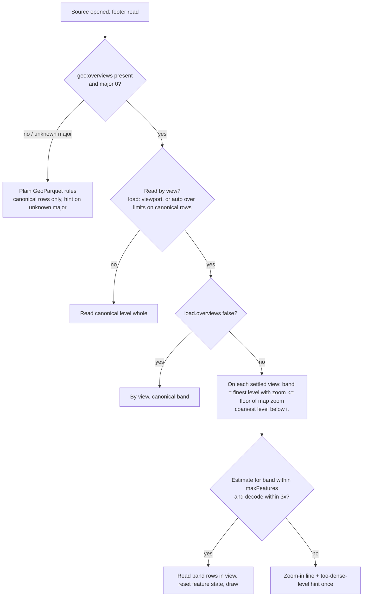

# Large Data Round 2 - Plan

## Goal Capsule

- **Objective:** Large files draw at every zoom and are easier to prepare: by-view GeoParquet reads the overview level that fits the zoom, computed classify breaks work on by-view GeoParquet, PMTiles MLT archives just work, and authors get a guide, hints that name the fix, and two CLI helpers.
- **Product authority:** the easy-large-data design (`docs/plans/2026-10-24-easy-large-data-design.md`, PR #207, decisions D1-D13) and maintainer decisions of 2026-10-27 recorded on ml-315 and in this document's Key Decisions. The maintainer's rule on dropping features stands: none beyond MapLibre's normal generalisation and the producer's own overview levels. Product Contract preservation: one clarification (AE1 now names the canonical level's zoom, z14, since the footer lists the canonical level among the levels); otherwise unchanged. The brainstorm's Outstanding Questions are resolved in the Planning Contract (KTD8, KTD10, KTD12).
- **Execution profile:** one feature branch off `main` (`feat/large-data-round-2`, from f382989, after live documents #210, JSON/TOML #211 and bundle headroom #213 merged), one commit per unit, one PR for the theme (the live-documents convention the maintainer chose). Changesets: core minor, cli minor.
- **Stop conditions:** stop and ask if the entry bundle would exceed the 177,802 B gzip ceiling (`size-baseline.json`: 174,730 + 3,072 allowance; the entry measured 175,061 B at f382989, so 2,741 B spare). Since #213 the GeoParquet reader *and* its by-view loader live in the lazy `formats/lib/geoparquet.ts` (`chunks/geoparquet.js`); `formats/geoparquet.ts` is a 16-line constants stub. Entry modules this plan touches: `formats/detect.ts`, the schemas (descriptions are stripped from the CDN build, so they cost the entry almost nothing), `parser/format-checks.ts`, `classify/checks.ts`, `renderer/classify-runtime.ts`, `renderer/layer-manager.ts`, `renderer/cloud-sources.ts` (thin wrappers and the host), `formats/pmtiles.ts` (protocol install and handler), `renderer/map-renderer.ts` and `components/student-messages.ts`. U1 starts by estimating the entry-side remainder and reports it before any code lands; if the `geo:overviews` level metadata in the fixture contradicts the design doc's encoding (§2.1); or if no first-party MapLibre version draws MLT from a PMTiles archive in the pinned range.
- **Tail ownership:** the implementing session runs `pnpm presubmit` and `pnpm verify:browser`, drives the real pages listed in the Verification Contract, writes the changesets, updates the beads, and reports. The maintainer merges and files the two upstream issues.
- **Bundle note (refreshed 2026-10-28, after #213):** the bundle-headroom pass (`docs/plans/2026-10-28-001-perf-bundle-headroom-plan.md`) moved the FlatGeobuf, GeoParquet and COG adapters and the cloud-source loaders into their reader chunks (`formats/lib/*`, shared `formats/lib/cloud-reader.ts`), which reach core only through host objects (`renderer/cloud-host.ts`: `CloudHost`, `PmtilesHost`) and import core as types only (`tests/lazy-chunks.test.ts`). This plan's module table, KTD1, KTD9, KTD11, U1-U4, U6 and the stop conditions are updated to match. Rule for new wording: text shown only from inside a chunk lives in that chunk (the PMTiles error-wording pattern); text the entry shows before or without a chunk stays in `student-messages.ts`.
- **Open blockers:** none.

---

## Product Contract

### Summary

Core 0.10 reads the `geo:overviews` level whose zoom matches the map's when it reads a GeoParquet file by view, on by default and labelled experimental, with `load: { overviews: false }` to opt out. Computed classify breaks become available for GeoParquet read by view, from a scan of one column of the full-detail rows. PMTiles archives whose tiles are MLT get `encoding: mlt` set from their header, and a failure caused by 64-bit integer columns becomes a notice with the fix. A Large data guide, hints that name the next command, `mlym prepare` and `mlym breaks` close the loop for authors.

### Problem Frame

0.9.2 made large files safe: GeoParquet and FlatGeobuf above the whole-file limits are read by view, a view over 150,000 features shows "Too many features to show here — zoom in", and an overview file draws only its canonical level so nothing stacks. Safe is not yet easy. A citywide view of a parcel fabric shows the zoom-in line even when the file carries coarse levels built for exactly that view. A `classify:` with `method: quantile` on such a source is refused because the browser sees only the view, although one column of the whole file is cheap to read. An MLT PMTiles archive renders nothing until the author knows to add `encoding: mlt`, and an int64 column makes every tile fail with a serialisation error from MapLibre. Authors who hit the limits get hints that name causes but not a single place that says which format to choose for which size, and there is no tool that looks at a file and says what to do.

Measurements behind these numbers are in the design doc (§4) and the PLUTO benchmark (`docs/plans/2026-10-23-pluto-lonboard-benchmark.md`, PR #205).

### Key Decisions

- **Overviews are read by default, experimental.** A by-view GeoParquet read picks the finest level whose zoom is at or below `floor(map zoom)`, with no YAML change. `load: { overviews: false }` reads only the canonical level. The spec is a draft (major version 0); a file declaring another major is read at its canonical level with an author hint, as 0.9.2 already does.
- **The budget stays in features.** `maxFeatures` keeps its 0.9 meaning and ceilings. A cost model in vertices or decoded bytes returns with worker decoding, where it changes anyway.
- **Statistics never come from coarse levels.** Computed breaks scan the canonical level's rows only, so classes describe the whole dataset and do not shift with zoom or pan.
- **Computed breaks in the browser are GeoParquet-only.** FlatGeobuf and PMTiles read by view keep the refusal; the refusal hint points to `mlym breaks`, which computes breaks from a whole local file.
- **PMTiles stays the citywide recommendation for dense polygon fabrics.** Overview GeoParquet is recommended for points, lines and sparse polygons, or when the GeoParquet file itself is the deliverable (D4). This is revisited after re-measuring tylertoo's next release (ml-cnv.30).
- **The CLI advises; it does not convert.** `mlym prepare <file>` reads a file's header or footer and prints one recommended command and the YAML source block; it never writes data. Running external tools is later (`--run`).
- **Upstream asks are drafted, not filed.** The plan carries issue texts for maplibre-gl-js and tylertoo (Appendix); the maintainer files them.

### Actors

- A1. **Author** - writes the YAML and prepares data files; reads hints while developing.
- A2. **Reader** - views the published map; must see a drawn map or the zoom-in line, never an error.
- A3. **Producer** - the tool that wrote the file (tylertoo, freestiler, tippecanoe, GDAL, geoparquet-io); outside this library's control.

### Requirements

**Overview levels**

- R1. A GeoParquet file read by view that declares `geo:overviews` (or `geo.overviews`) with major version 0 draws, at each zoom, the finest level whose zoom is at or below `floor(map zoom)`, falling back to the spec's resolution rule when a level declares no zoom.
- R2. Each level is read with the existing by-view row-group and bounding-box selection; the per-view budget and its zoom-in line apply to the level being read.
- R3. `load: { overviews: false }` reads the canonical level only, as 0.9.2 does; the key validates in v1 and v2 documents and appears in the JSON Schema.
- R4. Popups, hover highlight, `promoteId` and live-document updates behave at every level as at the canonical level; a level switch on zoom does not count as a document update.
- R5. The docs label overview reading experimental and state what coarse levels look like for each common producer.

**Computed breaks**

- R6. A `classify:` with a computed `method` on a GeoParquet source read by view computes its breaks from one column of the canonical level's rows, read once when the source loads, instead of being refused.
- R7. The legend and the paint expression use those breaks at every zoom and pan; they change only when the document changes.
- R8. FlatGeobuf and PMTiles sources read by view keep the refusal, and its message names `mlym breaks` as the way to get breaks for them.

**MLT and PMTiles**

- R9. A vector source whose PMTiles archive header declares MLT tiles is drawn without the author adding `encoding: mlt`; an author-supplied `encoding` wins.
- R10. When MLT tiles fail because of 64-bit integer columns, the map shows one notice naming the cause and the two fixes (write the column as a double or string, or build MVT), instead of an error per tile.

**Author guidance**

- R11. A Large data guide tells an author which format to use for which size, with one command per route and the YAML to paste, including the tylertoo parcel recipe and overview GeoParquet.
- R12. Hints for a dense view, a too-dense overview level and an unknown overviews version name the command that fixes them and link the Large data guide.
- R13. `mlym prepare <file>` reports a file's feature count, size, CRS, sort order, bounding-box column, row-group size and overview levels, then prints the one recommended command and the YAML source block; it never writes data.
- R14. `mlym breaks <file> --field <name> --method <m> --classes <n>` prints YAML-ready `breaks:` and the field's range from a whole local GeoParquet, FlatGeobuf or GeoJSON file.

### Key Flows

- F1. Citywide view of an overview file
  - **Trigger:** A2 opens a map of a 250,000-row GeoParquet overview file at zoom 10.
  - **Steps:** The loader reads the footer, picks the z10 level, reads its row groups in view, and draws them under the budget.
  - **Outcome:** A drawn map instead of the zoom-in line; zooming in switches to finer levels down to the canonical one.
  - **Covers:** R1, R2.
- F2. Thematic map on a large by-view file
  - **Trigger:** A1 writes `classify: { field: NumFloors, method: quantile, classes: 5 }` on a by-view GeoParquet source.
  - **Steps:** The loader reads the `NumFloors` column of the canonical rows once, computes breaks, and the legend shows them.
  - **Outcome:** Stable classes at every zoom; no refusal.
  - **Covers:** R6, R7.
- F3. Author with a raw file
  - **Trigger:** A1 has `parcels.geojson` (300 MB) and does not know what to do.
  - **Steps:** `mlym prepare parcels.geojson` prints the features and size, recommends the PMTiles route with the tylertoo command, and the YAML source to paste.
  - **Outcome:** One command to run and a block to paste.
  - **Covers:** R13, R11.

### Acceptance Examples

- AE1. **Covers R1.** Given an overview file with levels at z8, z10, z12 and the canonical level at z14, when the map is at zoom 11.4, then the z10 level is read; at zoom 12.0 the z12 level; at zoom 15 the canonical level.
- AE2. **Covers R3.** Given the same file and `load: { overviews: false }`, when the map is at zoom 10, then only canonical rows are read and the zoom-in line shows if the view exceeds the budget.
- AE3. **Covers R1, R2.** Given a level whose estimated view still exceeds `maxFeatures`, when the map is at that zoom, then the zoom-in line shows; no coarser level is tried in 0.10.
- AE4. **Covers R6, R7.** Given a by-view GeoParquet with `method: quantile`, when the reader pans and zooms across levels, then the breaks in the legend and paint never change.
- AE5. **Covers R8.** Given a by-view FlatGeobuf with `method: jenks`, then the refusal notice names `mlym breaks`.
- AE6. **Covers R9.** Given a PMTiles archive with MLT tiles and no `encoding` in the source, then the map draws; given `encoding: mvt` written by the author, the author's value is used.
- AE7. **Covers R10.** Given MLT tiles with an int64 column, then one notice names the cause and both fixes, and no per-tile errors reach the page.
- AE8. **Covers R4.** Given hover highlight with `promoteId` on an overview file, when the reader hovers a feature at a coarse level and zooms past a level switch, then hover works at both levels and no `ml-map:update-applied` fires for the switch.

### Success Criteria

- The PLUTO overview file draws a citywide view in under the design doc's measured 1.8 s / 0.7 GB on the desktop profile, with all 601 of 601 lots at block zoom.
- A new author can go from a raw 300 MB file to a working map using only the guide and `mlym prepare`'s output.
- No `classify` refusal remains for by-view GeoParquet.

### Scope Boundaries

**Deferred for later**

- Decoding FlatGeobuf, GeoParquet and `url:` GeoJSON in a worker (ml-37r.18); 0.11 with its own brainstorm.
- Falling back to a coarser overview level before the zoom-in line (ml-cnv.23), after re-measuring tylertoo's next release (ml-cnv.30).
- `mlym prepare --run` shelling out to tylertoo or ogr2ogr.
- A row-group cache across pans and partitioning-mode prefix reads (ml-cnv.29).
- A budget in vertices or bytes.
- GeoArrow geometry encodings (ml-cnv.13), page-index pruning (ml-37r.11), reprojection (ml-cnv.8, ml-37r.12).

**Outside this product's identity**

- Bundling a tiler or a native dependency in core or the CLI.
- Dropping or sampling features beyond the producer's levels and MapLibre's generalisation.

**Deferred to other tracks**

- The Python package's `format="auto"`, the tylertoo writer and its dependency extra (ml-37r.21, ml-37r.22, ml-37r.23), and whether the course's analysis notebooks should use one GeoParquet file citywide (Python track brainstorm).
- tylertoo for map-party's MapPLUTO retile worker (map-party bead).

### Dependencies / Assumptions

- The live-documents branch (PR #210) is the base; overview level switches happen inside the loader and never go through `update()`.
- tylertoo 0.8.0 is the reference producer; the `geo:overviews` spec is a draft at major 0.
- MapLibre GL 6.12 or later draws MLT when the source says `encoding: mlt`; older peers ignore the key and the hint says so.
- Core does not read the PMTiles header's tile type today and vector sources declare no `encoding` key in the schema (it passes through untyped); R9 adds both.

### Outstanding Questions

**Deferred to planning**

- How the column scan for R6 is bounded for very large files (a size cap with a hint, or always allowed since one column is small).
- Where `mlym prepare` gets file facts for GeoJSON (sampled count versus full parse) and its size threshold.
- Whether the int64 detection in R10 keys on MapLibre's error text or on the archive's column metadata.

### Sources

- Design: `docs/plans/2026-10-24-easy-large-data-design.md` (PR #207, D1-D13, §3 prototype, §4 measurements, §7.3 column scan, §8.3 notice wording).
- Benchmark: `docs/plans/2026-10-23-pluto-lonboard-benchmark.md` (PR #205).
- Code: `packages/core/src/formats/geoparquet.ts` (canonical-band rule, overviews parsing), `packages/core/src/renderer/cloud-sources.ts` (by-view loaders, budgets), `packages/core/src/classify/checks.ts` (the by-view refusal), `packages/core/src/formats/pmtiles.ts` (protocol, metadata), `packages/core/src/components/student-messages.ts` (`blockerAdvice`, `pmtilesCommand`, `LARGE_DATA_DOCS`), `packages/core/src/schemas/source.schema.ts` (`SourceLoadSchema`, `maxFeatures`), `packages/cli/src/commands/`.
- Beads: ml-cnv.22, .24, .25, .26, .27, .28, ml-41b; deferred ml-37r.18, ml-cnv.23, ml-cnv.29, ml-cnv.30.

---

## Planning Contract

### Key Technical Decisions

- **KTD1. One restriction point, a band argument.** Overview levels plug into the GeoParquet reader through the existing row-group restriction (`dataRowGroups` and the `rowStart`/`rowEnd` passed to hyparquet), which gains an optional band; with no band it keeps returning the canonical level (D2 unchanged). Every by-view helper (`rowsInView`, `rowGroupsInView`, `rowGroupExtents`, `canSkipByView`, `projectedSize`, `readBbox`) takes the band; whole-file reads, `mlym emit` and size guards never do. This is the design doc's §3 prototype shape. Level parsing, `overviewBand`, the band row-group math, the by-view helpers, `GeoParquetLoader` and `readColumns` all live in the lazy `formats/lib/geoparquet.ts` (`chunks/geoparquet.js`, loaded before any footer is parsed); no entry module needs the band.
- **KTD2. Levels are parsed, not discarded.** `parseOverviews` keeps every footer entry as `levels[]: {groupStart, groupEnd, rowStart, rowEnd, zoom?, gsd?}`, the canonical level included (on the fixture: five entries, zooms 10-14, canonical index 4 = groups 8-10), and `canonical` indexes into it. `overviewBand` chooses among all entries. Level choice: the finest level whose `zoom <= floor(map zoom)`; a level without `zoom` gets one from its `gsd` by the equatorial rule (`log2(40075016.69 / 1024 / gsd)`, no latitude correction); below the coarsest level, the coarsest level is read. Partitioning mode (no canonical band) reads every level up to the chosen one, as the spec requires.
- **KTD3. Whole stays whole.** `load:` has two modes, `all` (the default) and `viewport`; `all` already switches to reading by view when a file is over the whole-file limits. Levels apply whenever the loader reads by view: `load: viewport`, or the default on a file over the limits counted on canonical rows. A file under the limits is read whole at its canonical level. This resolves the design doc's §7.1 tension in favour of 0.9.2 behaviour for small files.
- **KTD4. `minzoom` records authorship.** `LoadMode` gains `authorMinzoom` (the `authorMaxFeatures` pattern) and `overviews: boolean` (default true). On an overview file read by view with no author `minzoom`, the floor is 0 so the coarsest level serves wide views; an author `minzoom` always wins.
- **KTD5. A level switch is a data change, not a document change.** It happens inside `ViewLoader.refresh` (debounced `moveend`, generation-guarded), delivers through `onData`, resets feature state for the source's layers (feature ids are unique only within a level), and never calls `update()` or emits `ml-map:update-applied`. Changing `load.overviews` in a live update recreates the loader through the existing `recreateLoader` path.
- **KTD6. Budget per level, no fallback.** The per-view estimate and the 3x decode cap apply to the chosen level's row groups; when the chosen level exceeds `maxFeatures` the zoom-in line shows (AE3). A distinct author hint names the coarsest level's count and the rebuild options; no coarser level is tried (ml-cnv.23 deferred).
- **KTD7. A one-column reader for breaks.** The GeoParquet reader gains `readColumns(source, names)`: canonical band, no geometry, no bbox filter, values converted with the chunk's existing int64 rule (exported from the chunk so `numericValue` sees numbers, not `bigint`). `ClassifyRuntime`'s by-view hook gains an async `wholeColumn(sourceId, fields)` backed by `LayerManager` and the source's loader; the runtime feeds a property-only collection to its existing `withData` → `computeBreaks` path, guarded against `destroyed` and `reseed` while the read is in flight.
- **KTD8. The scan is capped.** Each scanned column's compressed size in the canonical band (from the footer's column-chunk metadata) must be at most 32 MB; the `field` and `normalize` columns are counted separately. Over the cap, on a scan failure, or when the field is missing or non-numeric, the source keeps today's refusal, with its notice naming `mlym breaks` (AE5 wording applies here too). The parse-time refusal in `classify/checks.ts` exempts sources whose format is GeoParquet; the runtime decides.
- **KTD9. MLT is set where the header is.** The PMTiles protocol handler (`formats/pmtiles.ts`, entry) hands each TileJSON reply to a small function in the pmtiles chunk (`formats/lib/pmtiles.ts`, next to `tileFailure`), which reads the archive's cached header and adds `encoding: "mlt"` when `header.tileType === TileType.Mlt` (6); the entry passes only whether the runtime meets the MLT floor (KTD11). MapLibre merges the source spec over the TileJSON, so an author's `encoding` wins without extra code (AE6). A page that registered `pmtiles` itself gets no auto-encoding (the existing host-wins rule), documented. `VectorSourceSchema` gains `encoding: "mvt" | "mlt"` with a description.
- **KTD10. The int64 failure is matched by text, once per source.** Worker errors lose their structured cause, so the renderer's `map.on('error')` path recognises the three engines' texts (`/serialize a BigInt|BigInt value can't be serialized|cannot serialize BigInt/i`: V8, Firefox, Safari) on a PMTiles-backed source, reports one notice with the §8.3 wording and drops later occurrences for that source before `onError` (the `MISSING_PROTOMAPS_LAYER` drop pattern), so neither the console nor `ml-map:error` repeats per tile.
- **KTD11. MLT needs a runtime that draws it.** Auto-encoding is applied only when the running maplibre-gl draws MLT (the version floor is confirmed in U4; the bead records 6.12); below it the handler leaves the TileJSON unchanged. The handler is shared by every map on the page and cannot report, so `formats/pmtiles.ts` gains an `archiveTileType(url)` helper (mirroring `archiveMetadata`, entry, reading the cached header through the loaded reader) and `map-renderer.ts` calls it for vector PMTiles sources below the floor and shows one hint through `LayerManager.hintOnce`. The below-floor hint and the int64 notice (KTD10) are worded in the pmtiles chunk, which is always loaded by the time either can fire (a header or a tile has been read); the entry shows them.
- **KTD12. `mlym prepare` reads, never writes.** It accepts a local path or an `http(s)` URL, reads only footers and headers through new core exports that take any `AsyncBuffer` and import nothing from `node:` (a GeoParquet facts reader that reports a projected CRS instead of throwing, and a FlatGeobuf header reader); the fs-backed file-handle `AsyncBuffer` lives in the CLI (`packages/cli/src/lib/`), because core's index is also built for the browser, and samples GeoJSON (full parse up to 200 MB; above, a size-based estimate stated as such). It prints the facts, one recommended command from the guide's table, and the YAML source block. Already-good files get "no change needed" and the YAML. Exit codes are the CLI's existing `EXIT_CODES`: 0 report printed, 2 `FILE_NOT_FOUND` for a missing or unreadable path, 1 `VALIDATION_ERROR` for an unsupported file, a bad flag or no file argument, 4 `UNKNOWN_ERROR` otherwise. Accepting `http(s)` URLs as well as local paths extends R13's wording, since by-view sources are usually remote.
- **KTD13. `mlym breaks` reuses core's math.** It decodes the whole local file (the CLI's existing `data-loader`, whose `decodeGeoParquet`/`decodeFlatGeobuf` calls #213 kept unchanged; they load the reader chunk in Node as `mlym emit` already does), computes breaks with core's exported `computeBreaks`/`classifyWithData`, and prints a YAML-ready `breaks:` line plus min and max. A string field exits 1 (`VALIDATION_ERROR`) naming the type and suggesting `categories`; exit codes match KTD12.
- **KTD14. Hints and docs point to one page.** `LARGE_DATA_DOCS` gains `guides/large-data/`; the dense-view hint adds the overview route for GeoParquet and keeps the PMTiles route; the unknown-major hint gains its command and link; one-shot hint state lives in `LayerManager.hintOnce` so loader recreation on a live update does not repeat hints. The new anchors join `docs/scripts/check-stable-urls.mjs` NEVER_MOVE because core's shipped text links them.

### High-Level Technical Design

Which level a GeoParquet source reads:

Where each new behaviour lives:

| Behaviour | Module (chunk or entry) | Reached from |
|---|---|---|
| Level parsing, band math, `readColumns` | `formats/lib/geoparquet.ts` (chunk) | loader, classify hook |
| Level choice per view, budget per band, too-dense-level hint wording | `formats/lib/geoparquet.ts` `GeoParquetLoader` (chunk) | `moveend` |
| Feature-state reset at a level switch | `GeoParquetLoader` asks through its callbacks; `renderer/layer-manager.ts` resets (entry, a few lines) | level change |
| Breaks from a column | `renderer/classify-runtime.ts` by-view hook + `LayerManager` (entry), calling the chunk's `readColumns` through `cloudReaders("geoparquet")` | classify on load |
| MLT encoding from header | `formats/lib/pmtiles.ts` TileJSON rewrite (chunk), called from the `formats/pmtiles.ts` handler (entry) | MapLibre TileJSON request |
| MLT below the runtime floor | `formats/pmtiles.ts` `archiveTileType` + `renderer/map-renderer.ts` hint (entry); hint wording in the chunk | source added |
| Once-only int64 notice | `renderer/map-renderer.ts` error handler (entry: text match and drop); wording in the chunk | `map.on('error')` |
| Hints and links shown by the entry | `components/student-messages.ts` (entry): `LARGE_DATA_DOCS`, classify refusal text, `CloudMessages` additions | loaders, renderer |
| Node-safe facts readers | `formats/lib/geoparquet.ts`, `formats/lib/flatgeobuf.ts` (chunks), thin async exports in `renderer/cloud-sources.ts` re-exported from `index.ts` | CLI |
| `mlym prepare`, `mlym breaks` | `packages/cli/src/commands/` | CLI |

### System-Wide Impact

- **Bundle.** The entry has 2,741 B of headroom under the 177,802 B ceiling. Entry-side: `LoadMode` fields and the `overviews` format check, the feature-state reset callback, the classify hook and its wiring, the classify-refusal wording, the BigInt text match and drop, `archiveTileType` and the floor check, `LARGE_DATA_DOCS` and a few `CloudMessages` additions. Lazy (`chunks/geoparquet.js`): levels, bands, level choice, budget per band, `readColumns`, the facts reader and the GeoParquet hint wording; (`chunks/pmtiles.js`): the TileJSON rewrite and the MLT wording; (`chunks/flatgeobuf.js`): the header reader. Chunks have no budget yet (ml-7qa.5); record their growth in the PR. If U1's estimate exceeds the spare, stop and ask (Goal Capsule).
- **Live documents.** Level switches never pass through `update()`; a `load.overviews` change does, and recreates the loader. Hint dedupe survives recreation (KTD14).
- **Interactions.** Hover highlight and feature state reset at each level switch; popups opened at a coarse level stay as a snapshot of that feature until closed.
- **Public API.** Core gains three Node-safe exports for the CLI (KTD12) and `VectorSourceSchema.encoding`; both are documented in the changeset.
- **Docs.** The sidebar's "Large data" group relabels its first item; `geoparquet.mdx` replaces "coarse levels are planned" with the shipped behaviour.
- **CI matrix.** MLT e2e skips below the MLT runtime floor, as the state tests skip below 5.6.

### Risks & Dependencies

| Risk | Mitigation |
|---|---|
| Entry budget exhausted by new entry-side code | U1 estimates the entry remainder first; the loader, parsing, band math and chunk-only wording go in the lazy chunks; the entry size is recorded after every unit; stop condition in the Goal Capsule |
| A chunk imports a core value (breaks the self-contained chunk rule) | new chunk code reaches core through `CloudHost`/`PmtilesHost` additions; `tests/lazy-chunks.test.ts` fails otherwise |
| Draft spec changes (tylertoo#441) | accept major 0 only; experimental label; `overviews: false` escape hatch |
| No MLT fixture can be built locally | U4 tries freestiler, then tylertoo; otherwise unit tests with a patched header and a manual check by the maintainer, recorded in the PR |
| Jenks on a large column is memory-heavy (about 34 MB for 856k values, 5 classes) | the 32 MB column cap bounds input; note in the guide that quantile is cheaper |
| int64 matching depends on engine error text | match the V8, Firefox and Safari texts on PMTiles-backed sources; one unit case per engine; e2e on the chromium leg that draws MLT |
| `e2e/large-data.spec.ts` asserts `levels == [4]` at z14 | keep the `level` column readable; extend that spec with z10/z12 cases |

### Open Questions

**Deferred to implementation, with defaults**

- If U1's estimate of the entry-side remainder exceeds the 2,741 B spare (before U1 lands): new wording already sits behind its chunk where it can (Bundle note rule), so the remaining choice is a larger allowance or trimming entry text, which the maintainer decides.

### Deferred to Implementation

- The exact first maplibre-gl version that draws MLT from `encoding: "mlt"` (check its changelog and the 5.x leg), which sets KTD11's floor.
- Whether the gsd rule needs the level's `gsd` units normalised (metres assumed).
- The `AsyncBuffer` file-handle shape in Node (fs.promises `FileHandle.read` versus a range-reading stream).

---

## Implementation Units

### U1. Overview levels in the GeoParquet reader and the `load.overviews` key

- **Goal:** The reader knows every level and can read a band; authors can turn levels off.
- **Requirements:** R1, R3; KTD1, KTD2, KTD4.
- **Dependencies:** none.
- **Files:** `packages/core/src/formats/lib/geoparquet.ts` (chunk: `parseOverviews` with `levels[]`, the `Overviews.levels[]` type, `overviewBand(overviews, zoom)`, band row-group math, the band argument on `dataRowGroups`, the by-view helpers and `ReadOptions`), `packages/core/src/formats/detect.ts` (`LoadMode.overviews`, `authorMinzoom`), `packages/core/src/schemas/source.schema.ts` (`SourceLoadSchema.overviews`), `packages/core/src/parser/format-checks.ts` (warn on `overviews:` for non-GeoParquet sources), `packages/core/tests/formats/geoparquet.test.ts`, `packages/core/tests/parser/format-checks.test.ts`, `packages/core/tests/schemas/json-schema-snapshot.test.ts` (update snapshot).
- **Approach:** First build and measure: estimate the entry-side bytes this plan adds (the System-Wide Impact bundle list: `LoadMode` fields, format check, feature-state reset, classify hook and wiring, BigInt match and drop, `archiveTileType`, entry wording) and report it against the 2,741 B spare before landing code. Parse levels from the footer key the design doc §2.1 describes; keep `canonical` exactly as today. `overviewBand` implements KTD2 and returns `undefined` for non-overview files. Helpers default to the canonical band so every existing caller is unchanged.
- **Patterns to follow:** the existing `geo:overviews` describe block and byte-patch technique in `tests/formats/geoparquet.test.ts`; `authorMaxFeatures` in `detect.ts`; the `load: maxFeatures` tests in `tests/parser/format-checks.test.ts`.
- **Test scenarios:**
  - `parseOverviews` on `lots-overviews.parquet` returns five levels with zooms 10-14, canonical index 4 (groups 8-10, 600 rows); `geo.overviews` in the `geo` JSON parses the same.
  - On the fixture (levels at z10, z11, z12, z13, canonical at z14): `overviewBand` at zoom 11.4 → z11; 12.0 → z12; 9.0 → z10 (coarsest); 15 → canonical. The general rule of AE1 is covered by a synthetic footer with levels at z8, z10, z12 and a canonical level at z14.
  - A level without `zoom` gets one from `gsd`; a file with neither on a level falls back to canonical with a hint.
  - Partitioning mode returns the union of levels up to the chosen one.
  - `rowsInView` and `readBbox` with a band touch only that band's row groups; without a band, behaviour equals 0.9.2 (canonical).
  - `load: { overviews: false }` validates in v1 and v2; `overviews:` on a FlatGeobuf source warns; a non-boolean errors at `load.overviews`.
  - `authorMinzoom` is set only when the author wrote `minzoom`.

### U2. Level selection in the by-view loader

- **Goal:** A by-view overview file draws the zoom-matched level, within the budget, and switches cleanly.
- **Requirements:** R1, R2, R4; AE1, AE2, AE3, AE8; KTD3, KTD5, KTD6.
- **Dependencies:** U1.
- **Files:** `packages/core/src/formats/lib/geoparquet.ts` (chunk: `GeoParquetLoader.estimate`, `decodeTooCostly`, `readView` with the band; minzoom floor rule; band-change signal; too-dense-level hint worded here and shown through the loader's existing hint callback), `packages/core/src/renderer/cloud-host.ts` (types for any new callback), `packages/core/src/renderer/layer-manager.ts` (feature-state reset on the band-change callback; `hintOnce` dedupe), `packages/core/tests/renderer/cloud-sources.test.ts`, `packages/core/tests/formats/geoparquet.test.ts` (loader-level cases), `e2e/large-data.spec.ts` (z10, z12, z14 on the overview fixture; `overviews: false`; hover across a switch).
- **Approach:** Compute the band once per settled view from `floor(map.getZoom())`; pass it to estimate, cap and read; when it differs from the last band, bump the generation and reset feature state for the source's layers before delivering. Whole-or-by-view uses canonical rows (KTD3). An overview file with no author `minzoom` gets a floor of 0.
- **Execution note:** write the "switch while a read is in flight" test first; stale band reads must never land.
- **Patterns to follow:** `ViewLoader.refresh`/`skip`/`generation`; `fakeMap(zoom, bounds)` with `moveend()` in `tests/formats/geoparquet.test.ts`; `e2e/large-data.spec.ts` helpers (`guard`, `OPEN`, `count`, `querySourceFeatures`).
- **Test scenarios:**
  - Covers AE1: zoom 10 reads only z10 rows; 12 only z12; 14 the canonical rows (600 lots); `level` column values match.
  - Covers AE2: `overviews: false` at zoom 10 reads canonical rows and shows the zoom-in line when over budget.
  - Covers AE3: a level over `maxFeatures` shows the zoom-in line and one too-dense-level hint naming the coarsest count; no coarser level is read.
  - Zooming across two level boundaries within the debounce reads only the final band; a read started for the first band is discarded.
  - A small overview file (under the whole-file limits) with no `load:` key is read whole at its canonical level; with `load: viewport` it uses levels; a file over the limits with no `load:` key switches to by view and uses levels.
  - Author `minzoom: 12` on an overview file: nothing is read below 12, even though levels exist.
  - Covers AE8: hover with `promoteId` works at a coarse level and after a switch; feature state is reset at the switch; no `ml-map:update-applied` fires.
  - A live update changing `load.overviews` recreates the loader once and the hint does not repeat.

### U3. Computed breaks from one column on by-view GeoParquet

- **Goal:** `classify` with a computed method works on by-view GeoParquet with stable breaks.
- **Requirements:** R6, R7, R8; AE4, AE5; KTD7, KTD8.
- **Dependencies:** U1.
- **Files:** `packages/core/src/formats/lib/geoparquet.ts` (chunk: `readColumns` via `parquetReadObjects` with `columns: [field]` and the canonical `rowStart`/`rowEnd`, column compressed-size lookup, the int64 property conversion), `packages/core/src/renderer/cloud-sources.ts` (entry: a thin `readColumns` through `cloudReaders("geoparquet")`), `packages/core/src/renderer/classify-runtime.ts` (async `wholeColumn` hook in the by-view branch), `packages/core/src/renderer/layer-manager.ts` and `packages/core/src/renderer/map-renderer.ts` (`createClassify` wiring), `packages/core/src/classify/checks.ts` (exempt GeoParquet; refusal text names `mlym breaks`), `packages/core/src/renderer/classify-runtime.ts` (`byViewClassifyError` text), `packages/core/tests/classify/runtime.test.ts`, `packages/core/tests/classify/parse.test.ts`, `packages/core/tests/formats/geoparquet.test.ts`, `e2e/classify.spec.ts` (by-view GeoParquet quantile case).
- **Approach:** On load the runtime asks the hook for the classify field (and `normalize` field) of a by-view GeoParquet source; the hook calls `readColumns` on the canonical band, converts values, and returns a property-only collection; breaks are computed once and applied. FlatGeobuf and PMTiles keep the refusal.
- **Patterns to follow:** `ClassifyRuntime.compute` and `withData`; `fieldStats`; the existing refusal tests.
- **Test scenarios:**
  - Covers AE4: quantile breaks on the overview fixture equal breaks computed from a whole read of the canonical rows, and do not change across zooms and pans.
  - An int64 field yields numeric breaks (no `bigint` dropped as no data).
  - A field over the 32 MB cap (simulated footer size) keeps the refusal with `mlym breaks` in the notice.
  - A missing field and a string field keep the refusal with the field-specific message.
  - A scan that fails (fetch error) keeps the refusal and does not block the layer's drawing.
  - Covers AE5: by-view FlatGeobuf with `method: jenks` refuses, naming `mlym breaks`, at parse time and at runtime.
  - Categorical `classify` on the same source is unaffected.
  - A `reseed` (live update changing `classify.field`) while a scan is in flight discards the stale result and scans the new field.

### U4. MLT encoding from the PMTiles header and the int64 notice

- **Goal:** MLT archives draw without `encoding:`, and the int64 failure becomes one useful notice.
- **Requirements:** R9, R10; AE6, AE7; KTD9, KTD10, KTD11.
- **Dependencies:** none.
- **Files:** `packages/core/src/formats/lib/pmtiles.ts` (chunk: the TileJSON rewrite from `header.tileType`, the MLT int64 notice and below-floor hint wording), `packages/core/src/renderer/cloud-host.ts` (`PmtilesHost` additions if the chunk needs core), `packages/core/src/formats/pmtiles.ts` (entry: handler hands `type: json` replies to the chunk with the runtime-floor result; `archiveTileType(url)`), `packages/core/src/schemas/source.schema.ts` (`VectorSourceSchema.encoding`), `packages/core/src/renderer/map-renderer.ts` (BigInt drop and once-only report; below-floor hint via `archiveTileType` and `hintOnce`), `packages/core/tests/renderer/cloud-sources.test.ts` (handler cases), `packages/core/tests/lazy-chunks.test.ts` (still green: the chunk imports core as types only), `packages/core/tests/renderer/map-renderer.test.ts` (error drop), `packages/core/tests/schemas/json-schema-snapshot.test.ts`, `docs/public/gallery-assets/cloud-native/` (small MLT archive, if buildable), `scripts/fixtures/` (the script that builds it), `e2e/cloud-native.spec.ts` (MLT draws; gated on the runtime floor).
- **Approach:** Read the cached header in the `type: "json"` branch; set `encoding: "mlt"` only when the tile type is MLT and the runtime meets the floor. Build a 50-feature MLT archive with an int64 column and a second without, using freestiler or tylertoo; if neither writes MLT locally, test the handler with a patched header and record the manual check.
- **Execution note:** confirm the MapLibre MLT floor before writing KTD11's check; record it in the PR body.
- **Patterns to follow:** the direct `install()` handler call in `tests/renderer/cloud-sources.test.ts` (around line 70); the `MISSING_PROTOMAPS_LAYER` drop in `map-renderer.ts`.
- **Test scenarios:**
  - Covers AE6: a header with tile type 6 adds `encoding: "mlt"` to the TileJSON; tile type 1 does not; an author `encoding: "mvt"` wins in the merged source.
  - Below the MLT floor the TileJSON is unchanged and one hint names the floor.
  - Covers AE7: ten BigInt errors from one PMTiles source produce one notice, one console line and one `ml-map:error`, for each of the V8, Firefox and Safari message texts; an unrelated MLT decode error is reported normally.
  - Below the floor, two maps on one page with the same MLT archive each show the hint once; `archiveTileType` returns 6 from the cached header.
  - `encoding: "mlt"` validates; `encoding: "x"` errors at the key; the JSON Schema snapshot includes it.
  - e2e (on the leg that draws MLT): the MLT fixture draws features with no `encoding:` in YAML.

### U5. Hints, the Large data guide and doc updates

- **Goal:** One page tells authors what to do, and every large-data hint points at it with the right command.
- **Requirements:** R5, R11, R12; KTD14.
- **Dependencies:** U2, U3, U4 (wording names the shipped behaviour).
- **Files:** `packages/core/src/components/student-messages.ts` (`LARGE_DATA_DOCS`, dense-view overview route, unknown-major hint command and link), `packages/core/src/renderer/cloud-sources.ts` (hint call sites only), `docs/src/content/docs/guides/large-data.mdx` (new), `docs/src/content/docs/guides/geoparquet.mdx` (overview files section), `docs/src/content/docs/guides/cloud-native-data.mdx` (link from "Which format?"), `docs/src/content/docs/guides/pmtiles.mdx` (MLT note), `docs/src/content/docs/guides/classify.mdx` or equivalent (breaks on by-view GeoParquet, `mlym breaks`), `docs/astro.config.mjs` (sidebar), `docs/scripts/check-stable-urls.mjs` (NEVER_MOVE anchors), `packages/core/tests/components/ml-map-student-errors.test.ts`.
- **Approach:** The guide is a size-to-format table (under 50k as-is; 50k-250k GeoParquet by view; above or dense fabrics PMTiles via tylertoo; GeoParquet deliverable as an overview file), one command per route, the YAML to paste, what coarse zooms show per producer, and the experimental label. Hints reuse `pmtilesCommand` and add an overviews command.
- **Patterns to follow:** `docs/STYLE.md` page shape; existing per-format "Large files" sections; `blockerAdvice`.
- **Test scenarios:**
  - The dense-view hint for GeoParquet names the overviews route and links `guides/large-data/`; for FlatGeobuf it names the PMTiles route via GeoParquet.
  - The unknown-major hint names its command and link.
  - A hint shown once does not repeat after a live update recreates the loader.
  - `pnpm docs:validate-snippets` passes with the guide's YAML; the docs build resolves every new anchor; `check-stable-urls` lists them.

### U6. Node-safe readers exported for the CLI

- **Goal:** The CLI can read footers and headers without downloading whole files or hitting browser-only paths.
- **Requirements:** R13 (enabling); KTD12.
- **Dependencies:** none.
- **Files:** `packages/core/src/formats/lib/geoparquet.ts` (chunk: a facts reader over any `AsyncBuffer` that reports CRS instead of throwing), `packages/core/src/formats/lib/flatgeobuf.ts` (chunk: header reader over an `AsyncBuffer`), `packages/core/src/renderer/cloud-sources.ts` (entry-side thin async exports that load the chunk through `cloudReaders`, so npm consumers of the index don't load hyparquet eagerly), `packages/core/src/index.ts` (exports), `packages/cli/src/lib/file-buffer.ts` (new: the fs-backed file-handle `AsyncBuffer`), `packages/core/tests/formats/node-readers.test.ts` (new), `packages/cli/test/file-buffer.test.ts` (new).
- **Approach:** Core's new readers import nothing from `node:`; core's index is also built as `dist/index.browser.js`, so the fs-backed buffer stays in the CLI. Keep the readers out of `register.browser`.
- **Test scenarios:**
  - The facts reader on the overview fixture returns rows, row groups, bbox column, sort hint and levels from a file handle, reading only the footer bytes.
  - A projected-CRS GeoParquet returns its CRS in the facts instead of throwing.
  - The FlatGeobuf header reader returns feature count, index presence and CRS from the first bytes.
  - `register.browser.js` contains none of the new modules, and `dist/index.browser.js` builds and contains no `node:` specifier.

### U7. `mlym prepare`

- **Goal:** One command looks at a file and says what to do.
- **Requirements:** R13; F3; KTD12.
- **Dependencies:** U6.
- **Files:** `packages/cli/src/commands/prepare.ts` (new), `packages/cli/src/cli.ts` (register), `packages/cli/test/prepare.test.ts` (new), `docs/src/content/docs/cli/reference.mdx` (`### prepare`).
- **Approach:** Detect format by extension and magic bytes; read facts (U6); pick the route from the guide's table; print facts, the command with filenames filled in, and the YAML block. GeoJSON is parsed fully up to 200 MB, estimated above.
- **Patterns to follow:** `emit.ts` (`defineCommand`, exported testable function, `EXIT_CODES`); `test/emit-cloud-native.test.ts` fixtures.
- **Test scenarios:**
  - Covers F3: a 300 MB GeoJSON (synthetic, estimated) recommends the PMTiles route with the tylertoo command and a `type: vector` YAML block.
  - A sorted GeoParquet with bbox column under 250k rows prints "no change needed" and the by-view YAML.
  - An unsorted GeoParquet recommends the gpio sort command.
  - A FlatGeobuf without an index recommends the ogr2ogr index command.
  - A projected-CRS file names the reprojection command first.
  - An overview file reports its levels and the experimental note.
  - An `http(s)` URL is read by range; a missing path exits 2 (`FILE_NOT_FOUND`); no file argument exits 1 (`VALIDATION_ERROR`).

### U8. `mlym breaks`

- **Goal:** Breaks for files the browser cannot classify by view.
- **Requirements:** R14; KTD13.
- **Dependencies:** none (U3 shares wording only).
- **Files:** `packages/cli/src/commands/breaks.ts` (new), `packages/cli/src/cli.ts`, `packages/cli/test/breaks.test.ts` (new), `docs/src/content/docs/cli/reference.mdx` (`### breaks`).
- **Approach:** Decode the whole file with `lib/data-loader.ts`, compute with core's exports, print `breaks: [...]` and the range.
- **Test scenarios:**
  - Quantile, equal and jenks on the districts fixture print breaks equal to core's `computeBreaks` on the same data.
  - `--classes` outside the supported range exits 1 (`VALIDATION_ERROR`); a string field exits 1 naming the type and suggesting `categories`; a missing file exits 2.
  - GeoParquet, FlatGeobuf and GeoJSON inputs all work; a missing field exits 1.

### U9. Real-pages pass, changesets and release notes

- **Goal:** Everything is proven on real pages and recorded for the release.
- **Requirements:** all; Success Criteria.
- **Dependencies:** U1-U8.
- **Files:** `examples/verification/cloud-native/large-data.html` (overview cases at z10, z12 and a classify case), `e2e/large-data.spec.ts`, `e2e/live-update-gallery.spec.ts` (still green with the new pages), `.changeset/large-data-round-2.md` (core minor), `.changeset/cli-prepare-breaks.md` (cli minor), `docs/src/content/docs/getting-started/upgrading.mdx` (0.10 additions).
- **Approach:** Drive the fixture page and the new guide's examples in a real browser at the three zooms; run `mlym prepare` and `mlym breaks` on the repo's sample files and paste the output into the PR body; measure the PLUTO overview citywide view against the Success Criteria on the desktop profile when the dataset is available locally, else record that it was not.
- **Test expectation:** e2e and CLI tests above; the PR body carries the manual measurements.

---

## Verification Contract

| Gate | Command | Applies to | Done signal |
|---|---|---|---|
| Presubmit through the box lane | `pnpm presubmit` | every unit | exit 0, checked with `$?` |
| Browser suite | `pnpm verify:browser` | U2, U3, U4, U5, U9 | all specs green, MLT spec skipped only below the floor |
| Bundle | `pnpm --filter @maplibre-yaml/core build && pnpm --filter @maplibre-yaml/core test -- tests/bundle-size.test.ts tests/lazy-chunks.test.ts` | U1, U2, U3, U4, U6 | entry within 177,802 B gzip; new readers absent from the entry; chunks still self-contained; chunk sizes recorded |
| CLI | `pnpm --filter @maplibre-yaml/cli test` | U7, U8 | green |
| Docs | `pnpm docs:validate-snippets` and `pnpm --filter @maplibre-yaml/docs build` | U5 | exit 0; new anchors resolve |
| Real pages | the overview fixture at z10, z12, z14; the guide's examples; `mlym prepare` and `mlym breaks` on sample files; a phone preview of the fixture | U9 | drawn at every zoom, breaks stable, output pasted in the PR |

## Definition of Done

- R1-R14 and AE1-AE8 have passing tests; the real-pages pass is recorded in the PR body.
- `pnpm presubmit` and `pnpm verify:browser` pass; the entry bundle is within budget.
- Changesets for core (minor) and cli (minor); the guide, per-format pages, CLI reference and upgrading page are updated.
- Beads ml-cnv.22, .24, .25, .26, .27, .28 and ml-41b are closed with the PR; ml-37r.20 (parcel recipe) is closed by the guide; follow-ups filed.
- The two upstream issue drafts remain in the appendix for the maintainer.
- No dead-end code remains.

## Appendix: upstream issue drafts (for the maintainer to file)

**maplibre-gl-js: MLT tiles with 64-bit integer columns fail with "Do not know how to serialize a BigInt"**

Steps: build a PMTiles archive with MLT tiles from data with an int64 property (freestiler 0.3.0 on NYC PLUTO; `BBL` is int64), add it as a vector source with `encoding: "mlt"` in plain maplibre-gl 6.12 (also 6.15). Every tile fails in the worker with `Do not know how to serialize a BigInt` and nothing draws. With `BBL` written as double the same archive draws (105 MB versus 179 MB as MVT; citywide view 17.5 MB versus 31.4 MB). Expected: int64 properties decode (as number when safe, or string/BigInt per a documented rule) instead of failing the tile.

**tylertoo: a "by-view GeoParquet" overview profile**

Context: maplibre-yaml reads `geo:overviews` levels by zoom from GeoParquet in the browser, under a per-view feature budget (150,000 by default). With 0.8.0, coarse levels drop most small lots (NYC PLUTO at z10 keeps few parcels, 19% of the screen coloured citywide versus 37% for PMTiles); with main's placeholder squares a citywide z10 view holds about 224,000 features from a 254,000-row level, above the budget. Request: a profile whose coarse levels cover the fabric within a feature budget per view (for example merged blocks or aggregated cells rather than per-lot squares), so one GeoParquet file draws a complete citywide view in the browser.
