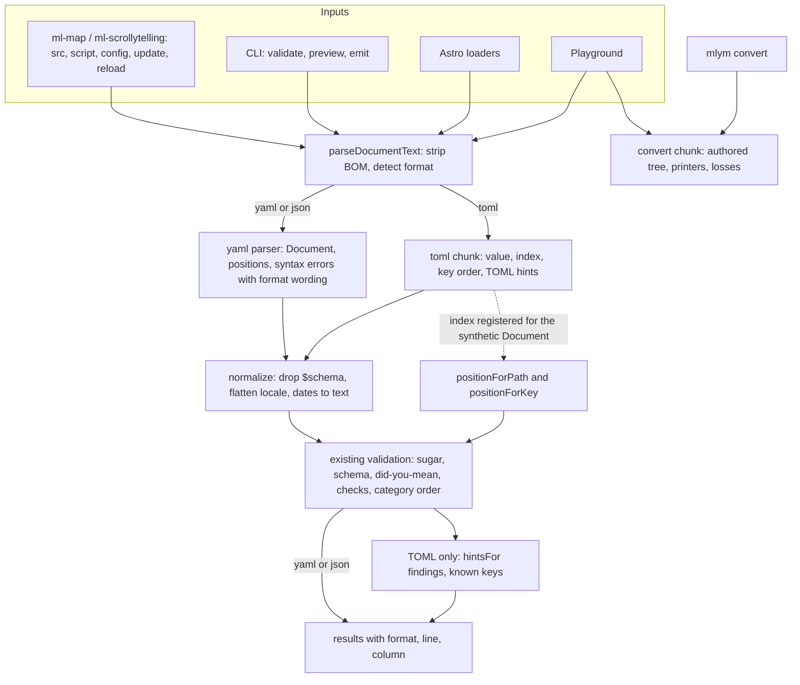
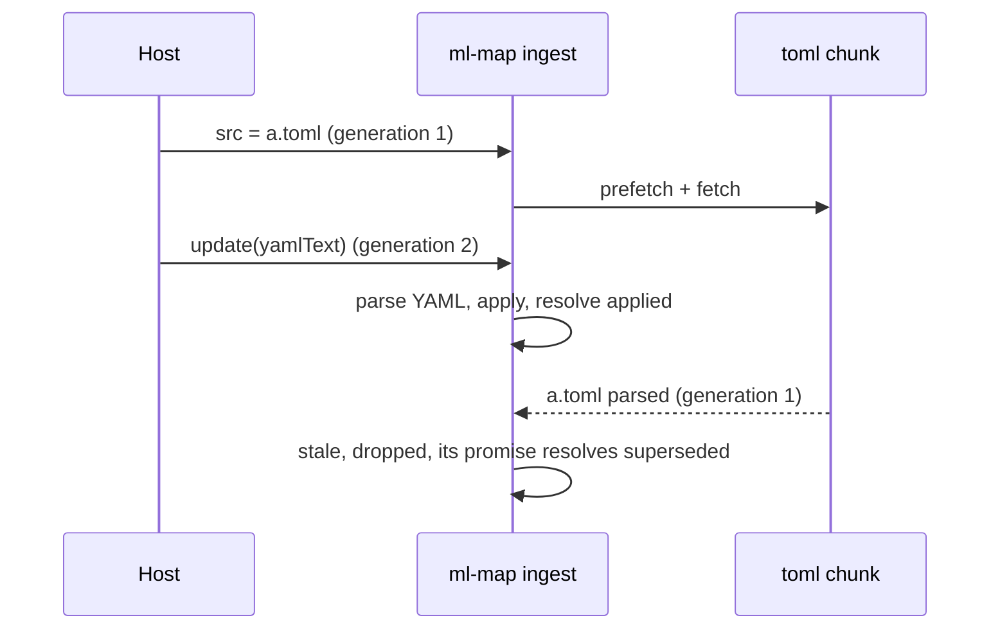

# JSON and TOML Documents - Plan

## Goal Capsule

- **Objective:** a map or story document can be written in YAML, JSON or TOML and behaves the same on every surface, with the same positioned diagnostics, while YAML stays the canonical teaching format.
- **Product authority:** the JSON and TOML research (`docs/plans/2026-10-26-json-and-toml-documents.md`, PR #208, on `origin/docs/plan-json-toml`), and maintainer decisions of 2026-10-27 recorded on ml-315 and ml-4cn.8: TOML is un-parked and ships with JSON in 0.10; `mlym convert` is in scope; Python reads three formats and writes two; nested `locale` tables flatten in every format; the playground gets a language toggle; budget-conscious without trading away performance, with a budget triage to follow.
- **Product Contract preservation:** two kinds of change.
  - **R22:** the Python package reports paths without positions and writes TOML dates in RFC 3339 form, as the maintainer confirmed on 2026-10-28.
  - **Review clarifications, with no scope change:** R8 names the tested table-ordering hint. R12 covers date values from collections. R15 no longer counts `!html` as a loss, because it round-trips. AE4's GeoJSON fixture is a `.json` file, so the sniff is what rejects it. The Outstanding Questions were resolved into the Planning Contract (KTD2, KTD4, KTD12, Deferred to Implementation). Everything else is unchanged.
- **Execution profile:** one feature branch (`feat/json-toml-documents`) off `feat-v0.10`, because the element work extends live documents' `update()`. One commit per unit, one PR for the theme. Rebase onto `main` once PR #210 merges. The maintainer orders this branch against the large-data branch; both draw on the same bundle headroom.
- **Stop conditions:** stop and ask in any of these cases:
  - an existing YAML diagnostic changes text or position;
  - the TOML parser fails on Node 18 on both the 1.0 and 0.10 lines;
  - U1's estimate of entry growth exceeds 4 KB gzip, which is past the expected size and needs a triage call before code lands;
  - the playground editor chunk would pass its 140 KB cap.
- **Tail ownership:** the implementing session owns the tail. It runs `pnpm presubmit` and `pnpm verify:browser`, drives the real pages in the Verification Contract, writes the changeset, files the Python and map-party beads, and reports. The maintainer merges.
- **Open blockers:** none.

---

## Product Contract

### Summary

JSON and TOML become official document formats beside YAML across `<ml-map>`, `<ml-scrollytelling>`, React, Astro, the CLI, the playground and the Python package. Every format runs the same validation and reports diagnostics at the author's line and column. `mlym convert` moves documents between the three. One guide page teaches JSON and TOML; every other page stays YAML.

### Problem Frame

A prospective power user asked whether documents could be written in JSON or TOML. JSON already parses, because it is a subset of YAML 1.2, but nothing says so: syntax errors from the CLI and Astro are worded for YAML, folder validation skips `.json`, a `$schema` key draws a warning, and no page documents it. Agents and APIs emit JSON, so this gap shows up first in automated publishing. TOML does not work at all outside Astro content collections, where errors have no positions. Its traps are silent: unquoted dotted keys nest, bare dates become objects, and `null` does not exist.

### Actors

- A1. **Author:** writes and maintains documents by hand in an editor or the playground.
- A2. **Host developer:** embeds maps through the element, React or Astro, and may pass document text at run time.
- A3. **Agent or pipeline:** generates documents, usually JSON, and validates them with the CLI.
- A4. **Python user:** builds or edits documents from a notebook with the Python package.

### Key Decisions

- **One pipeline for every format.** Each format becomes a plain value, which then goes through the existing checks. Diagnostics are this product's strength, so TOML gets exact positions, even though that means a larger lazily loaded parser.
- **YAML stays canonical for now.** JSON and TOML share one guide page, and no snippet gets format tabs. The maintainer intends to make JSON and TOML first-class across all docs and the playground later; 0.10 does not.
- **Explicit signals win over sniffing.** A file extension, a response content type or a script type decides the format. Only unlabeled text is sniffed, and text that is not clearly JSON or TOML is read as YAML.
- **Nested `locale` tables flatten in every format.** A nested table under `locale` has never been valid, so flattening breaks nothing. It makes TOML dotted keys work, and the rule is identical in YAML and JSON.
- **TOML gaps are documented, not emulated.** TOML has no `null`, anchors or tags. The guide and the hints point at the existing idioms: omit the key, use named sources or `$ref`, use `{"$html": ...}`.
- **Python reads three formats and writes two.** Its standard library reads JSON and TOML and writes JSON, so the base install keeps two dependencies. TOML output goes through `mlym convert`.
- **Budget-conscious, never slower.** YAML and JSON pages download no TOML code. Small entry-side additions (detection, hints, wording) are accepted, and if they exceed the bundle budget, the allowance rises and the 0.10 budget triage that follows absorbs it. Nothing is deferred to save bytes at the cost of speed or diagnostics.
- **Convert writes the authored document.** It converts what the author wrote, not the defaults-filled result, and keeps expressions inline so the output stays readable.

### Requirements

**Formats and detection**

- R1. YAML, JSON and TOML documents are accepted wherever a document enters: element `src`, inline script, `config` attribute, `update()` text, React props, Astro components and loaders, CLI `validate`, `preview`, `emit` and `convert`, the playground, and Python `load()`.
- R2. An explicit signal picks the format: file extension, response content type, or inline script type. Unlabeled text is sniffed; text that is not clearly JSON or TOML is read as YAML.
- R3. When YAML parsing fails on text that looks like TOML, the error says so and names how to label it.
- R4. The same document in any format produces the same validation result, the same map, and the same `getDocument()` value.
- R5. An inline script of an unsupported type is named in the error card instead of "No configuration provided" (ml-4cn.9).

**Diagnostics**

- R6. Every diagnostic that carries a line and column for YAML carries one for JSON and TOML, at the offending key or value.
- R7. Syntax errors name the format they came from on every surface, including CLI and Astro file loads.
- R8. JSON gets hints for comments and unquoted values. TOML gets hints for unquoted colours, for `null` (omit the key), for dotted keys that nest outside `locale`, and for a key that landed under an already-opened sub-table.
- R9. The authored order of integer-like `categories` keys survives in every format.

**Data model**

- R10. A top-level `$schema` key is accepted in every format and by the published JSON Schemas, and never reaches the renderer or the emitted style.
- R11. Nested tables under `locale` flatten to dotted keys in every format, and the published JSON Schemas accept the nested form. A key that appears both nested and dotted is an error naming both spellings.
- R12. TOML dates and datetimes become strings exactly as written, before validation. Date objects that arrive as values, as from Astro content collections, become ISO 8601 text instead.
- R13. The `{"$html": ...}` marker is documented as the JSON and TOML spelling of `!html`, with the same trust gating.

**CLI**

- R14. `mlym validate <folder>` finds JSON and TOML documents by their content, and skips other JSON and TOML files: `package.json`, `style.json`, GeoJSON, `pyproject.toml`, `wrangler.toml`. A file named explicitly always validates. A folder with no documents says so. YAML discovery is unchanged.
- R15. `mlym convert <file> --to yaml|json|toml` validates the input, then writes the authored document with expressions kept inline, and reports every loss on stderr: comments, expanded anchors, and nulls. The `!html` spelling round-trips as `{"$html": ...}`, so it is not a loss.
- R16. Converting to TOML drops a null where omitting the key means the same thing (a story `filter`, a feature property) and reports it. Any other null fails the conversion and names its path.
- R17. `preview` and `emit` accept all three formats, and `preview` reloads on edits to JSON and TOML files.

**Browser, React and Astro**

- R18. Both elements read inline `application/toml` scripts and `src` documents with a `.toml` extension or `application/toml` type.
- R19. A page with no TOML document downloads no TOML code. The first TOML document loads the parser once per page. If that load fails, the error card shows and `reload()` retries.
- R20. Every Astro loader picks the format by extension. The guide says that Astro content collections parse TOML themselves and give weaker errors.

**Playground**

- R21. A YAML, JSON and TOML toggle switches the editor's language and converts the current document, reporting losses. Diagnostics, story detection, rendering and the downloaded document follow the chosen format. Typing completions stay YAML-only.

**Python**

- R22. `load()` reads YAML, JSON and TOML. `save()` writes YAML or JSON, chosen by extension. Saving to a `.toml` path fails with a message that points to `mlym convert`. Python reports diagnostics by path; positions come from the CLI. It writes TOML dates in RFC 3339 form, because its standard library keeps no source text.

**Docs and release**

- R23. One guide page covers JSON and TOML: when to use each, the `$schema` key, the TOML `#:schema` editor directive and VS Code JSON settings, TOML gaps and idioms, table-ordering traps, and converting. `llms.txt` and `llms-full.txt` carry the same rules, so agents never write `filter = null`.
- R24. Changesets: core minor, cli minor, astro minor. The Python package ships these rules in its first release.

### Acceptance Examples

- AE1. **Covers R2, R4.** Given `<ml-map>` with a `config` attribute holding TOML text, when it renders, then the map matches the YAML original. JSON text in the same attribute renders the same way. YAML whose string values contain ` = ` stays YAML.
- AE2. **Covers R6, R8.** Given the four documents in the research's side-by-side section, written in TOML with planted mistakes, when validated, then each finding matches the YAML finding and points at the TOML line and column. Examples: `config.zoom` at 7:8, and `max-fraction-digit` at the exact column inside an inline table.
- AE3. **Covers R11.** Given `locale: {Popup: {Close: Fermer}}` in YAML, `[config.locale]` with `Popup.Close = "Fermer"` in TOML, and `"Popup.Close": "Fermer"` in JSON, when parsed, then all three yield the same locale. A document holding both `Popup.Close` and a nested `Popup: {Close}` fails, naming both.
- AE4. **Covers R14.** Given a folder with `map.json`, `map.toml`, `package.json`, `style.json`, `points.json` (a GeoJSON FeatureCollection) and `pyproject.toml`, when `mlym validate` runs on the folder, then only the two maps validate, and `--verbose` reports four skipped files.
- AE5. **Covers R15, R16.** Given a story whose `setFilter` action has `filter: null`, when converted to TOML, then the output omits `filter` and stderr reports it. A `null` inside an expression fails the conversion and names the path.
- AE6. **Covers R19.** Given a page with only YAML maps, when it loads, then no TOML code is requested. Adding a TOML map loads the parser once.
- AE7. **Covers R12.** Given `date = 2024-01-02` in a TOML document, when parsed, then the value is the string `"2024-01-02"`.
- AE8. **Covers R22.** Given a TOML document loaded in Python, when saved as `map.yaml`, then it writes YAML that validates. Saving it as `map.toml` fails and points to `mlym convert`.

### Scope Boundaries

**Deferred for later**

- JSON and TOML as first-class formats on every docs page and in playground completions. The maintainer intends to do this.
- `mlym init --format json|toml`. Templates stay YAML.
- A TOML writer in Python.
- Better diagnostics for Astro content collections, which Astro parses itself.
- Content sniffing for YAML folder discovery.

**Outside this work**

- JSON5, JSONC and other syntaxes. A JSON comment gets a hint, not support.
- New document features that exist only in one format.

### Dependencies and Assumptions

- The research doc lives on PR #208 and is unmerged. Planning cites it from `origin/docs/plan-json-toml`, or merges it first.
- The live-documents work (PR #210) adds `update()` and its text form; R1 and AE1 extend that.
- The large-data plan draws on the same entry-bundle headroom. The bundle-budget triage after these themes settles the final allowance.
- The Python package (design PR #204) does not exist in the repo yet. R22 lands with its first release.

### Sources

- Research: `docs/plans/2026-10-26-json-and-toml-documents.md` (PR #208). It has the parser table, the position prototype, the semantic-gap inventory, four side-by-side translations, and the effort estimates.
- Inline document scripts and JSON wording: `packages/core/src/components/document-script.ts`.
- Value entry points: `safeParseMapBlockValue` and `safeParseScrollytellingBlockValue` in `packages/core/src/parser/yaml-parser.ts`.
- Position helpers: `positionForPath` and `positionForKey` in `packages/core/src/parser/validation-utils.ts`, with 19 call sites in 8 files.
- Category order from the YAML tree: `packages/core/src/classify/category-order.ts`.
- Folder pattern: `packages/cli/src/lib/glob.ts`. Locale schema: `packages/core/src/schemas/map.schema.ts`. Lazy loader seam: `packages/core/src/formats/decoders.ts`.
- Astro loaders: `packages/astro/src/utils/loader.ts`. The glob loader calls the yaml library directly.
- Playground: `docs/src/playground/schema-assist.mjs` (story detection), `docs/src/playground/download.mjs` (zip download).
- Python editing and dependencies: the Python design on PR #204 (D8, D11).

---

## Planning Contract

### Key Technical Decisions

- KTD1. **One async front door, existing sync methods kept.** Core gains `parseDocumentText(text, options)`, which returns a promise. Its options are `kind` (map, story or any), an explicit `format`, and `signals` (file name or URL, content type, script type). YAML and JSON resolve without awaiting anything; TOML awaits its reader chunk. Every consumer of author text (elements, CLI, Astro, playground) calls it. The `YAMLParser` static methods stay public and synchronous, and their behaviour does not change, because map-party and other hosts call them. JSON-specific wording (the JSON spelling of fixes, the JSONC hint) is applied by the front door, which knows the format. `parseDocumentText` never rejects because of document content: any exception becomes an error result. Rejection is reserved for a failed chunk download (`kind: "chunk"`).
- KTD2. **Detection precedence.** An explicit `format` wins. Then a script `type`, then the requested URL's pathname extension, then `response.url`'s extension, then a content type, then the sniff. A content type counts only if it names a YAML, JSON or TOML media type. Parameters are dropped and the `+json` suffix is accepted, while `text/plain` and `application/octet-stream` are no signal. The sniff strips a byte-order mark first. A first significant `{` means JSON. Text with a `key = value` line, or a table header followed by a `key = value` line, and no column-0 `key:` line, means TOML. A bare `[name]` line on its own stays YAML, because it is a flow sequence. Anything else is YAML. The mislabel hints cover two directions:
  - **YAML fails on TOML-looking text.** This uses the synchronous sniff only, so it never downloads the TOML chunk (R3).
  - **A TOML label on text that parses as YAML.** This is a planning-time addition beside R3; the YAML parser is already in the entry.
- KTD3. **JSON stays on the yaml library.** JSON is YAML 1.2, so the yaml parser keeps line and column positions, the duplicate-key error and the authored key order. Only the wording and the hints change. The `config` attribute, the `config` property given a string, and `update(text)` move from `JSON.parse` to the front door. A duplicate key there becomes an error, and those surfaces now accept YAML and TOML text too. The story-to-inner-map handoff passes the parsed value instead of text, so no story pays a second parse.
- KTD4. **The TOML reader is a lazy chunk.** `toml: () => import(...)` joins `LOADERS` in `packages/core/src/formats/decoders.ts` with a library marker in the lazy-chunks test. The chunk bundles toml-eslint-parser 1.0.3 (MIT) as a core devDependency, like hyparquet. It imports core for types only and returns a reader object with five outputs:
  - the value, with dates and datetimes as the source text;
  - a path-to-position index for keys and values;
  - the authored key order of each table;
  - key-origin facts (dotted key, table header) for hints;
  - translated syntax errors with the TOML hints.
  - **Hints.** The reader exposes a pure `hintsFor(findings, knownKeys)`. The entry calls it after validation and passes the known layer and config key lists. The hint text stays in the chunk, and the chunk keeps no value imports from core.
  - **Prototype safety.** Tables and arrays of tables are built with own-property definition, following `model/normalize.ts`, never by assignment through `obj[key]`. The index and the key-order records are `Map`s.
  - **Never throws.** The parse and the walk are wrapped, so any exception becomes a `toml-syntax` result. An explicit nesting cap of 512 levels makes that error the same on every engine.
- KTD5. **TOML positions come through the two existing helpers.** A TOML value goes through the value entry points with positions on. Their synthetic YAML `Document` is registered in an entry-side `WeakMap` against the TOML index.
  - `positionForPath` and `positionForKey` (`validation-utils.ts`) check that registry first, and answer from the index for a value or a key. Which helper is called already says whether the key or the value is meant.
  - The answer is the exact node, else the nearest indexed ancestor.
  - All 19 call sites and every message that quotes lines then use TOML lines unchanged.
  - The value entry points gain an optional authored-order provider. Category order (`restoreCategoryOrder`) reads it instead of the YAML tree, so R9 holds for TOML.
  - A wider `SourcePositions` refactor stays deferred.
- KTD6. **Normalizations live in the value pipeline, ahead of validation, for every format.**
  - Strip the root `$schema` key.
  - Flatten nested tables under `config.locale` and the v2 `runtime.map.locale`.
  - Turn any date object that arrives as a value into ISO 8601 text. Astro collections hand core smol-toml dates, and the TOML text path already supplies text.
  Flattening keeps a map from flattened key to original path, so positions and the collision error point at the authored spelling. It runs before the misspelt-locale check. Paths are kept as segment arrays, never dot-joined strings, in the flatten map and the TOML index alike. The flattener builds its output and collision map with own properties and `Map`. The zod `locale` schema stays flat, because flattening runs first, so the exported `MapBlock` type does not change. Only the emitted JSON Schema accepts the nested form. A nested `$schema` still warns.
- KTD7. **Syntax error codes stay compatible.** YAML and JSON syntax errors keep `code: "yaml-syntax"`, as inline JSON scripts already do. TOML adds `"toml-syntax"`. Every result and error gains a `format` field (`yaml`, `json` or `toml`) that wording and consumers key on. The playground, the CLI formatters and the element card are updated in this plan, and map-party gets a bead for the new code.
- KTD8. **`<ml-map>` ingests through one path with a last-wins token.** `src`, the inline script, the `config` attribute and property, `update()`, `reload()` and `base` changes all go through one ingest step. It bumps a generation counter before its first await, drops stale results, and returns its own promise, so `update(tomlText)` resolves with the outcome that actually happened.
  - The empty-document check is cancelled before awaiting.
  - Seeing a TOML signal starts the chunk download alongside the fetch (`prefetchDecoder`).
  - A failed chunk shows a document-level card ("the TOML reader couldn't be downloaded") and rejects a running map's update with `kind: "chunk"`. `reload()` retries through `getDecoder`'s existing `?retry=` mechanism and re-ingests the `config` attribute as well as `src` and the script.
  While a text ingest is pending, the `config` getter returns the last applied document. A repeat assignment of identical text is deduped by the raw string before any await, so a React re-render is a no-op. `<ml-scrollytelling>` shares the helper and keeps its own generation counter.
- KTD9. **One converter, in a second lazy chunk.** `convertDocument`, in the entry, parses the input itself: a yaml `Document` for YAML and JSON, or the TOML reader for TOML. It validates the input and builds an authored tree that keeps key order, counts comments and records anchors. It then calls the `convert` chunk with that tree and an injected host that exposes the entry's yaml `Document` and `stringify`.
  - **Chunk rules.** The convert chunk imports core as types only and holds the printers and the loss rules. It converts any syntactically valid document and returns the validation result beside the output and losses.
  - **Callers.** `mlym convert` refuses to write when that result has errors. The playground toggle and the parity test use the output either way.
  - **Printers.** Expressions and short arrays stay inline within 80 columns. YAML output quotes scalars that YAML 1.1 readers would retype (`2024-01-02`, `on`, `no`). TOML output is TOML 1.0: scalars come before sub-tables, and dotted locale keys and `$ref`, `$html` and spaced keys are quoted. Schema hints are translated between the YAML modeline, the JSON `$schema` key and the TOML `#:schema` directive.
  - **Losses.** Comments, expanded anchors and merge keys, and dropped nulls are reported. A null not on R16's list, `inf` or `nan` going to JSON, and an integer above 2^53 all fail, naming the path.
- KTD10. **`mlym convert` contract.** It writes to stdout or `--out`, and reports losses on stderr. With losses, it still exits 0. `--strict` makes any loss exit 1 (`VALIDATION_ERROR`). It refuses `--out` equal to the input. The same source and target format is allowed and reprints the file. Input that fails validation exits 1 and writes nothing; warnings do not block. That refusal lives in the command, not in `convertDocument`. A missing file exits 2 (`FILE_NOT_FOUND`).
- KTD11. **Folder discovery reads a raw prefix, not a parse.** Under a folder argument, a `.json` or `.toml` file joins the run when its first 64 KB matches any of three checks:
  - a `type` of `map` or `scrollytelling`;
  - a top-level `pages` key;
  - a `$schema` under `docs.maplibre-yaml.org/schema/`.
  A broken or very large document therefore still joins the run and fails. The CLI's own project config (`maplibre-yaml.config.json`) is excluded by name. `--verbose` reports skipped files. Globs and named files keep today's behaviour, and YAML discovery is unchanged.
- KTD12. **Playground.**
  - **Editor.** A CodeMirror language compartment uses `@codemirror/lang-json` and the legacy-modes TOML stream language. Diagnostics come from core only.
  - **Sharing.** Share links gain `#json/` and `#toml/` prefixes, and `#code/` stays YAML, so old links still open. The saved draft stores its format.
  - **Toggle.** It is refused, with a message, on a syntax error. On schema errors it converts anyway and reports losses. Toggling back with no edits restores the pre-toggle text verbatim.
  - **Format-aware checks.** The trust banner and the trust notes read the same `parseDocumentText` result the preview renders, after it resolves. If that parse fails, the banner says the document could not be read, never "no other sites". The bare `parseYaml` calls in `render()` and `showShared()` move to the front door, so the merge fan-out guard applies to shared links. The downloaded zip names the document by format and rewrites site paths for each format. The editor chunk stays under its 140 KB gzip cap.
- KTD13. **Budget.** The entry gains detection, the sniff, the wording, the normalizations and the ingest path. The TOML parser, its adapter, its hints and the converter are all lazy. U1 measures the entry growth before code lands. When it exceeds the spare budget, `size-baseline.json`'s allowance rises in this PR, per the maintainer's 2026-10-27 call, and the PR records the figure for the budget triage. No lazy-loading or caching is removed to save bytes. Growth above 4 KB gzip is a stop condition (Goal Capsule) and needs a triage call before code lands.
- KTD14. **The parser's Node floor.** toml-eslint-parser 1.0.3 declares Node 20.19 or later, and core still supports Node 18. Bundled, the declaration binds nobody, but the code must run on Node 18. CI's Node 18 leg runs core's TOML tests. If they fail, pin the 0.10 line (Node 16 or later), which still accepts the heterogeneous arrays expressions need.
- KTD15. **Python gets a contract, not code.** The package is not in this repository yet. Appendix A records what its `load()` and `save()` must do, and a bead links it to the Python package design (PR #204).

### High-Level Technical Design

| Module | Where | Loaded |
|---|---|---|
| Front door, detection, sniff, BOM, format wording, mislabel hints | `packages/core/src/parser/document-text.ts` (new) | entry |
| Value normalizations (`$schema`, locale, dates) | `packages/core/src/parser/normalize.ts` (new), wired into `yaml-parser.ts` value and text paths | entry |
| TOML reader: parser, value, index, order, key origins, TOML hints | `packages/core/src/parser/toml/` (new), `formats/decoders.ts` `toml` line | lazy chunk `toml` |
| Converter: authored tree, printers, loss report | `packages/core/src/convert/` (new), `formats/decoders.ts` `convert` line | lazy chunk `convert` |
| Element ingest and generation token | `packages/core/src/components/document-ingest.ts` (new), `ml-map.ts`, `ml-scrollytelling.ts`, `document-script.ts`, `styles.ts`, `error-card.ts` | entry |
| CLI | `packages/cli/src/commands/convert.ts` (new), `lib/validator.ts`, `lib/glob.ts`, `commands/validate.ts`, `preview/server.ts`, `commands/emit.ts` | Node |
| Astro | `packages/astro/src/utils/loader.ts`, `src/integration.mjs` | Node |
| Playground | `docs/src/playground/` (`app.ts`, `editor.ts`, `schema-assist.mjs`, `share.mjs`, `download.mjs`, `diagnostics.mjs`) | docs |

### System-Wide Impact

- **Public API.** It gains `parseDocumentText`, `convertDocument` (async; it loads the convert chunk), `ParseError.format` and the `toml-syntax` code. The `YAMLParser` methods are unchanged. The `config` attribute and `update(text)` now accept YAML and TOML, and reject duplicate JSON keys.
- **Element timing.** A document that arrives as TOML renders one chunk download later. YAML and JSON paths keep their synchronous parse, but the error card for invalid documents now appears after a microtask. About ten unit tests that assert the card synchronously move to awaiting the ingest promise.
- **Bundle.** The entry grows by U1's measured figure, with the allowance raised for the triage. Two new lazy chunks change the CDN and npm chunk graph, so the Astro 4 to 7 dev runs in CI must stay green (the 9f05e9d optimize-deps fix).
- **Schemas.** Every published JSON Schema accepts a root `$schema` and nested `locale` tables. The schema snapshot test changes.
- **Docs and agents.** One new guide page, an editor-setup section, `llms.txt` rules, and snippet validation for JSON and TOML fences.
- **map-party and Python.** map-party gets a bead for the `toml-syntax` code and the `format` field, and Python gets Appendix A.

### Risks & Dependencies

| Risk | Mitigation |
|---|---|
| Entry growth on top of large data's headroom | U1 measures first; the allowance rises per the maintainer; the PR records the figure for the triage |
| Async ingest regresses existing element timing or races | One generation counter with superseded promises; existing live-update and lazy-chunk e2e suites run unchanged; the race scenario from the sequence diagram is a unit test |
| toml-eslint-parser on Node 18 | KTD14: the Node 18 CI leg proves it; fallback is the 0.10 line |
| TOML 1.1 support is young in the parser | The guide and the converter target TOML 1.0; 1.1 input is accepted but not taught |
| The TOML index misses inline-array elements | Index elements of arrays and inline tables; AE2's inline-table column is a test; the parity test fails on unexpected ancestor fallbacks |
| Converter printers drift from what the parser reads | The corpus round trip (YAML to JSON and TOML and back) asserts equal values and equal diagnostics for every fixture |
| Research doc unmerged | Cite it from `origin/docs/plan-json-toml`; the maintainer may merge PR #208 first |

### Deferred to Implementation

- Exact sniff regexes and their fixture list (start from the flow analysis cases: `[config]` alone is valid YAML).
- Whether `text/x-toml` and `application/x-toml` are accepted beside `application/toml` and `text/toml`. The default is to accept all four.
- The CodeMirror TOML mode's exact setup and how its tokens map to diagnostics ranges.
- Helper names, and whether the authored-order provider is a function or a map.
- The chunk-failure card wording, which follows `student-messages.ts` conventions.

---

## Implementation Units

| U-ID | Title | Key files | Depends on |
|---|---|---|---|
| U1 | Front door, detection and format wording | `parser/document-text.ts`, `parser/yaml-parser.ts`, `document-script.ts` | none |
| U2 | Value normalizations and schema acceptance | `parser/normalize.ts`, `schemas/map.schema.ts`, `scripts/emit-json-schema.ts` | U1 |
| U3 | The TOML reader chunk | `parser/toml/`, `formats/decoders.ts` | U1, U2 |
| U4 | Element and story ingestion | `components/document-ingest.ts`, `ml-map.ts`, `ml-scrollytelling.ts` | U1, U3 |
| U5 | The converter and `mlym convert` | `convert/`, `cli/src/commands/convert.ts` | U3 |
| U6 | CLI validate, preview and emit | `cli/src/lib/validator.ts`, `lib/glob.ts`, `commands/validate.ts` | U1, U3 |
| U7 | Astro loaders and dev reload | `astro/src/utils/loader.ts`, `integration.mjs` | U1, U3 |
| U8 | Playground language toggle | `docs/src/playground/*` | U4, U5 |
| U9 | Guide, editor setup, agents and snippet checks | `docs/src/content/docs/guides/json-and-toml.mdx`, `generate-agent-assets.mjs`, `validate-doc-snippets.mjs` | U5, U6 |
| U10 | Corpus parity, real pages, Python contract and release | tests, `examples/verification/`, `.changeset/` | U1-U9 |

### U1. Front door, detection and format wording

- **Goal:** Every text entry point can name the format of what it read and say so in its errors.
- **Requirements:** R2, R3, R4, R7, R8 (the JSON hints); KTD1, KTD2, KTD3, KTD7, KTD13.
- **Dependencies:** none.
- **Files:**
  - `packages/core/src/parser/document-text.ts` (new: `parseDocumentText`; an internal, unexported `detectDocumentFormat`; BOM strip; the sniff, mislabel and looks-like-TOML hints, JSON wording);
  - `packages/core/src/parser/yaml-parser.ts` (`format` on results and errors only; its own wording does not change);
  - JSON wording, in `document-text.ts`, is applied when the format is JSON: the JSON spelling of the missing-`type` and missing-key fixes, and the comment and unquoted-value hints in place of the YAML `#` hint;
  - `packages/core/src/parser/index.ts`, `packages/core/src/index.ts` (exports);
  - `packages/core/src/components/document-script.ts` (`wordForJson` becomes the shared wording);
  - `packages/core/tests/parser/document-text.test.ts` (new), `packages/core/tests/parser/error-corpus.test.ts`.
- **Approach:**
  - Before any code lands, estimate the entry growth of this plan's entry modules (this unit, U2, U4) and record it against the budget, noting the large-data plan's own estimate.
  - YAML and JSON call the existing text pipeline. The TOML branch is a stub in this unit that loads the chunk from U3.
  - JSON keeps today's leniency: the yaml parser accepts trailing commas, and that does not change.
- **Execution note:** Characterize first. Every existing YAML error-corpus expectation must stay byte-identical.
- **Patterns to follow:** `parseToDocument` hint ordering (`yaml-parser.ts`), `essence()` in `document-script.ts`, `student-messages.ts` voice.
- **Test scenarios:**
  - **Detection precedence:** explicit format beats script type, which beats extension, which beats content type, which beats the sniff. `map.toml?v=3` is TOML. `text/plain` gives no signal. `application/geo+json` counts as JSON. A charset parameter is ignored.
  - **The sniff:**
    - a BOM plus `{` is JSON;
    - `[config]` with `zoom = 3` under it is TOML;
    - `[config]` alone, a YAML flow sequence, stays YAML;
    - YAML whose values contain ` = ` stays YAML;
    - an empty or whitespace-only text gives one "the document is empty" message in every format.
  - **Covers R3:** YAML parsing fails on TOML text, and the error says it looks like TOML and how to label it, with no TOML chunk requested. A `.toml` label on YAML text says it reads as YAML.
  - **Never rejects:** an internal exception inside the front door resolves as an error result.
  - **Covers R7:** a missing comma in JSON from a file, from `src` and from a script all say "JSON syntax error" at the same line and column.
  - A JSON comment line gets the JSONC hint. `"circle-color": #f00` in JSON gets a "strings must be quoted" hint, not the YAML comment hint.
  - A missing `type` in a JSON document suggests `"type": "map"`, not `type: map`.
  - A duplicate JSON key is an error with a position.
- **Verification:** the error corpus is unchanged for YAML; the new tests pass; the entry estimate is recorded.

### U2. Value normalizations and schema acceptance

- **Goal:** `$schema`, nested locale tables and date values behave the same whether a document arrives as text or as a value.
- **Requirements:** R4, R10, R11, R12 (the value side); AE3; KTD6.
- **Dependencies:** U1.
- **Files:**
  - `packages/core/src/parser/normalize.ts` (new);
  - `packages/core/src/parser/yaml-parser.ts` (call it on the text and value paths before validation; the flattened-key map feeds positions);
  - `packages/core/src/parser/document-checks.ts` (the locale check reads flattened keys);
  - `packages/core/src/schemas/map.schema.ts` (root `$schema`; `locale` stays flat in zod), plus the story and root schemas;
  - `packages/core/scripts/emit-json-schema.ts` (`$schema` on each root `$defs` entry, per ml-ohh.15; nested locale);
  - `packages/core/tests/parser/normalize.test.ts` (new), `packages/core/tests/schemas/json-schema-snapshot.test.ts`.
- **Approach:**
  - **Flattening.** Join path segments with dots, to any depth, and keep quoted dotted keys inside a nested table as written. A non-string leaf is an error at its flattened path. A collision names both authored spellings.
  - **`$schema`.** Strip it from the root only, so it never reaches `getDocument()` or emit.
  - **Dates.** Date objects become ISO 8601 text; the TOML path supplies source text instead.
- **Patterns to follow:** `expandSugar` placement in `yaml-parser.ts`; the misspelt-locale check in `document-checks.ts`.
- **Test scenarios:**
  - **Covers AE3:** YAML nested, YAML dotted and JSON dotted locales give equal values. A document with both `Popup.Close` and nested `Popup: {Close}` fails, naming both, with the position of the second.
  - **Locale edge cases:**
    - Three-level nesting flattens.
    - An empty nested table warns.
    - A nested number leaf errors at `config.locale."Popup.Close"`, with the path segment quoted in the message.
    - v2 `runtime.map.locale` flattens the same way.
  - **`$schema`:** a root `$schema` in YAML or JSON gives no warning, and `getDocument()` and `emit` omit it. A `$schema` nested in a layer still warns.
  - **Dates and schemas:** a plain `Date` value in a feature property becomes `"2024-01-02T00:00:00.000Z"`. A date-like object with its own `toJSON` returning a string uses that string, so a smol-toml local date from an Astro collection stays `"2024-01-02"`.
  - **Prototype safety:** a locale table nested under `__proto__` or `constructor` leaves `Object.prototype` untouched, and `__proto__` as a flattened key causes no false collision. The emitted map, story and any schemas accept a root `$schema` and nested locale under vscode-json-languageservice.
- **Verification:** unit and snapshot tests pass; the YAML corpus is unchanged.

### U3. The TOML reader chunk

- **Goal:** TOML text validates with the same findings as YAML, at TOML positions, without touching the entry.
- **Requirements:** R1, R4, R6, R8 (TOML hints), R9, R12; AE2, AE7; KTD4, KTD5, KTD14.
- **Dependencies:** U1, U2.
- **Files:**
  - `packages/core/package.json` (devDependency `toml-eslint-parser`);
  - `packages/core/src/parser/toml/index.ts`, `reader.ts`, `index-positions.ts`, `hints.ts` (new);
  - `packages/core/src/formats/decoders.ts` (`toml` line);
  - `packages/core/tsup.config.ts` (`noExternal`);
  - `packages/core/src/parser/yaml-parser.ts` (authored-order provider input on the value entry points; `restoreCategoryOrder` reads it);
  - `packages/core/src/parser/validation-utils.ts` (the index registry consulted by `positionForPath` and `positionForKey`);
  - `packages/core/src/classify/category-order.ts`;
  - `packages/core/tests/parser/toml.test.ts` (new), `packages/core/tests/lazy-chunks.test.ts` (seam list and marker), `packages/core/tests/fixtures/toml/` (the four research documents, hand-written).
- **Approach:**
  - Walk the AST once to build four outputs: the value, the index, the per-table key order and the key-origin facts.
  - Dates use their source slice. Validation runs with positions on, and the registered index answers the two position helpers (KTD5).
  - **TOML hints:**
    - unquoted `#` colours;
    - `null`, with a pointer to the omit-the-key idiom;
    - a dotted key that nested where a flat key was meant, firing only when a failing path came from one dotted key;
    - a known layer key that landed under an opened sub-table, with "move it above `[layers.paint]`".
  - A hint for an array-of-tables header that attached to the wrong parent is a follow-up bead, not part of this unit.
  - Benchmark first: a 5 MB TOML document end to end against the same document in YAML. Record the ratio, and set U10's scale target from it.
- **Execution note:** Test-first against the four research documents with planted mistakes. The research's prototype output is the expected result.
- **Patterns to follow:** the `update` chunk (types-only imports, injected host); `getDecoder` retry; `LIBRARY_MARKERS` in `tests/lazy-chunks.test.ts`.
- **Test scenarios:**
  - **Covers AE2:** quick-start TOML with four planted mistakes. Expected: `config.zoom` at 7:8; `paitn` did-you-mean at 19:1; `circel` did-you-mean at the `[[layers]]` header; `max-fraction-digit` at the exact column inside an inline table.
  - **Covers AE7:** a bare date, an offset datetime, a local datetime and a local time inside arrays and inline tables all become their source text.
  - **Covers R9:** a TOML `categories` table with keys `10`, `2`, `1` keeps that order through validation.
  - **Hints:** a colour written `circle-color = #fff` gets the quoting hint at its line; `filter = null` gets the omit-the-key hint.
  - **Dotted keys:** an unquoted `maplibre-yaml.Legend.Title = "x"` under `locale` validates through U2 flattening, while `paint.circle-color = "red"` triggers no hint.
  - **Table ordering:** `minzoom = 3` written after `[layers.paint]` gets the move-above hint.
  - **The bundle:** the lazy-chunks test finds the parser marker in `chunks/toml.js` and not in `register.browser.js`, and `chunks/toml.js` imports nothing.
  - **Node 18:** the suite runs on the Node 18 CI leg.
  - **Prototype safety:** `[__proto__]` with a key under it, `a.__proto__.b = 1`, `[[__proto__]]` and `[constructor.prototype]` leave `Object.prototype` untouched and reach validation as ordinary keys.
  - **Deep nesting:** an array nested 10,000 levels deep resolves as one `toml-syntax` error result, not a rejection or a stack overflow.
  - **Line-quoting messages:** two TOML layers with the same `id` give the duplicate-id error quoting their TOML lines.
- **Verification:** TOML tests pass on Node 18, 20 and 22; the entry does not grow from this unit.

### U4. Element and story ingestion

- **Goal:** Every way a host hands `<ml-map>` or `<ml-scrollytelling>` a document accepts all three formats, and the newest document always wins.
- **Requirements:** R1, R2, R5, R18, R19; AE1, AE6; KTD3, KTD8.
- **Dependencies:** U1, U3.
- **Files:**
  - `packages/core/src/components/document-ingest.ts` (new), `ml-map.ts`, `ml-scrollytelling.ts`;
  - `document-script.ts` (TOML script types; the unsupported-type check from ml-4cn.9);
  - `styles.ts` (hide TOML scripts), `error-card.ts` (the parser-chunk card);
  - `packages/core/src/react.ts` (typings and docs: `config` accepts any document text);
  - `packages/core/tests/components/ml-map.test.ts`, `ml-map-update.test.ts`, `ml-scrollytelling.test.ts`;
  - `examples/verification/document-formats.html` (new: TOML and JSON through every entry point, chunk blocked, a race);
  - `e2e/document-formats.spec.ts` (new), `e2e/server.mjs` (`.toml` content type).
- **Approach:**
  - Route all entry points through the ingest helper with one generation counter.
  - Preserve `update()`'s documented outcomes and live-documents' last-wins queue; ingest enters the queue before awaiting the parser.
  - The story hands its inner map the parsed value.
  - The unsupported-script card fires only when no document script matched and a child script type mentions yaml, toml, json5 or jsonc; `module`, `importmap` and `application/ld+json` never trigger it.
- **Execution note:** Write the race test from the sequence diagram first: `src` TOML waiting, then a YAML `update()`.
- **Patterns to follow:** `ml-scrollytelling` `generation`/`stale()`; `loadFromURL`'s cancel-empty-check; `update-chunk.html` and `e2e/lazy-chunks.spec.ts` for chunk blocking and the `?retry=` assertion.
- **Test scenarios:**
  - **Covers AE1:** a TOML `config` attribute renders the same map as YAML. JSON text in the attribute renders too, and gains positions.
  - **Covers AE6:** a YAML-only page requests no TOML chunk. The first TOML document loads it once, and a second TOML map reuses it.
  - **Race:** `src=a.toml` is in flight when `update(yaml)` arrives. The YAML document applies and `a` is dropped; `update(yaml)` resolves applied and the `src` promise resolves superseded.
  - **Update outcome:** `update(tomlText)` on a running map resolves with the real outcome and summary, not an empty applied.
  - **Chunk failure:** with the chunk blocked, a first-render TOML document shows the TOML-reader card, and `reload()` retries with `?retry=1` and renders. On a running map, `update(tomlText)` rejects with `kind: "chunk"` and the map stays.
  - **Scripts and the empty check:** an inline `<script type="application/toml">` renders and is hidden. A `type="text/x-yaml5"` script names its type in the card instead of "No configuration provided". The empty-document check does not fire while the TOML chunk downloads.
  - **Duplicate keys:** a duplicate key in a JSON `config` attribute is an error with a position.
  - **Expansion guard:** a merge fan-out document in the `config` attribute shows the `yaml-expansion` card.
  - **Getter and dedupe:** while a TOML ingest is pending, `el.config` returns the last applied document. Setting the same TOML text twice starts one ingest.
  - **Stories:** a story from a TOML `src` renders its chapters, and the inner map never parses text.
  - **React:** the React 18 attribute path and the React 19 property path both accept TOML text (example app smoke).
- **Verification:** unit tests and the new e2e spec pass; the live-update and lazy-chunks suites pass unchanged.

### U5. The converter and `mlym convert`

- **Goal:** Any document converts between the three formats readably, and every loss is reported.
- **Requirements:** R15, R16; AE5; KTD9, KTD10.
- **Dependencies:** U3.
- **Files:**
  - `packages/core/src/convert/index.ts`, `tree.ts`, `print-yaml.ts`, `print-json.ts`, `print-toml.ts`, `losses.ts` (new);
  - `packages/core/src/formats/decoders.ts` (`convert` line), `packages/core/src/index.ts` (`convertDocument`);
  - `packages/cli/src/commands/convert.ts` (new), `packages/cli/src/cli.ts` (registration);
  - `packages/core/tests/convert/*.test.ts` (new), `packages/cli/test/integration/convert-command.test.ts` (new).
- **Approach:**
  - The authored tree comes from the yaml `Document` for YAML and JSON, and from the TOML reader's ordered value for TOML; it is never built from `result.data`.
  - `convertDocument` returns the output, the losses and the validation result. Only the command refuses invalid input.
  - The lazy-chunks test asserts that the convert sources import core as types only and that `chunks/convert.js` imports nothing.
  - `!html` prints as `{"$html": …}` in JSON and TOML and back as `!html` in YAML; that is not a loss.
- **Patterns to follow:** `commands/emit.ts` (arguments, `--out`, exit codes, `consola` notices on stderr).
- **Test scenarios:**
  - **Covers AE5:** a story's `setFilter` with `filter: null` converts to TOML without the key, and stderr reports it. A `null` inside an expression fails, naming its path, and exits 1.
  - The quick-start YAML converts to JSON in about 40 lines, with expressions inline (the research's hand-formatted shape).
  - **YAML to TOML to YAML:** data and diagnostics are equal. Comments are reported with line numbers, and an anchor and a merge key are reported where they were expanded.
  - **TOML output details:** dotted locale keys are quoted; a layer's scalars come before its `[layers.paint]`; the output parses under TOML 1.0.
  - **YAML output details:** `2024-01-02` and `on` are quoted. A `# yaml-language-server` modeline becomes `"$schema"` in JSON and `#:schema` in TOML.
  - **Strictness and refusals:** `--strict` with one comment loss exits 1. `--out` equal to the input is refused. An invalid input exits 1 and writes nothing, and a missing file exits 2.
  - **Invalid input through the API:** `convertDocument` on a schema-invalid document still returns converted output with its errors.
  - **Prototype safety:** the authored tree keeps `__proto__` as an ordinary key.
  - **Number limits:** `inf` going to JSON fails, naming the path. An integer above 2^53 fails, naming the path.
- **Verification:** core and CLI tests pass; the convert chunk is lazy (lazy-chunks test marker).

### U6. CLI validate, preview and emit

- **Goal:** The CLI reads all three formats through the front door and finds JSON and TOML documents in folders without picking up other files.
- **Requirements:** R1, R7, R14, R17; AE4; KTD11.
- **Dependencies:** U1, U3.
- **Files:**
  - `packages/cli/src/lib/validator.ts` (front door; the root-fallback check becomes format-aware);
  - `packages/cli/src/lib/glob.ts` (folder pattern adds `.json` and `.toml` with the prefix sniff);
  - `packages/cli/src/commands/validate.ts` (`--verbose`; a "no documents found in <folder>" message);
  - `packages/cli/src/preview/server.ts` (front door; help and error text name the format);
  - `packages/cli/src/commands/emit.ts`;
  - `packages/cli/test/unit/glob.test.ts`, `unit/validator.test.ts`, `integration/validate-command.test.ts`, `integration/emit-command.test.ts`;
  - `packages/cli/test/fixtures/formats/` (new).
- **Patterns to follow:** `resolveTargets` (named files always kept; the `seen` dedup); the machine formats' stderr notices.
- **Test scenarios:**
  - **Covers AE4:** the six-file folder validates only the two maps, and `--verbose` reports four skipped files.
  - **Broken and large documents:** a `.json` map with a syntax error joins the run and fails. A 6 MB `.toml` map with inline coordinates joins and validates.
  - **Exclusions:** `maplibre-yaml.config.json` is skipped. A glob `'**/*.json'` keeps today's behaviour and reports `package.json` as before.
  - **Empty folder:** a folder with no documents prints the new message and keeps today's exit code.
  - **Wording and formats:** `mlym validate bad.json` says "JSON syntax error" with line and column in the human, JSON, SARIF and VS Code formats. `mlym emit map.toml` gives the same style as the YAML original.
  - **Preview:** `mlym preview map.toml` serves the map, and an edit reloads it.
- **Verification:** CLI tests pass against a fresh core build.

### U7. Astro loaders and dev reload

- **Goal:** Astro reads all three formats from files and globs with positioned errors, and reloads on TOML edits.
- **Requirements:** R1, R7, R20; KTD1, KTD6.
- **Dependencies:** U1, U3.
- **Files:**
  - `packages/astro/src/utils/loader.ts` (`loadYAML`, `loadMapConfig`, `loadScrollytellingConfig` and `loadFromGlob` dispatch through the front door; error names unchanged, messages name the format);
  - `packages/astro/src/integration.mjs` (`.toml` in the watched extensions);
  - `packages/astro/tests/utils/loader.test.ts`, `packages/astro/tests/fixtures/` (TOML and JSON fixtures).
- **Approach:** `loadYAML` keeps its name and signature. Its parse moves to the front door, so it gains TOML, JSON wording and a single parse-options source.
- **Patterns to follow:** `validationError()` location attachment; the parity test pattern from the `!html` drift fix.
- **Test scenarios:**
  - `loadMapConfig('map.toml')` returns the same config as YAML. A TOML error names the file, field, line and column in Astro's first-message display.
  - `loadFromGlob` over mixed `.yaml`, `.json` and `.toml` files returns all three.
  - A content collection entry with a TOML date and a nested locale validates, through U2.
  - Dev reload fires on a `.toml` edit under `public/`.
- **Verification:** Astro tests pass; the Astro 4 to 7 dev CI legs stay green.

### U8. Playground language toggle

- **Goal:** A reader can switch the playground between YAML, JSON and TOML and keep a working map.
- **Requirements:** R21; KTD12.
- **Dependencies:** U4, U5.
- **Files:**
  - `docs/src/playground/app.ts` (front door; a generation token in `run()`; format-aware story detection and trust banner);
  - `editor.ts` (language compartment), `schema-assist.mjs` (completions stay YAML-only, guarded off otherwise);
  - `share.mjs` (prefixes), `download.mjs` and `download-template.mjs` (file name, schema hint, site-path rewrite per format);
  - `diagnostics.mjs`, `docs/package.json` (`@codemirror/lang-json`, `@codemirror/legacy-modes`);
  - `e2e/playground.spec.ts`.
- **Patterns to follow:** the existing starters and share-link tests; the editor-chunk size check.
- **Test scenarios:**
  - **Toggle round trip:** YAML to TOML shows the converted text and the same map, and reports the dropped comment. Toggling back with no edits restores the original YAML with its comments.
  - **Refusals:** a toggle on text with a syntax error is refused with a message, and the editor is unchanged.
  - **Story detection:** a TOML story gets story detection and renders as a story.
  - **Trust banner:** a shared TOML link that fetches from another host shows that host, including when the TOML chunk is delayed. A link whose parse fails says the document could not be read. A `#code/` link from before this change opens as YAML.
  - **Expansion guard:** a shared `#code/` link with a merge fan-out shows the expansion error instead of hanging the tab.
  - **Download:** the zip from a TOML session holds `map.toml`, an `index.html` whose `src` points to it, and site paths rewritten.
  - **Diagnostics and size:** a TOML diagnostic lands on the right editor range. The editor chunk stays under 140 KB gzip.
- **Verification:** the playground e2e passes; a manual pass on a phone confirms the toggle fits.

### U9. Guide, editor setup, agents and snippet checks

- **Goal:** The docs teach when and how to use JSON and TOML in one place, and agents get the rules.
- **Requirements:** R13, R23; KTD12.
- **Dependencies:** U5, U6.
- **Files:**
  - `docs/src/content/docs/guides/json-and-toml.mdx` (new);
  - `docs/astro.config.mjs` (sidebar, under Tools);
  - `docs/src/content/docs/guides/editor-setup.mdx` (Taplo and Even Better TOML `#:schema`; VS Code `json.schemas`; the `$schema` key);
  - `docs/src/content/docs/guides/parsing-and-validating.mdx` (`parseDocumentText`, `ParseError.format`);
  - `docs/scripts/generate-agent-assets.mjs` (`llms.txt` "Don't write these": `filter = null`, unquoted dotted keys, bare `#` colours);
  - `scripts/validate-doc-snippets.mjs` (validate `json` and `toml` fences);
  - `docs/test/agent-assets.test.mjs`.
- **Approach:**
  - **The guide.** Cover when to use each format, the side-by-side quick start, the TOML gaps and idioms (`null`, anchors, `!html` as `$html`, dotted keys, table ordering), and converting. Note that Astro collections parse TOML themselves.
  - **Elsewhere.** Every other page keeps YAML only.
- **Test scenarios:**
  - The snippet validator fails on a planted invalid TOML fence and passes the guide.
  - `llms.txt` contains the TOML rules (agent-assets test).
  - The docs build resolves the new page and anchors.
- **Verification:** `pnpm docs:validate-snippets` and the docs build pass.

### U10. Corpus parity, real pages, Python contract and release

- **Goal:** Prove all three formats agree across the whole fixture corpus and on real pages, then hand off Python and ship.
- **Requirements:** R4, R6, R22, R24; the ml-4cn.8 acceptance list; KTD15.
- **Dependencies:** U1 to U9.
- **Files:**
  - `packages/core/tests/parser/format-parity.test.ts` (new), `packages/core/tests/fixtures/parity/index.ts` (new), and the suites whose inline documents move into it;
  - `examples/verification/document-formats.html` (extended);
  - `.changeset/json-toml-documents.md` (core, cli and astro, all minor);
  - Appendix A of this plan, which goes to the Python bead.
- **Approach:**
  - **Fixture parity.** The parity corpus is `packages/core/tests/fixtures/error-corpus/` plus a new `packages/core/tests/fixtures/parity/index.ts`. The inline documents of the format-checks, reserved-prefix, source-refs, classify, cog-checks and student-mistakes suites move into that module, and both those suites and the parity test import them. The test converts each document to JSON and TOML with the U5 converter. Assert equal errors, warnings and suggestions, with every positioned YAML finding also positioned in the other formats.
  - **Real pages.** Run the four research documents through `<ml-map src>`, inline `application/toml`, `mlym validate`, `mlym preview`, Astro build and the playground. Paste the output in the PR.
  - **Beads.** File the Python bead with Appendix A, the map-party bead for the new code and field, and a follow-up for the array-of-tables wrong-parent hint. Close ml-4cn.1, .3, .4, .5, .6, .7, .8 and .9 with the PR.
- **Test scenarios:**
  - **Parity:** every fixture gives equal findings across formats. A nearest-ancestor position counts as a failure unless the YAML position was also an ancestor. A fixture that cannot convert to TOML (a null inside an expression) is listed with its reason and still runs the JSON leg; it is never skipped silently.
  - **TOML at scale:** a 5 MB TOML document validates in the browser and CLI within the ratio U3's benchmark recorded, and its peak memory is recorded beside the time.
- **Verification:** the full gates pass, the real-pages pass is recorded, and the changesets and beads are in place.

---

## Verification Contract

| Gate | Command | Applies to | Done signal |
|---|---|---|---|
| Presubmit through the box lane | `pnpm presubmit` | every unit | exit 0, checked with `$?`, never piped |
| Browser suite | `pnpm verify:browser` | U4, U8, U10 | all specs green, including live-update and lazy-chunks unchanged |
| Bundle and chunks | `pnpm --filter @maplibre-yaml/core build && pnpm --filter @maplibre-yaml/core test -- tests/bundle-size.test.ts tests/lazy-chunks.test.ts` | U1, U2, U3, U4, U5 | entry within the (possibly raised) budget; the `toml` and `convert` markers absent from the entry |
| Node 18 | CI Node 18 leg (core, astro, effects) | U3 | TOML tests pass |
| CLI | `pnpm --filter @maplibre-yaml/cli test` | U5, U6 | green against a fresh core build |
| Astro | `pnpm --filter @maplibre-yaml/astro test`; CI Astro 4 to 7 dev legs | U7 | green |
| Docs | `pnpm docs:validate-snippets` and `pnpm --filter @maplibre-yaml/docs build` | U8, U9 | exit 0 |
| Real pages | the verification page, the four research documents on every surface, the playground toggle, a phone preview | U10 | output and screenshots in the PR |

## Definition of Done

- R1 (except Python `load()`), R2-R21, R23 and R24 and AE1-AE7 have passing tests. R1's Python clause, R22 and AE8 are carried by Appendix A and the Python bead.
- Every existing YAML diagnostic is unchanged, and the parity test covers every listed fixture.
- `pnpm presubmit` and `pnpm verify:browser` pass, the entry size and any allowance change are recorded in the PR body, and the TOML and convert chunks are lazy.
- A changeset for core, cli and astro (minor) is written.
- Beads ml-4cn.1, .3, .4, .5, .6, .7, .8 and .9 close with the PR. The Python and map-party beads are filed, and follow-ups are filed for anything deferred.
- No dead-end or experimental code remains in the diff.

## Appendix A: Python contract (for the Python package plan)

- `load(path)` reads `.yaml` and `.yml` through ruamel.yaml with `typ='rt'` (never `'unsafe'`), `.json` through `json`, and `.toml` through `tomllib`.
- **YAML guards.** It registers `!html` to the `{$html}` marker. It refuses fan-out merge keys (a sequence-valued `<<` or a repeated `<<` in one mapping) and alias expansion beyond a fixed budget, with the same wording as core's `yaml-expansion` error. It strips a byte-order mark, and an unknown extension sniffs with the same rule as core (KTD2).
- `save(path)` writes YAML or JSON by extension. A `.toml` path raises an error naming `mlym convert`.
- **Normalizations before writing.** Drop nothing silently. Flatten nested locale tables, and quote YAML 1.1 ambiguous scalars when writing YAML.
- **TOML dates** become RFC 3339 text (`isoformat()` with `T`, offset kept, `Z` for UTC). This differs from core's as-written form, and the Python docs say so.
- **Positions.** Python validation reports paths. Positions come from `mlym validate` (D7's strict mode), which reads all three formats.
- **JSON output (a recommendation; the Python plan decides):** keep expressions on one line within 80 columns, matching `mlym convert`.
