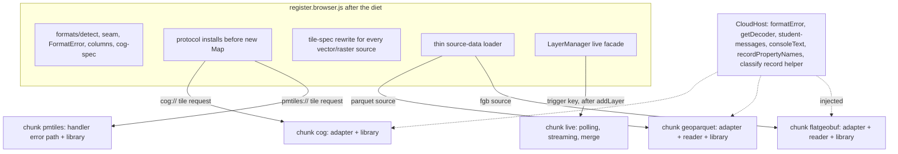

# Bundle Headroom - Plan

## Goal Capsule

- **Objective:** win back about 30 KB gzip of the `<ml-map>` main bundle with changes that do not alter how plain, story, classify, popup or cloud pages load (live-data pages fetch one new chunk after first paint), then lock the gain in the size gate.
- **Product authority:** maintainer decisions of 2026-10-28 (low-risk wins only; lock the gains; popups stay eager), the measured composition in `docs/plans/assets/2026-10-28-bundle-measurements.md`, and the 2026-10-18 lazy-loading plan (`docs/plans/2026-10-18-lazy-loading-plan.md`), whose larger units stay deferred.
- **Product Contract preservation:** clarified R4 (the loading UI is removed, not lazy-loaded), R5 (layer-manager tests that read the live managers go through the facade) and R8 (the allowance is capped at 4,096 B), plus the Summary and Problem Frame wording; no scope change. A stream-only fix proposed during planning was withdrawn: a stream without a `refresh:` block is a documented, validated rule (ml-aot.134), not a bug.
- **Execution profile:** branch `perf/bundle-headroom` off `main`, one commit per unit, one PR. Changeset: core patch (smaller bundle, no API change).
- **Stop conditions:** stop and ask if any existing test or browser spec needs its assertions changed for reasons other than where code lives or the live facade; if a cloud page would need a second request; or if the strip guard finds a `.describe()` argument it cannot remove.
- **Tail ownership:** the implementing session runs `pnpm presubmit` and `pnpm verify:browser`, drives the real pages, writes the changesets, updates the beads, opens the PR and babysits CI. The maintainer merges.
- **Open blockers:** none.

---

## Product Contract

### Summary

Four changes take about 30 KB gzip out of the main bundle: the browser build drops schema descriptions, the story stylesheet is minified, and the cloud-format adapters move into the reader chunks that already load on demand, and the live-data machinery moves into a new on-demand `live` chunk. The size gate is then reset to the smaller bundle with a small allowance, so later growth needs a visible raise.

### Problem Frame

The main bundle grew from 122.6 KB gzip in 0.8.1 to 197.8 KB at the end of 0.10's feature work, leaving 387 B under a ceiling the maintainer raised twice during the cycle. Half of real documents use no optional feature, yet every page pays for cloud-format adapters (17.6 KB), live-data polling, streaming and the loading UI (4.2 KB), and 538 schema descriptions nothing reads at runtime (8.7 KB). The large-data round 2 work lands next and needs room.

### Key Decisions

- **Low-risk only.** Each change keeps today's loading behaviour for plain maps, stories, classify documents and popups. The story, classify, messages-on-error and parse-stage chunks from the 2026-10-18 plan stay deferred.
- **Popups stay in the main bundle.** 16% of real documents use them and the CLI starter has one; a first hover right after load must not do nothing.
- **Lock the gains.** The baseline resets to the post-diet size, with an allowance set from that measurement and large data's refreshed estimate.
- **No extra fetch for cloud pages.** A cloud page still makes one request per format, as today.

### Requirements

**Smaller main bundle**

- R1. The browser builds carry no schema `.describe()` text; the npm build keeps it, so JSON Schema emission, the docs reference and map-party see no change.
- R2. The story element's stylesheet ships minified, with identical rendering.
- R3. The cloud-format adapters and protocol code leave the main bundle. A page loads them only when its document has a cloud source, in the same request as that format's reader.
- R4. Polling, streaming and merging leave the main bundle and load only for documents that refresh or stream; the loading UI is no longer constructed (`loading:` is already deprecated with no effect). A live source's first paint is unchanged; its first refresh may wait for the chunk.

**Behaviour preserved**

- R5. Every existing test, browser spec and real-page check passes unchanged, apart from tests that assert where code lives or that read the live managers through `LayerManager` fields (now the facade).
- R6. Cloud and live pages behave the same offline and on a failed chunk download as other lazy chunks do today: a clear notice, other layers unaffected, and `reload()` retries.
- R7. CDN, import-map, Vite and Astro consumers keep working; the Astro 4-7 dev runs stay green.

**Size gate**

- R8. The baseline resets to the measured post-diet size. The allowance is 4,096 B, lowered to large data's refreshed entry-growth estimate if that is smaller, and the PR records both numbers.
- R9. The plain-page saving is reported in the PR as a before/after table.

### Acceptance Examples

- AE1. **Covers R3.** Given a plain GeoJSON map page, when it loads, then no cloud adapter code is requested. A PMTiles page makes one PMTiles request, as today.
- AE2. **Covers R4.** Given a document with `refreshInterval`, when it loads, then the first data paints as today and the refresh starts once the live chunk arrives. A static document never requests it.
- AE3. **Covers R1.** Given the published JSON Schema and the docs reference, when built after this change, then every description is still present.

### Scope Boundaries

**Deferred for later**

- Story element, classify, messages-on-error and parse-stage chunks; lazy maplibre-gl; preload hints (ml-7qa.7).
- Per-chunk size budgets (ml-7qa.1).
- Popups and the small extras (legend, params, images, markers, 3D) as chunks.

### Dependencies and Assumptions

- The large-data plan (`docs/plans/2026-10-27-002-feat-large-data-round-2-plan.md`) treats the GeoParquet and PMTiles adapters as main-bundle code. After this work most of its additions land in lazy chunks, so that plan is refreshed before its work starts.
- The chunk seam only admits chunks that import no core code unless that code is handed in (the `update` chunk's pattern). Planning decides how the adapters and live code receive what they need.

### Sources

- Measured composition, census and levers: `docs/plans/assets/2026-10-28-bundle-measurements.md` (main at 525157b).
- `packages/core/src/formats/decoders.ts` (the chunk seam), `packages/core/tsup.config.ts`, `packages/core/size-baseline.json`, `packages/core/tests/bundle-size.test.ts`, `packages/core/tests/lazy-chunks.test.ts`.
- Live-data entry points: `packages/core/src/renderer/layer-manager.ts`; cloud adapters: `packages/core/src/formats/*`, `packages/core/src/renderer/cloud-*`.

---

## Planning Contract

### Key Technical Decisions

- KTD1. **Strip descriptions with a build plugin, guarded.** An esbuild `onLoad` plugin for `src/schemas/*.ts`, shaped like `geotiffBrowserOnly` in `packages/core/tsup.config.ts`, removes every `.describe(…)` call in the CDN build `register.browser` only, gated on `chunks` beside the seam plugin. `index.browser` is a published export for tooling pages and is not size-gated, so it keeps its descriptions. It counts `.describe(` occurrences per file and fails the build when any survive, so a future template-literal argument cannot slip through. The npm build and `index.browser` are untouched: the JSON Schema emitter, the docs reference generator, Astro collections and map-party read descriptions from source or npm. Nothing at runtime reads a zod description; `OPEN_SCHEMAS` identity is unaffected because no marked schema is described directly.
- KTD2. **Minify the story CSS at build time only.** A second `onLoad` plugin rewrites `SCROLLYTELLING_CSS` in `src/scrollytelling/styles.ts` to its minified form with `build.esbuild.transform` (no new dependency). Source, its tests (which assert the readable selector text) and `dist/scrollytelling.css` stay as they are.
- KTD3. **Cloud adapters ride inside their reader chunks.** Each existing seam entry becomes "adapter plus library": the FlatGeobuf and GeoParquet adapters and the cloud-source reader classes move into `formats/lib/flatgeobuf.ts` and `formats/lib/geoparquet.ts`; the COG adapter joins the `cog` chunk; the PMTiles handler's error path joins `pmtiles`. A cloud page still makes one request per format.
- KTD4. **What stays in the entry for cloud sources.** Format detection (`formats/detect.ts`), the seam and `FormatError`, `columns.ts` and `cog-spec.ts` (parse and story use them), the tile-spec rewrite every vector or raster source passes through (`withoutFormatKeys`, `toMapLibreTileSpec`), `absoluteUrl`, both protocol `install`s (they must register before `new Map()` and keep the host-wins check), and a thin source-data loader that decides the format and hands off to the chunk.
  - **COG helpers the entry calls stay too:** `fileUrlOf`, `cogHint`/`cogHintFor` with their single `hints` map (the chunk's handlers receive `recordHint` as a callback), and `readCogHeaderAhead`, which routes through `getDecoder("cog")`.
  - **Public decoders stay as thin wrappers:** `decodeFlatGeobuf` and `decodeGeoParquet` (exported from `packages/core/src/index.ts`, used by the CLI) become async wrappers over `getDecoder`. No entry or index module imports a `formats/lib/*` module.
  - **Downloads still overlap:** the thin loader starts the file request (`openWhole`, header range reads) alongside `getDecoder` and hands the opened response to the chunk, as today's prefetch does.
  - `BodyTooLarge` and `WholeFileTooLarge` are checked with `instanceof`, so their single class definitions stay in the entry and reach the chunk through the host.
- KTD5. **Core code reaches the chunks through a host object.** The adapters use student-messages builders (`describeFormatFailure`, the large-data links and commands), `consoleText`, `recordPropertyNames` and the classify record helper. They receive them through a `CloudHost`, as the `update` chunk receives `UpdateHost`, so chunk sources import core as types only. The host also carries a `formatError(failure)` factory (the `FormatError` constructor calls `describeFormatFailure`, which would otherwise pull the whole message catalogue into each chunk) and `getDecoder` (the GeoParquet adapter loads `geoparquet-brotli` from inside its chunk; a bundled copy of the seam would resolve that to `chunks/chunks/`). Chunk code never value-imports `formats/errors.ts`; the duck-typed `isFormatError` and `isAbortError` may be copied. An adapter's calls for its own library become direct imports inside its `lib/<format>.ts`.
- KTD6. **Live data is a `live` chunk started after the first load.** `PollingManager`, `StreamManager` (SSE, WebSocket, base connection) and `DataMerger` move behind a `live` seam entry; they import only the leaf modules `retry-manager` and `utils/event-emitter`, which the CDN chunk duplicates (about 1.1 KB raw). `LayerManager` holds them behind a null-safe facade: the sync stop, pause, resume, has and destroy calls are no-ops until a pipeline started. The chunk is prefetched only when a source would start a pipeline (the same predicates `setupDataUpdates` uses: a `refresh` interval with a `url`, or a `stream` beside a `refresh` block) and awaited inside the already-async `setupDataUpdates`, after `addLayer`.
  - **Intent during the wait is kept.** `LayerManager` gains destroyed and paused flags. After awaiting the live or a cloud chunk, it returns without starting when the manager was destroyed or the source was removed or replaced, and it starts paused when `pause()` ran in the meantime.
  - **npm keeps the exports.** `packages/core/src/index.ts` still exports the managers, so in the npm build their code stays reachable from `dist/index.js`; the npm marker check skips `live` for that closure only.
- KTD7. **The loading manager leaves without a chunk.** `loading:` is deprecated with no effect, and `LayerManager` only hides and destroys a manager whose UI is off. `LayerManager` stops constructing it; the class stays exported from the npm API.
- KTD8. **A failed live or cloud chunk behaves like today's reader failures.** A cloud source shows the existing "reader couldn't be downloaded" notice. A live source keeps its first data and shows one notice that updates stopped (its own text, caught before the generic reader-failure label, which has no live entry); `reload()` retries through `getDecoder`'s `?retry=` path.
- KTD9. **Lock the gain.** `size-baseline.json` re-records `baselineGzip` and `recordedAt` at the post-diet commit. The allowance defaults to 4,096 B and is lowered if U6's re-estimate of large data's remaining entry growth is smaller. The bundle-size failure message is reworded to name the seam generally, not the update chunk.

### High-Level Technical Design

| Change | Saving (gzip, plain page) | Where |
|---|---:|---|
| `.describe()` strip | about 8.7 KB | build plugin in `packages/core/tsup.config.ts` |
| Story CSS minify | about 1.3 KB | build plugin |
| Cloud adapters into reader chunks | up to 17.6 KB (less what KTD4 keeps) | `packages/core/src/formats/`, `packages/core/src/renderer/cloud-*` |
| Live data chunk + loading manager removal | about 4.2 KB (including the 0.9 KB loading UI) | `packages/core/src/renderer/layer-manager.ts`, `packages/core/src/data/` |

### System-Wide Impact

- **Consumers:** no API or document behaviour changes. CDN, import-map, Vite and Astro consumers already resolve seam chunks; the existing chunks just carry more code, plus one new `live` chunk.
- **Bundles:** `register.browser.js` loses descriptions; `index.browser.js` and npm `dist/index.js` keep them. The npm public API keeps exporting the live managers and the decode functions.
- **Tests:** unit tests that construct `PollingManager`/`StreamManager` directly keep working; layer-manager tests that read those fields go through the facade.

### Risks & Dependencies

| Risk | Mitigation |
|---|---|
| A stripped `.describe()` changes zod behaviour | A corpus-equivalence test parses every parity fixture with stripped and unstripped schemas and asserts identical results |
| Streaming has no browser coverage today | U3 adds an SSE page and spec before any streaming code moves (characterization first) |
| Cloud adapters miss a core helper inside the chunk | The types-only import test per chunk; the cloud-native and large-data browser specs pass unchanged |
| Astro dev re-optimization when chunk contents change | CI's Astro 4-7 dev legs |
| The large-data plan's entry assumptions go stale | U6 adds a note to that plan; it is refreshed after this merges |
| A nested chunk load resolves to the wrong path | U5 asserts no `chunks/*.js` contains a `./chunks/` dynamic import |
| The strip transform is needed in a vitest test | The transform lives in a small shared module both `tsup.config.ts` and the test import |

### Deferred to Implementation

- Exact `CloudHost` members once each adapter's imports are traced.
- Whether `cloud-sources.ts` splits into an entry half and a chunk half, or moves whole with a thin entry wrapper.
- The live-update failure notice wording (student-messages voice).

---

## Implementation Units

### U1. Strip schema descriptions from the browser builds

- **Goal:** both browser bundles carry no `.describe()` text, with identical validation.
- **Requirements:** R1, R5; AE3; KTD1.
- **Dependencies:** none.
- **Files:** `packages/core/scripts/strip-describe.ts` (new: the transform, shared by the build and the test); `packages/core/tsup.config.ts` (plugin in `browserBuild`, gated on `chunks`); `packages/core/tests/build/strip-describe.test.ts` (new: corpus equivalence, guard count); `packages/core/tests/lazy-chunks.test.ts` or `packages/core/tests/bundle-size.test.ts` (a dist assertion that no description string survives in `register.browser.js`).
- **Approach:** reuse the measurement replica's regex (`docs/plans/assets/2026-10-28-bundle-measurements.md`), applied per file with a count check that throws on a mismatch.
- **Patterns to follow:** `geotiffBrowserOnly` in `packages/core/tsup.config.ts`.
- **Test scenarios:**
  - **Covers AE3:** the emitted `packages/core/schemas/map.schema.json` and the docs reference still contain descriptions.
  - Every parity fixture (`packages/core/tests/fixtures/parity/index.ts` and the error corpus) parses to identical success, data, errors and warnings with stripped and unstripped schemas.
  - The guard throws for a synthetic schema file whose `.describe()` takes a template literal with `${}`.
  - `register.browser.js` contains no sample description sentence (e.g. a known phrase from `map.schema.ts`), while `index.browser.js` and `dist/index.js` still do.
- **Verification:** the entry shrinks by about 8.7 KB gzip; core tests and the browser suite pass.

### U2. Minify the story stylesheet in the browser builds

- **Goal:** the story CSS ships minified with identical rendering.
- **Requirements:** R2, R5; KTD2.
- **Dependencies:** U1 (same plugin list).
- **Files:** `packages/core/tsup.config.ts`; a dist assertion in `packages/core/tests/lazy-chunks.test.ts` or a new `packages/core/tests/build/story-css.test.ts`.
- **Test scenarios:**
  - `register.browser.js` contains the minified selector `ml-scrollytelling>script[type="application/toml"]` and none of the source CSS comments.
  - `dist/scrollytelling.css` is unchanged.
  - `e2e/scrollytelling.spec.ts` (computed-style checks) passes unchanged.
- **Verification:** about 1.3 KB gzip off the entry; story pages render identically.

### U3. Streaming characterization

- **Goal:** streaming gets browser coverage before its code moves.
- **Requirements:** R5 (baseline for U4).
- **Dependencies:** none.
- **Files:** `e2e/server.mjs` (an SSE endpoint emitting GeoJSON updates); `examples/verification/stream-sse.html` (new); `e2e/stream.spec.ts` (new).
- **Execution note:** characterization: the spec passes against today's code before U4 changes anything.
- **Test scenarios:**
  - An SSE source with a `refresh` block receives three events and the layer's features update each time.
  - The stream reconnects after the server drops the connection once.
  - A source with `stream:` and no `refresh` block stays unconnected and validation shows its warning (today's documented rule, ml-aot.134).
  - Polling plus merge (`examples/verification/24-merge-top-level-id.html`) still passes.
- **Verification:** the new spec passes on today's code.

### U4. Live data as a chunk; loading manager removed

- **Goal:** plain and static pages carry no polling, streaming or merge code.
- **Requirements:** R4, R5, R6; AE2; KTD6, KTD7, KTD8.
- **Dependencies:** U3.
- **Files:** `packages/core/src/data/live/index.ts` (new seam entry re-exporting the managers); `packages/core/src/formats/decoders.ts` (`live` line); `packages/core/src/renderer/layer-manager.ts` (facade, prefetch, await in `setupDataUpdates`, failure notice; no `LoadingManager`); `packages/core/src/components/student-messages.ts` (the live-update failure notice); `packages/core/tests/lazy-chunks.test.ts` (seam name, markers, a types-only check allowing `retry-manager` and `utils/event-emitter`, and the npm closure exception for `dist/index.js`); `packages/core/tests/renderer/layer-manager.test.ts`; `e2e/lazy-chunks.spec.ts` (plain page requests no `chunks/live.js`; blocked live chunk).
- **Test scenarios:**
  - **Covers AE2:** a `refreshInterval` document paints its first data, then refreshes once the live chunk arrives; a static document never requests it.
  - Pause, resume and destroy on a static map are no-ops and throw nothing.
  - `destroy()` while the live chunk downloads: nothing starts when it arrives. `pause()` during the wait: polling starts paused.
  - A source with only legacy `updateStrategy`, or a `refresh` block with no interval, never requests `chunks/live.js`.
  - A document update that adds `refresh` to a static source starts polling (the re-target path); one that removes it stops.
  - With `chunks/live.js` blocked, the first data still shows, one notice says updates stopped, and `reload()` retries and starts polling.
  - The SSE spec from U3 and the merge spec pass unchanged.
- **Verification:** about 4.2 KB gzip off the entry; live specs pass.

### U5. Cloud adapters inside their reader chunks

- **Goal:** plain pages carry no cloud adapter code; cloud pages still make one request per format.
- **Requirements:** R3, R5, R6, R7; AE1; KTD3, KTD4, KTD5, KTD8.
- **Dependencies:** U4 (both touch `layer-manager.ts`).
- **Files:** `packages/core/src/formats/lib/flatgeobuf.ts`, `lib/geoparquet.ts`, `lib/cog.ts`, `lib/pmtiles.ts` (adapters join); `packages/core/src/formats/flatgeobuf.ts`, `geoparquet.ts`, `cog.ts`, `cog-protocol.ts`, `pmtiles.ts`, `crs.ts`, `http.ts` (move or split); `packages/core/src/renderer/cloud-sources.ts` (thin entry loader; reader classes move); `packages/core/src/renderer/cloud-host.ts` (new: the `CloudHost`); `packages/core/src/index.ts` (thin async `decodeFlatGeobuf`/`decodeGeoParquet`); `packages/core/src/components/ml-map.ts` (COG helpers stay entry-side); `packages/core/src/renderer/layer-manager.ts` (async starts take the chunk's readers); `packages/core/tests/lazy-chunks.test.ts`; `e2e/lazy-chunks.spec.ts`.
- **Approach:** move one format at a time (FlatGeobuf, GeoParquet, COG, PMTiles), running that format's browser spec after each.
- **Patterns to follow:** `UpdateHost` in `packages/core/src/renderer/update/types.ts` and its construction in `map-renderer.ts`.
- **Test scenarios:**
  - **Covers AE1:** a plain GeoJSON page requests no `chunks/` file; a PMTiles page requests `chunks/pmtiles.js` once and nothing else from `chunks/`.
  - `e2e/cloud-native*.spec.ts`, `large-data.spec.ts`, `large-files.spec.ts` and `protomaps-basemap.spec.ts` pass unchanged, including whole-file limits, view reads and their student messages.
  - The host-protocol page (a host that registered `pmtiles://` first) keeps the host's handler.
  - With `chunks/flatgeobuf.js` blocked, the existing notice text appears and other layers draw.
  - Each changed chunk's sources import core as types only, and no adapter marker appears in `register.browser.js` or the npm entries.
  - No `chunks/*.js` contains a `./chunks/` dynamic import; a brotli-compressed GeoParquet footer still loads its decoder.
  - A FlatGeobuf `fitTo` page starts the file request before the chunk finishes (network order recorded in the spec).
  - With a reader chunk blocked, `reload()` retries and the layer draws.
  - `destroy()` while a reader chunk downloads starts no loader.
  - The CLI's `decodeFlatGeobuf`/`decodeGeoParquet` use still passes its tests.
- **Verification:** the cloud share of the entry drops to what KTD4 keeps; all cloud specs pass.

### U6. Lock the gain, record it, ship

- **Goal:** the size gate holds the new size, and the PR shows the before and after.
- **Requirements:** R8, R9; KTD9.
- **Dependencies:** U1-U5.
- **Files:** `packages/core/size-baseline.json`; `packages/core/tests/bundle-size.test.ts` (generic failure message); `docs/plans/assets/2026-10-28-bundle-measurements.md` (an "after" section); `docs/plans/2026-10-27-002-feat-large-data-round-2-plan.md` (a note that its adapters now land in lazy chunks and its entry estimates need refreshing); `.changeset/bundle-headroom.md`.
- **Approach:** re-measure the entry and every chunk; re-estimate large data's remaining entry-side growth from its plan's entry list now that its adapters live in chunks; set the allowance from that (4,096 B by default).
- **Test scenarios:**
  - The bundle-size test passes at the new baseline and fails when 5 KB of incompressible content (random base64) is added to the entry (checked once, then reverted).
- **Verification:** the PR body carries the before/after table for the entry and each chunk.

---

## Verification Contract

| Gate | Command | Applies to | Done signal |
|---|---|---|---|
| Presubmit | `pnpm presubmit` (box lane) | every unit | exit 0, checked directly |
| Browser suite | `pnpm verify:browser` | U1-U5 | all specs green, including the new stream spec |
| Bundle and chunks | core build, then `tests/bundle-size.test.ts` and `tests/lazy-chunks.test.ts` | U1-U6 | entry within the new budget; markers only in their chunks |
| CI matrix | the PR's CI (Node 18/20/22, maplibre 4/5/6, Astro 4-7) | U6 | green |
| Real pages | a plain map, a story, a PMTiles, a FlatGeobuf, a GeoParquet, a COG and a polling page on the built docs and verification pages, desktop and phone | U6 | identical behaviour, request lists recorded in the PR |

## Definition of Done

- R1-R8 and AE1-AE3 have passing tests; R9's table is in the PR body; the new streaming spec passes.
- The entry is about 30 KB gzip smaller, the baseline is re-recorded, and the PR shows the numbers.
- `pnpm presubmit`, `pnpm verify:browser` and CI pass; beads ml-7qa.2 closes and ml-7qa.5 records what remains.
- The large-data plan carries a note that its entry assumptions changed.
- No dead-end code remains.

