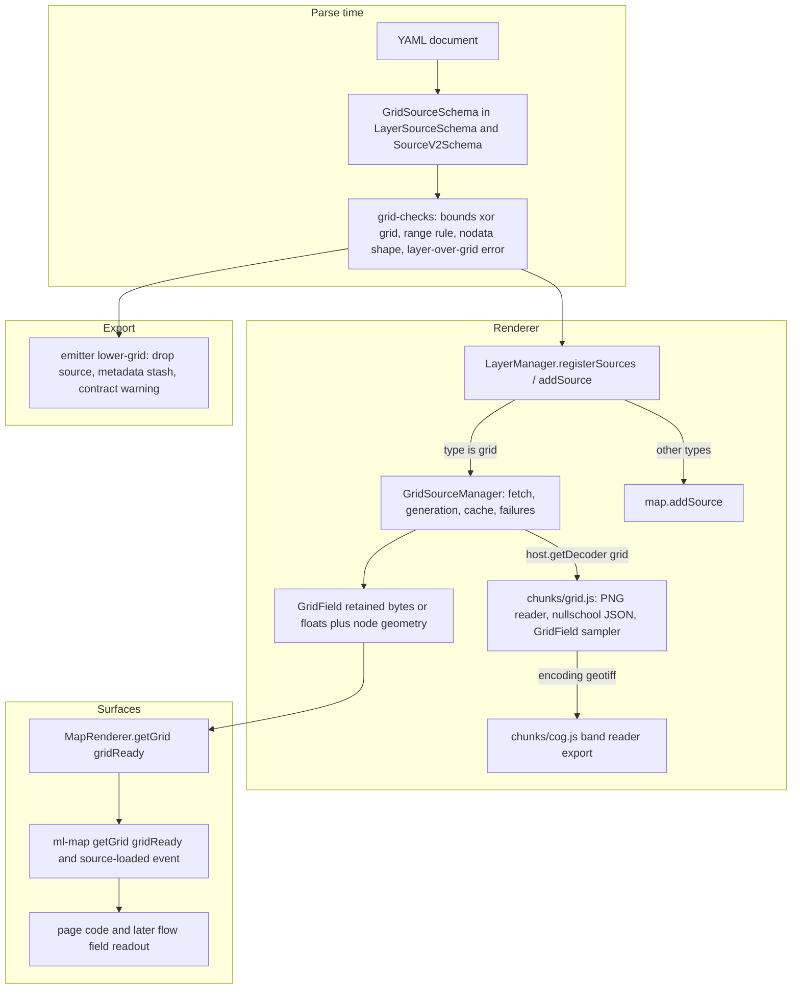

# Grid Source - Plan

## Goal Capsule

- **Objective:** add a `grid` source kind to `@maplibre-yaml/core`: a sampleable regular raster field on a lat/lon grid, declared in YAML, decoded once, readable from page code through `getGrid(id).sample(lngLat)`. No layer draws it in this release.
- **Authority:** this plan, then the origin brainstorm (section 5 R2, section 6 decisions, section 8 findings), then repo conventions in `CLAUDE.md` and `CONTRIBUTING.md`. Where they disagree, this plan wins and the disagreement is recorded here.
- **Constraints carried from the maintainer:** extend MapLibre without unnecessary divergence. Reuse MapLibre key names and orders (`bounds` as `[west, south, east, north]`, `encoding` for pixel packing, `metadata` as the carrier in emitted styles). Build the general capability, not the example: every key, type name, event and message must make sense for any regular raster field (elevation, density, temperature, any vector field), nothing in the public surface may refer to weather or to the null.earth page, and the spike page is one demonstration of the capability rather than its specification.
- **Stop conditions:** stop and ask if the lazy-chunk or bundle-size gates cannot be met without restructuring the formats seam, if a change to `SOURCE_RUNTIME_KEYS` or the v2 envelope contract becomes necessary, or if GeoTIFF band reading cannot share the COG chunk's decoder.
- **Execution profile:** units in dependency order, each landing as one commit with its tests; `pnpm presubmit` green before the unit is called done; a changeset lands with U7.
- **Tail ownership:** the maintainer merges; the PR body carries a "Verify with these examples" section naming the verification pages and emit commands.

---

## Product Contract

### Summary

A `grid` source is treated as its own kind end to end: a closed schema in the v1 and v2 source unions, a parse-time check module for the cross-field rules, a renderer branch that never reaches MapLibre's `addSource`, decode and sampling in a lazy chunk inside the bundle budget, an atomic field swap on a live URL change, `getGrid(id)` on the renderer and `<ml-map>` plus a `source-loaded` event, a Node-testable decoder verified against the committed fixtures, and the spike page repointed at the core API as the browser regression test.

### Problem Frame

Documents can declare vector and raster data MapLibre knows how to draw, but nothing that page code can read as numbers. The null.earth spike (origin section 8) had to decode its PNG frames on a canvas and interpolate by hand to show a value under the pointer, and the follow-on layers (particles, colorized fields, a readout control) all need the same decoded field. Gridded scalar and vector data are common well beyond weather: elevation, sea surface temperature, population density, air quality, any regular raster someone wants to query rather than only look at. MapLibre has no source type for this, so the library needs one that stays as close to MapLibre's conventions as the data allows.

### Requirements

**Declaration**

- R1. A source may be declared with `type: grid` in a v1 document's `sources:` or an inline layer-level source, and in a v2 document's `style.sources`.
- R2. The source carries `url`, `encoding` (one of `rg-uv`, `scalar-r`, `nullschool-json`, `geotiff`), and for the image encodings either `bounds` as `[west, south, east, north]` cell edges or `grid` as node geometry `{ nx, ny, lo1, la1, dx, dy }`, never both; `nullschool-json` and `geotiff` carry their own geometry and reject `bounds` and `grid`.
- R3. Byte encodings (`rg-uv`, `scalar-r`) require `range: [lo, hi]`, the physical values bytes 0 and 255 map to; `nullschool-json` and `geotiff` carry physical values and reject `range`.
- R4. Optional keys: `units` (free string, documented canonical vocabulary), `nodata` (`{ channel, below | above | equals }` for byte encodings, a number for `geotiff`), `attribution`, `bands` (`[u, v]` or `[value]` indices for `geotiff`), and the existing runtime keys `cache` and `loading`.
- R5. The grid schema is closed: unknown keys and misspelt enum values produce the parser's did-you-mean messages, not silence; `format:` on a grid is an error that points at `encoding:`.
- R6. A layer whose `source` names a grid is a parse error in this release, worded to say that no layer type draws a grid yet and how page code reads it.

**Decoding and sampling**

- R7. The renderer fetches and decodes a grid once, into retained bytes or floats plus geometry, without calling MapLibre's `addSource`; decode runs on demand from a lazy chunk so pages without grids pay nothing.
- R8. `sample(lngLat)` interpolates bilinearly over the four surrounding nodes, wraps in longitude when the grid spans the globe, clamps latitude to the first and last row, and returns `null` outside a non-wrapping grid or when any contributing node is missing.
- R9. A scalar grid samples to a number; a vector grid samples to `{ u, v, speed }`; the field exposes `kind`, `units`, `bounds`, `wraps`, and its node geometry.
- R10. Missing data is the union of the declared `nodata` rule and the encoding's own marker: alpha 0 for images, `null` entries for `nullschool-json`, and the `GDAL_NODATA` tag or declared value for `geotiff`; a node that any rule marks missing is missing.
- R11. PNG input is decoded value-exactly (no color management, no premultiplication) for 8-bit grayscale, RGB and RGBA, non-interlaced; `rg-uv` requires at least two channels and `scalar-r` reads the first; other PNG shapes and non-PNG images fail with a message that names the limitation.
- R12. GeoTIFF input is read through the same decoder the COG reader uses, from one shared chunk; EPSG:4326 only, bounds from the file's georeferencing.
- R13. Size guards: the whole-file byte cap the cloud readers already apply, plus a cap of 16 million cells read from the image or file header before any decoding, both reported through the per-source notice with wording written for a grid (bytes or cells over the cap, use a coarser grid or a smaller extent), never the cloud readers' by-view or conversion advice.

**Lifecycle and API**

- R14. `MapRenderer.getGrid(id)` and `MLMap.getGrid(id)` return the field once decoded and `undefined` before; `gridReady(id)` resolves with the field, rejects with an error naming the id when the applied document has no grid source of that id, rejects with the source's failure when its load fails (a later `reload()` gives new callers a fresh promise), and rejects when the source is removed or the renderer destroyed; `<ml-scrollytelling>` forwards both.
- R15. `<ml-map>` emits `ml-map:source-loaded` with `{ sourceId }` when a grid is decoded and routes failures through the existing per-source error notice; `mapReady()` does not wait for grids.
- R16. A live document update that changes a grid's `url` fetches the new file and swaps the field atomically, keeping the old field readable until the new one is decoded; a change to `range` or `units` produces a new field from the retained bytes without a fetch; a change to `encoding`, `bounds` or `grid` re-decodes; every swap emits `source-loaded` again, and a field object page code already holds is never mutated.
- R17. `reload()` after a failed grid fetch retries it; removing the source or destroying the renderer cancels in-flight work and drops the field.

**Export and tooling**

- R18. `mlym emit` drops a grid source from `style.sources`, preserves its declaration under `metadata["maplibre-yaml:grid-sources"]`, and reports an ordinary contract warning, so `--strict` passes.
- R19. `mlym validate` attaches no warning to a well-formed grid source; the layer-over-grid case from R6 is an error.
- R20. The documentation site gets a guide that leads with the general case, a row in the source-type table, an entry in the export-classes table, and a generated reference entry; every YAML fence validates.

### Acceptance Examples

- AE1. **Covers R2, R8.** Given the committed 1° wind frame declared with `grid: { nx: 360, ny: 181, lo1: -180, la1: 90, dx: 1, dy: 1 }`, when page code samples `{ lng: 179.9, lat: 0 }` and `{ lng: -179.9, lat: 0 }`, then the two speeds differ by less than the step between adjacent nodes, because the grid wraps.
- AE2. **Covers R3, R8, R9.** Given the committed 2 m temperature frame with `range: [193, 328]`, when sampled over the Sahara and the Antarctic plateau in November, then the first value exceeds 280 K, the second is below 265 K, and both are numbers rather than objects.
- AE3. **Covers R6.** Given a `fill` layer whose `source` is a grid, when the document is parsed, then validation fails at that layer's `source` line with a message naming the grid and the page-code alternative.
- AE4. **Covers R16.** Given a loaded page, when the document is updated with the next forecast hour's URL, then `getGrid('wind')` keeps answering with the old field until `ml-map:source-loaded` fires again, after which the sampled value at a fixed point changes.
- AE5. **Covers R18.** Given a document with one grid source and no layers over it, when it is emitted with `--strict`, then emit succeeds, `style.sources` lacks the grid, and `metadata["maplibre-yaml:grid-sources"]` carries its declaration.
- AE6. **Covers R11.** Given a 16-bit PNG, when the grid loads, then the per-source notice says 8-bit PNG is required and names the file's bit depth.

### Scope Boundaries

- The `flow` and `field` layers that draw a grid (R3 of the epic), time stepping and playback (R4), and the readout control with unit conversion (R5) are separate plans. This plan only has to leave them a field they can consume: retained values, geometry, `wraps`, and `nodata` resolved.
- No worker. Decoding a 1440 by 721 PNG on the main thread is within budget; a worker is new build infrastructure and waits for a measured need.
- JPEG input, 16-bit PNG, interlaced PNG, and GeoTIFFs in other projections are out. Each fails with a clear message.
- The v2 envelope keeps `style.sources` as the home for grid sources with `type: grid`; no new `runtime.grids` record. The exception to "everything under `style` erases to style.json" is documented, and emit carries the declaration in `metadata`.
- No `units` enumeration yet. R5 will introduce canonical names when it adds conversion; this plan documents the recommended spellings.

#### Deferred to Follow-Up Work

- `fitTo` on a grid source (its bounds are known, so it is cheap) once `fitTo`'s source enumeration is next touched.
- Attribution from a grid reaching the attribution control, when the first layer draws one.
- A pure-JS JPEG path, or 16-bit PNG, if a real dataset needs it.
- Bead ml-nb1.6 keeps the converter work: rename its `scalar-r` and `rg-uv` output to match the schema vocabulary (already matching), document the `grid:` geometry form in its manifest, and a 0.25° variant.

---

## Planning Contract

### Key Technical Decisions

- **The grid is its own source kind, not a format on an existing type.** The cloud-native readers key on file format over a MapLibre type and end in `addSource`; a grid never reaches MapLibre. Treating it as a kind keeps format sniffing (`formatOfSource`, `prepareProtocols`) away from it, gives the differ a clean `grid` identity, and avoids the "grid is a file format, not a source type" message the format machinery would otherwise emit. Rejected: `type: raster` plus `format: grid`, which would route `.tif` URLs into the COG protocol and make the schema lie about what MapLibre receives.
- **Closed schema with did-you-mean, no passthrough.** Every existing source schema is open because MapLibre accepts unlisted keys; a grid is not read by MapLibre, so an open schema would swallow `encodng:`. "Closed" means zod's default strip object, not registered as open and not `.strict()`: the unknown-key walker only descends into a union member whose parse succeeds, so a strict object would turn a typo into a wrong-type complaint instead of the suggestion. Cross-field rules live in a parser check module modelled on `cog-checks.ts`, because the source union is at the TypeScript instantiation-depth limit and cannot take another chained refinement.
- **MapLibre's conventions wherever a key exists.** `bounds` is `[west, south, east, north]` as on raster sources; `encoding` is the key name MapLibre already uses for pixel packing on `raster-dem`; `attribution`, `cache` and `loading` behave as on other sources; emitted styles carry the declaration under `metadata`, the slot the style spec reserves for exactly this. The origin brainstorm's example used the image-library corner order and is corrected in this plan.
- **Two geometry forms, one internal representation.** `bounds` names cell edges and reads like every other MapLibre bounds; `grid` names nodes and matches the nullschool header, the GRIB convention, and the Deltares velocity-chunk input that R3 will reuse. Both normalize to node geometry internally; a `bounds` form that overshoots ±90° by at most one cell is accepted, since node-centred global grids produce exactly that.
- **Decoder, sampler and the source manager's body in a lazy chunk; the main bundle gains the schema member, the type entry and thin hooks.** The main bundle is measured at 177,355 bytes gzip against a budget of 177,802, so 447 bytes remain, not the 3 KB the allowance suggests. Everything that can sit behind the seam does: the decoders, the sampler, the manager's fetch-cache-decode body and the check module's message text are reached through the host the way the update engine is; the main bundle keeps the schema, `SOURCE_TYPES`, the differ's kind, and the branches that call into the chunk. U1 records the measured remainder and the maintainer sets a new baseline in `size-baseline.json` for it before U1 lands; the gate stays honest because the new baseline names what it paid for. The chunk imports core as types only, the same contract the cloud readers follow, so the no-shared-chunk gate holds.
- **PNG decoded by a small pure-JS reader over fflate, not a canvas.** Canvas readback un-premultiplies alpha and applies color management when a file carries gamma or ICC chunks, which corrupts values silently on files from GDAL or image editors; a direct inflate-and-unfilter path is value-exact and runs identically in Node, so unit tests exercise the real decoder against the committed fixtures with pngjs as an oracle. fflate is already a core devDependency; the main bundle does not carry it today, so the grid chunk bundles its own copy, which the gates allow, and Node tests resolve fflate's Node build while the npm build aliases its browser build, so the inflate path is exercised in both. Scope is 8-bit non-interlaced grayscale, RGB and RGBA.
- **GeoTIFF shares the COG chunk's decoder.** The COG chunk already bundles geotiff.js, but only as the protocol plugin's transitive dependency, so core cannot import it today. geotiff becomes a core devDependency pinned to the version the plugin resolves (3.0.5), the lazy-chunk test's COG allowlist gains it, and the COG chunk entry exports a band reader returning typed arrays plus georeferencing and nodata; the grid chunk obtains that reader through the host's decoder seam. One copy of geotiff.js, no new runtime dependency, and the COG protocol itself is unchanged. A GeoTIFF grid costs two chunk requests on first use (grid, then COG), which is the price of not duplicating the decoder. If the maintainer later prefers core not to depend on geotiff directly, the band reader becomes its own seam entry reached the same way.
- **Retain the decoded representation that makes rescaling free.** Byte encodings keep their decoded channel bytes and unscale on sample; a `range` change under live documents rescales without a refetch; R3 can materialize Float32 u and v from the same bytes on demand.
- **Emit drops the source with a contract warning, not a lossy one.** Nothing visible is lost in a release where no layer can draw a grid, so `--strict` builds of documents that declare one must pass. The declaration is preserved under `metadata["maplibre-yaml:grid-sources"]` so a renderer-side consumer can recover it. When R3 adds layers, a grid-backed layer becomes lossy, mirroring effects.
- **Readiness is separate from `mapReady()`.** A large frame must not delay first interaction with the map. `getGrid` returns `undefined` until decode completes, `gridReady(id)` resolves with the field, and `ml-map:source-loaded` announces it.
- **Failures reuse the format-failure vocabulary, with grid wording where the cloud readers' advice would mislead.** `FormatFailure.format` widens to include `grid` and gains an optional `cells` fact; the codes for HTTP errors, wrong bytes, missing chunks and read errors apply unchanged, so the `base` hint on a 404 comes for free. The `too-large` and `cors` messages get a grid branch: no by-view loading, no conversion commands, no Range-header clause, since a grid is fetched whole.

### High-Level Technical Design



Sampling, as the chunk implements it. Node geometry is `(lo1, la1)` for node `(0, 0)`, `dx` east, `dy` south, `nx` columns, `ny` rows; `wraps` is true when `nx * dx` is within half a cell of 360°, or when the grid carries a duplicated last column spanning `360 + dx`.

```text
sample(lng, lat):
  fx = (lng - lo1) / dx          -- fractional column
  if wraps: fx = fx mod nx       -- else: null when fx < 0 or fx > nx - 1
  fy = clamp((la1 - lat) / dy, 0, ny - 1)
  x0, y0 = floor(fx), floor(fy); x1 = wraps ? (x0 + 1) mod nx : min(x0 + 1, nx - 1); y1 = min(y0 + 1, ny - 1)
  if any of the four nodes is missing: null
  bilinear blend of the four node values, then unscale by range for byte encodings
```

Live update sequencing for a URL change: the differ classifies the source as kind `grid` with `url` settable; the manager starts a new generation, keeps the current field until the new one decodes, swaps, then emits `source:loaded`; a failure keeps the old field and reports the source error with the failed URL.

### Assumptions

- The committed fixtures under `examples/verification/null-earth/data` stay as they are; their `manifest.json` gains nothing this plan depends on, since the YAML declares geometry directly.
- The CDN build's chunk rewriting handles a new `LOADERS` entry the same way as the existing ten; the lazy-chunk test's seam list and library markers gain a `grid` entry whose markers appear only in the chunk.

### Sequencing

U1 first (schema and checks are the contract everything else types against), U2 after U1, U3 after U1 and U2 (its decode path calls the chunk U2 ships), U4 after U3, U5 after U1 and may run alongside U2 and U3, U6 after U2 through U4, U7 last.

---

## Implementation Units

### U1. Grid source schema and parse-time checks

- **Goal:** `type: grid` validates in v1 and v2 documents with closed keys, did-you-mean on keys and enum values, and the cross-field rules enforced at parse time.
- **Requirements:** R1, R2, R3, R4, R5, R6, AE3
- **Dependencies:** none
- **Files:** `packages/core/src/schemas/source.schema.ts` (new `GridSourceSchema`, added to `LayerSourceSchema`, not marked open), `packages/core/src/schemas/map-v2.schema.ts` (`SourceV2Schema` member), `packages/core/src/parser/validation-utils.ts` (`SOURCE_TYPES`), `packages/core/src/parser/grid-checks.ts` (new), `packages/core/src/parser/yaml-parser.ts` (merge in `withFormatChecks`), `packages/core/src/parser/format-checks.ts` (skip grid in format rules), `packages/core/src/formats/detect.ts` (`formatOfSource` returns none for grid), `packages/core/src/types/index.ts`, `packages/core/schemas/*.json` snapshots, tests `packages/core/tests/schemas/grid.schema.test.ts`, `packages/core/tests/parser/grid-checks.test.ts`.
- **Approach:** a default strip `z.object` (not `.strict()`, not registered as open) with `.describe()` on every field and a JSDoc `@example` that validates as a `sources:` fragment. Measure the main-bundle growth this unit adds and record the new baseline with the maintainer before landing. Keep the schema shallow; put `bounds` xor `grid`, the `range` rule per encoding, `nodata` shape per encoding, `bands` only with `geotiff`, `format` rejection, bounds order (`south < north`, else the existing did-you-mean for swapped order), the one-cell overshoot tolerance, and the layer-over-grid error in `grid-checks.ts`, following `cog-checks.ts` for how a specific message replaces the generic one by path. Update the JSON-schema snapshot through the test runner's update flag, not by hand.
- **Patterns to follow:** `packages/core/src/parser/cog-checks.ts`, `packages/core/src/parser/document-checks.ts` for the bounds-order hint, `packages/core/src/utils/suggest.ts` for enum suggestions.
- **Test scenarios:**
  - Happy path: minimal `rg-uv` with `bounds` and `range`; `scalar-r` with `grid` geometry; `nullschool-json` with neither geometry nor range; `geotiff` with `bands: [0, 1]`; the same four under v2 `style.sources`.
  - Edge cases: `bounds` north overshooting 90 by half a cell accepted; overshoot by two cells rejected; `grid` with `dy` positive normalized or rejected per the documented sign convention; `bands: [0]` on `rg-uv` rejected; `bounds` on `nullschool-json` or `geotiff` rejected as redundant with the file's own geometry.
  - Error paths: `encodng:` key suggests `encoding`; `encoding: rg_uv` suggests `rg-uv`; `type: gird` suggests `grid` through the source-type message; `range` missing on `scalar-r`; `range` present on `nullschool-json`; `range: [40, -40]` reversed; `bounds` and `grid` both present; `format: cog` on a grid points at `encoding`.
  - Integration: `Covers AE3.` a `fill` layer over a grid source fails at the layer's `source` path with the documented wording; `mlym validate` on that document exits non-zero, and on a grid-only document exits zero with no warnings.
- **Verification:** the schema tests and check tests pass; the JSON-schema snapshot, description and JSDoc-example tests pass; `pnpm docs:validate-snippets` still passes.

### U2. Grid decoder chunk and sampler, with the shared GeoTIFF band reader

- **Goal:** a lazy `grid` chunk that turns bytes into a `GridField` for every supported encoding and samples it correctly, plus the COG chunk's new band-reader export.
- **Requirements:** R7, R8, R9, R10, R11, R12, AE1, AE2, AE6
- **Dependencies:** U1 (types only)
- **Files:** `packages/core/src/formats/lib/grid.ts` (new: PNG reader, nullschool JSON reader, geometry normalization, `GridField`, the manager body behind the host), `packages/core/src/formats/lib/png.ts` (new: inflate via fflate, unfilter, 8-bit gray/RGB/RGBA), `packages/core/src/formats/lib/cog-reader.ts` and `packages/core/src/formats/lib/cog.ts` (add and export `readBands`), `packages/core/package.json` (devDependency `geotiff` pinned to the plugin's resolved version), `packages/core/src/formats/decoders.ts` (`LOADERS.grid`, the COG library interface, widen the failure `format` type), `packages/core/src/formats/errors.ts` (`cells` fact, `grid` format), `packages/core/src/components/student-messages.ts` (grid branches for too-large and cors; facts for bit depth and dimension mismatch), tests `packages/core/tests/formats/grid.test.ts`, `packages/core/tests/formats/png.test.ts`, `packages/core/tests/formats/decoders.test.ts` (chunk-failure case), `packages/core/tests/lazy-chunks.test.ts` and `packages/core/tests/bundle-size.test.ts` (expectations).
- **Approach:** the chunk exports a `decodeGrid(bytes, spec, host)` returning a `GridField` and imports core as types only; helpers it needs (failure constructor, decoder seam for the GeoTIFF reader) arrive through the host. PNG: parse chunks, concatenate `IDAT`, inflate with fflate, reverse the five filter types per scanline, reject interlace, bit depths other than 8, palette and 16-bit with a failure that names the bit depth or color type. The field retains decoded channel bytes for byte encodings and Float32 arrays for physical encodings; `nodata` resolves to a per-node mask at decode time. Geometry normalizes `bounds` to node form; `wraps` is inferred, never assumed. Declared `grid.nx` and `ny` must equal the image's width and height, otherwise a dimension-mismatch failure. The cell cap is checked from the PNG header, the nullschool header or the TIFF size tags before any inflating or parsing. GeoTIFF: ask the host for the COG chunk's `readBands`, require EPSG:4326, take geometry from tie point and pixel scale, nodata from the tag or the declared value.
- **Execution note:** write the sampler tests against a synthetic 4 by 3 grid before the decoders exist; they fix the wrap, clamp and nodata semantics that R3 will inherit.
- **Patterns to follow:** `packages/core/src/formats/lib/cog-reader.ts` for the chunk-and-host contract, `packages/core/tests/formats/flatgeobuf.test.ts` for Node-environment tests with fixture files and a stubbed fetch, `packages/core/tests/renderer/cloud-reader-chunks.test.ts` for chunk failure.
- **Test scenarios:**
  - Happy path: `Covers AE1.` the committed wind frame sampled either side of the date line is continuous; `Covers AE2.` the committed temperature frame reads warm over the Sahara and cold over Antarctica, decoded through the chunk and matching a pngjs oracle byte for byte; nullschool-format JSON with two records (u, v) and `lo1: 0` samples correctly without rolling; a GeoTIFF fixture built in the test with two float bands samples to the same values as its source arrays.
  - Edge cases: synthetic 4 by 3 grid: value at a node equals the node; midpoint between two nodes is their mean; latitude above the first row clamps to that row; a non-wrapping grid returns `null` one cell west of its first column; a wrapping grid returns the blend of last and first column at the seam; a duplicated-last-column grid is detected as wrapping; a `nodata` node makes any sample touching it `null`; alpha 0 marks missing in RGBA; `range` rescale after decode changes sampled values without re-decoding.
  - Error paths: `Covers AE6.` 16-bit PNG fails naming the bit depth; interlaced PNG fails; palette PNG fails; a grayscale PNG under `rg-uv` fails naming the channel count; a JPEG body fails as wrong bytes; declared `nx` differing from the image width fails naming both; a header over the cell cap fails before inflating and the notice never mentions by-view loading or a conversion command; a GeoTIFF in EPSG:3857 fails with the CRS code; the chunk import throwing surfaces the chunk failure code.
  - Integration: `LOADERS.grid` produces exactly one new chunk file, no shared chunk appears, and the main bundle stays within the size allowance.
- **Verification:** all listed tests pass in the Node environment; the lazy-chunk and bundle-size gates pass after `pnpm build`; a measured decode time for the committed 1° frame and for a generated 0.25° frame is recorded in the unit's commit message so the no-worker decision has a number.

### U3. Renderer integration: grid source manager and live updates

- **Goal:** a document with a grid source renders without MapLibre ever seeing it; the field is fetched, cached, decoded, swapped on update, retried on reload, and dropped on removal.
- **Requirements:** R7, R13, R14, R16, R17, AE4
- **Dependencies:** U1, U2
- **Files:** `packages/core/src/renderer/layer-manager.ts` (grid branch in `registerSources`, `addSource`, `setSourceUrl`, `removeSource`, `replaceSource`, `forgetSource`, `failedSources`, `destroy`), `packages/core/src/renderer/grid-sources.ts` (new `GridSourceManager`), `packages/core/src/renderer/map-renderer.ts` (`getGrid`, `gridReady`, `source:loaded` event, exclusions in `prepareProtocols` and `sourceIdsReading`), `packages/core/src/renderer/cloud-protocols.ts`, `packages/core/src/renderer/update/diff.ts` (kind `grid`, `url` settable, `range` and `units` in place), `packages/core/src/renderer/update/apply.ts`, `packages/core/src/utils/document-base.ts` (confirm `url` rebasing covers grid), tests `packages/core/tests/renderer/grid-sources.test.ts`, `packages/core/tests/renderer/update/diff.test.ts` additions.
- **Approach:** the manager in the main bundle is a thin shell owning a map of source id to `{ spec, generation, field, promise, failure }` and delegating fetch, cache and decode to the chunk through the host. The chunk keeps a bounded byte cache keyed by resolved URL and spec hash, honouring the source's `cache` key, read through the capped reader under the whole-file byte cap; the cache lives at module level so it outlives a renderer rebuild after a `mapStyle` change and a repeated frame costs no network (the existing GeoJSON fetcher is not involved, it parses JSON and is per-renderer). The cell cap is read from the file header before decoding. Failures register in the manager's failed set so `reload()` retries them and report through the per-source error callback. `setSourceUrl` on a grid starts a new generation and resolves to the new field without touching the old until decode completes; its grid branch comes before the existing "not on the map" guard, which would otherwise throw for a source MapLibre never received. `removeSource` and `forgetSource` bump the generation and drop the field. `prepareProtocols`, `formatOfSource`-driven reporting and `toMapLibreSourceSpec` must never see a grid.
- **Patterns to follow:** `packages/core/src/renderer/cloud-sources.ts` for host and cache wiring, `formatLoaders` lifecycle in `layer-manager.ts`, `nextGeneration` for stale-result dropping, `LayerManagerCallbacks.onSourceError` for notices.
- **Test scenarios:**
  - Happy path: a document with one grid source constructs a renderer whose mock map never receives `addSource` for it; `gridReady('wind')` resolves with a field whose `kind` is `vector`; `getGrid` is `undefined` before and the field after.
  - Edge cases: `Covers AE4.` an `update(doc)` changing only the URL keeps `getGrid` returning the old field until the new decode resolves, then returns the new one and emits `source:loaded` once more; an update changing only `range` rescales without a fetch; an update changing `encoding` re-decodes; the same URL requested twice hits the cache once.
  - Error paths: a 404 reports a source error with the failed URL and leaves `getGrid` `undefined`; a body over the byte cap reports too-large before decoding; a geometry over the cell cap reports too-large naming the cap; `reload()` after a failure refetches; a removal during an in-flight fetch discards the result.
  - Integration: an inline layer-level grid source is rejected before `addSource` with the U1 error, not the runtime unrecognized-source throw; `destroy()` leaves no pending promise callbacks firing.
- **Verification:** renderer tests pass with the mock map; the existing update and cloud-source suites still pass.

### U4. Element and framework surface

- **Goal:** `<ml-map>` and `<ml-scrollytelling>` expose `getGrid` and `gridReady`, emit `source-loaded` and route grid failures to the per-source notice, with typings consumers can rely on.
- **Requirements:** R14, R15
- **Dependencies:** U3
- **Files:** `packages/core/src/components/ml-map.ts` (`getGrid`, `gridReady`, `MLMapEventMap` entry, notice routing), `packages/core/src/components/ml-scrollytelling.ts` (forwarders), `packages/core/src/react.ts` (event prop docs), `packages/core/src/index.ts` (export the `GridField` type, and `decodeGrid` as an async wrapper over the decoder seam so the main entry never imports the chunk), `packages/core/tests/lazy-chunks.test.ts` (grid chunk in the types-only blocks), tests `packages/core/tests/framework-types.test.ts`, `packages/core/tests/components/ml-map-grid.test.ts`.
- **Approach:** thin forwarding to the renderer, with the element parking and re-resolving `gridReady` across a renderer rebuild the way it already re-attaches slot children. The event detail is `{ sourceId }`. Failures reuse the `source:<id>` notice key and the `source:retried` withdrawal.
- **Patterns to follow:** `mapReady()` and `reload()` in `ml-map.ts`, the forwarders near the end of `ml-scrollytelling.ts`, the pinned event map test.
- **Test scenarios:**
  - Happy path: `gridReady` resolves on the element; `ml-map:source-loaded` fires with the source id; the React prop name derives from the event map.
  - Edge cases: `gridReady` called before the map exists resolves after load; a `mapStyle` change mid-flight resolves against the rebuilt renderer; `<ml-scrollytelling>` forwards both methods.
  - Error paths: a grid 404 shows the notice with the `base` hint and clears it after a successful `reload()`.
- **Verification:** component and framework-type tests pass; `pnpm typecheck` passes for the React typings.

### U5. Emit lowering and CLI behaviour

- **Goal:** emitted styles stay valid MapLibre, the declaration is preserved, `--strict` passes, and `mlym validate` is quiet on a well-formed grid.
- **Requirements:** R18, R19, AE5
- **Dependencies:** U1
- **Files:** `packages/core/src/emitter/lower-grid.ts` (new), `packages/core/src/emitter/project.ts` (call the lowering before sources are copied; metadata stash), `packages/core/src/export/registrations.ts` (`source.grid` export class), `packages/cli/src/commands/emit.ts` and `validate.ts` (confirm the contract warning is not promoted), `docs/src/content/docs/guides/export-classes.mdx` (table row), tests `packages/core/tests/emitter/lower-grid.test.ts`, `packages/cli/tests/emit-grid.test.ts`.
- **Approach:** lowering removes the source from `style.sources`, writes the full declaration into `metadata["maplibre-yaml:grid-sources"][id]`, and pushes a contract warning with the `no-export` class. Because U1 already rejects layers over grids, the emitter never meets a dangling layer; a defensive drop with a lossy warning stays in place for documents produced by older tooling.
- **Patterns to follow:** `packages/core/src/emitter/lower-formats.ts`, `packages/core/src/emitter/lower-effects.ts`, `tests/emitter/lower-formats.test.ts`.
- **Test scenarios:**
  - Happy path: `Covers AE5.` a grid-only document emits with `--strict`, the source is absent from `style.sources`, the metadata stash carries `type`, `url`, `encoding`, geometry and `range`, and the output validates against the style spec.
  - Edge cases: two grid sources both land under the stash keyed by id; a v2 document behaves identically.
  - Error paths: a hand-built model with a layer over a grid emits a lossy warning and `--strict` refuses.
  - Integration: `mlym validate` on the docs guide's snippets exits zero.
- **Verification:** emitter and CLI tests pass; the export-classes page lists `source.grid`.

### U6. Browser verification: the spike page on the core API

- **Goal:** the null.earth page declares its two fields as grid sources in YAML and reads them through `getGrid`, and the suite proves the unhappy paths students will hit.
- **Requirements:** R8, R9, R13, R15, R16, AE1, AE2, AE4, AE6
- **Dependencies:** U2, U3, U4
- **Files:** `examples/verification/null-earth/null-earth.yaml` (two `type: grid` sources with `grid` geometry, `range`, `units`, `nodata`), `examples/verification/null-earth/index.html` (drop the hand-rolled decode and sampler; readout and both engines consume `getGrid` fields; time stepping through `el.update()`), `examples/verification/grid-sources.html` (new, flat projection, no custom layers, so it runs on every MapLibre leg: a plain scalar grid sampled from page code, then 404, wrong-size PNG, 16-bit PNG, `nocors` and oversize cases with notices), `e2e/null-earth.spec.ts` (test 5 against the core sampler, a new atomic-swap check), `e2e/grid-sources.spec.ts` (new), `e2e/server.mjs` (serve a generated wrong-size and a 16-bit PNG without committing binaries), `examples/verification/null-earth/README.md`.
- **Approach:** the engines keep the JS escape hatch for drawing, but the Deltares velocity chunk is built from the field's retained values rather than a second decode, which is the integration R3 will formalize. Time stepping becomes a document update so the live-update path is exercised in the browser. The unhappy-path page reuses the server's hosting prefixes and a generated bad PNG.
- **Patterns to follow:** `e2e/null-earth.spec.ts` guard and screenshot helpers, `e2e/data-notices.spec.ts` for notice assertions, the synthetic tile generators in `e2e/server.mjs`.
- **Test scenarios:**
  - Happy path: `Covers AE1, AE2.` the readout values come from `getGrid` and match the previous hand-rolled numbers within a byte step; both engines still move; the layer order is unchanged.
  - Edge cases: `Covers AE4.` stepping to the next hour via `update()` keeps the HUD value until `source-loaded`, then changes it; a `range` edit in the document rescales the readout with no new request (asserted through request counting).
  - Error paths: `Covers AE6.` the 16-bit PNG page shows the bit-depth notice; the 404 page shows the notice with the `base` hint and clears after `reload()`; the wrong-size page names declared and actual dimensions; the `nocors` page shows the CORS wording; no page produces a console error beyond the notice.
  - Integration: the suite stays hermetic, and a page without a grid never requests the grid chunk (asserted through request counting on an existing fixture).
- **Verification:** `pnpm verify:browser e2e/grid-sources.spec.ts` passes on maplibre-gl 4, 5 and 6; `e2e/null-earth.spec.ts` passes on 5 and 6 and skips cleanly on the 4.x leg where its globe custom layers are absent.

### U7. Documentation and changeset

- **Goal:** readers can declare, sample and troubleshoot a grid from the docs alone, and the release carries the right version bump.
- **Requirements:** R20
- **Dependencies:** U1 through U6
- **Files:** `docs/src/content/docs/guides/grid-sources.mdx` (new), `docs/src/content/docs/schema/sources-and-layers.mdx` (table row), `docs/src/content/docs/guides/data-sources.mdx` (section), `docs/src/content/docs/guides/export-classes.mdx`, `docs/astro.config.mjs` (sidebar line), `docs/brainstorms/2026-11-13-null-earth-replication.md` (correct the `bounds` example to `[west, south, east, north]` and show the `grid` form), `.changeset/grid-source.md` (`@maplibre-yaml/core: minor`, `@maplibre-yaml/cli: patch`).
- **Approach:** the guide leads with the general case (elevation, temperature, density, any regular raster), shows both geometry forms, the encodings with a sentence each on when to pick them, the `nodata` key, a vanilla and a React snippet for `getGrid().sample()`, the emit behaviour, and a troubleshooting list mapping each notice to its cause. Follow `docs/STYLE.md`: recommended path first, second person, sentence-case headings.
- **Patterns to follow:** `docs/src/content/docs/guides/cog.mdx` as the template.
- **Test scenarios:** `Test expectation: none -- documentation and release metadata; every YAML fence is exercised by the docs snippet validator.`
- **Verification:** `pnpm docs:validate-snippets` passes; the sidebar shows the guide; the changeset is present and names both packages.

---

## Verification Contract

| Gate | Command | Applies to | Pass signal |
|---|---|---|---|
| Full pre-submit | `pnpm presubmit` | every unit before it is called done | exit 0, captured directly, not through a pipe |
| Bundle baseline | `gzip -9 -c packages/core/dist/register.browser.js \| wc -c` after `pnpm build` in U1 | U1 | the number is recorded in `size-baseline.json` with the maintainer's approval before U1 lands |
| Core unit tests | `pnpm --filter @maplibre-yaml/core test` | U1 to U5 | all suites green, including snapshot, lazy-chunk and bundle-size gates |
| JSON-schema snapshot refresh | `pnpm --filter @maplibre-yaml/core test -- -u` once in U1 | U1 | snapshot diff shows only the new union member |
| CLI tests | `pnpm --filter @maplibre-yaml/cli test` | U5 | green |
| Browser checks | `VERIFY_PORT=<free port> pnpm verify:browser e2e/null-earth.spec.ts e2e/grid-sources.spec.ts` | U6 | grid-sources passes on every MapLibre leg; null-earth passes on 5 and 6 and skips on 4; no off-origin request |
| Docs snippets | `pnpm docs:validate-snippets` | U1, U7 | every fence validates with the built core |
| Real-page sweep | load the built docs guide and the two verification pages in a browser, exercise sampling and a time step | U6, U7 | values read, notices appear, no console errors |

---

## Definition of Done

- All seven units landed in dependency order, each with its tests, and `pnpm presubmit` green at the end.
- A document with a grid source renders on maplibre-gl 4, 5 and 6 without errors, proven by the flat verification page on each leg, and page code reads values through `getGrid`.
- Both verification pages pass under the hermetic server, and a page without a grid never downloads the grid chunk.
- Emitted styles from grid documents validate against the MapLibre style spec with `--strict`.
- The docs guide, table rows, sidebar entry and generated reference are live, and every snippet validates.
- The changeset names `@maplibre-yaml/core` minor and `@maplibre-yaml/cli` patch.
- The brainstorm's `bounds` example is corrected; beads ml-nb1.2 is closed with a pointer to the PR, and ml-nb1.3 and ml-nb1.5 carry a note on the field shape they inherit.
- No abandoned-attempt code remains: canvas decode paths, duplicated geotiff imports or scratch pages tried along the way are removed.
- The PR body carries a "Verify with these examples" section naming the two verification pages, the docs guide, and the `mlym emit --strict` command on the guide's snippet.

---

## Appendix

### Sources and research

- Origin: `docs/brainstorms/2026-11-13-null-earth-replication.md`, sections 5 (R2), 6 (decisions), 8 (spike findings and engine comparison).
- Source union and open-schema policy: `packages/core/src/schemas/source.schema.ts`; the v2 parallel union in `packages/core/src/schemas/map-v2.schema.ts`; `SOURCE_TYPES` in `packages/core/src/parser/validation-utils.ts`.
- Per-type parse checks precedent: `packages/core/src/parser/cog-checks.ts`, merged in `yaml-parser.ts` `withFormatChecks`.
- Source lifecycle: `packages/core/src/renderer/layer-manager.ts` (`registerSources`, `addSource`, `setSourceUrl`, `forgetSource`), `packages/core/src/renderer/cloud-sources.ts`, `packages/core/src/renderer/update/diff.ts`.
- Lazy chunk seam and gates: `packages/core/src/formats/decoders.ts`, `packages/core/tests/lazy-chunks.test.ts`, `packages/core/tests/bundle-size.test.ts`, `docs/plans/2026-10-28-001-perf-bundle-headroom-plan.md`.
- Emit lowering precedents: `packages/core/src/emitter/lower-formats.ts`, `packages/core/src/emitter/lower-effects.ts`, `packages/core/src/export/registrations.ts`.
- Failure vocabulary and student wording: `packages/core/src/formats/errors.ts`, `packages/core/src/components/student-messages.ts`.
- Reference sampler and data shape: `examples/verification/null-earth/index.html`, `examples/verification/null-earth/data/manifest.json`, `examples/verification/null-earth/tools/gfs-to-grid.py`.
- Geometry conventions reused: nullschool `grib2json` header (`lo1`, `la1`, `dx`, `dy`, `nx`, `ny`), Deltares `RegularVelocityChunk` grid shape, MapLibre `bounds` on raster sources.
